# 欢迎来到未来 · 26 生成式软件工程（NJU）第 01 讲

> 一句话说清：这不是讲大模型原理的课，而是在 agent 已能替你把活干完的时代，重新回答「CS 学生该学什么、软件工程为什么还没死」。

## 一句话结论

古法编程已经死了，单任务上 AI 无人能敌；但软件工程暂时没死——因为 intention→specification→implementation 之间的 gap 只能靠「先设计再实现」补，而这正是被 reward 训成做题家的模型最不愿做的事。

## 官方章节时间轴

| 时间 | 章节 |
|---|---|
| 00:00–29:44 | 课程简介 |
| 29:44–48:34 | 实操 (1) |
| 48:34–1:05:10 | 视频恢复—实操 (2) |
| 1:05:10–1:14:40 | 实操 (3) |
| 1:14:40–1:40:00 | 软件工程 |

## 分段大纲

| 序号 | 章节 | 核心内容 |
| --- | --- | --- |
| 1 | 能力日用品化 | 1975 第一台 PC → ICQ → 移动互联网 → 2022 ChatGPT |
| 2 | 为什么开这门课 | 「AI 替我上大学」的焦虑；完美简历被判零分 |
| 3 | 大学与 policy | 信息差、驾驭力；不上课、禁古法编程、token 自费、通过制 |
| 4 | 从大模型到 agent | 概率分布、next token、特殊 token 调工具成 loop |
| 5 | 普通人的用法 | 装机、邮件草稿、读书读论文、读 B 站视频 |
| 6 | 生态组合 | Chrome DevTools + skill = 信息飞轮 |
| 7 | 改卷流水线 | 摄像头 OCR + 脚本算分 + 人工核对 |
| 8 | 二维码案例 | 同一 spec 两种死法：硬编码 vs 先设计中间语言 |
| 9 | 三个空间 | gap 从哪来；焦油坑；导师之问 |

<!-- live:start -->
## 课堂实录（按时间顺序）

### 00:00–04:19 · 开场：能力被日用品化

<figure>
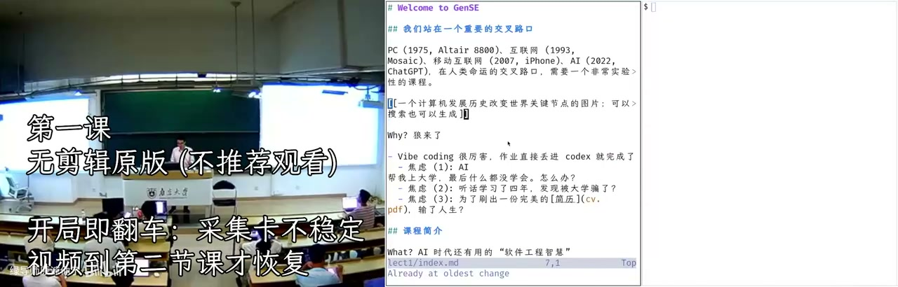
<figcaption>画面 00:33 · 开场：能力被日用品化</figcaption>
</figure>

开场他先演示自己按 F5 就把 neovim 里的 markdown 变成浏览器里的幻灯片，然后从 1975 年的 Altair 8800 讲起（配图是 AI 生成的），说计算机史的主线是把昂贵的能力变成日用品：PC 之后是互联网，他小学快毕业时装 ICQ，随机加到地球另一端的人，对方英语打得飞快而他只会 hello，腾讯的山寨版当时叫 OICQ。再往后是移动互联网——「一夜之间菜市场卖菜的人都有支付宝和微信两个二维码」，最后是 2022 年 ChatGPT，人类历史上增长最快的产品。正因为这样他才决定开这门课：老师用豆包出题、学生用豆包做作业，闭环里唯一没受训练的是学生，现在把作业链接丢进 codex，甚至一句「蒋老师操作系统课第八个实验帮我实现」就结束了。

### 04:19–09:20 · 零分简历与课程定位

<figure>
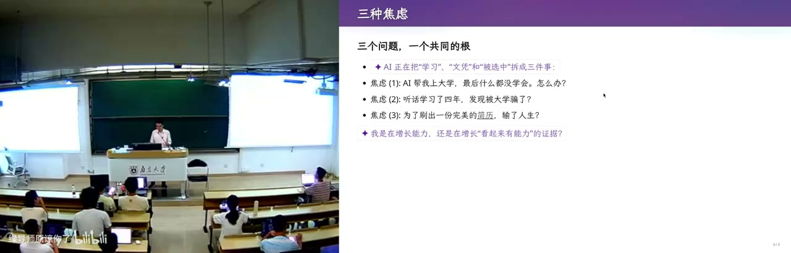
<figcaption>画面 04:21 · 零分简历与课程定位</figcaption>
</figure>

顺着这份焦虑，他放到投影上的是一份「完美简历」：信息被 AI 替换成 Unicode 方块，CCF 列表上的论文 accepted，还有一堆实习和奖项，可他给它打零分——没有 GitHub、没有个人主页、没有 preprint，「再投就等于不存在」，而这样的简历他收到过无数份。由此他说这门课想先把用 AI 写代码的快乐还给大家，课程叫生成式软件工程，而软件工程要解决的就是「怎么让软件不失败」。大学真正能给的只有两样：信息差（比如独一份的往年试卷）和驾驭别人驾驭不了的东西，这门课给后者。上课方式是以案例为主的松散组织，听课型同学「既不用到课，也不用看直播」。

### 09:20–14:31 · 讲义即源码，AI 造幻灯片

<figure>
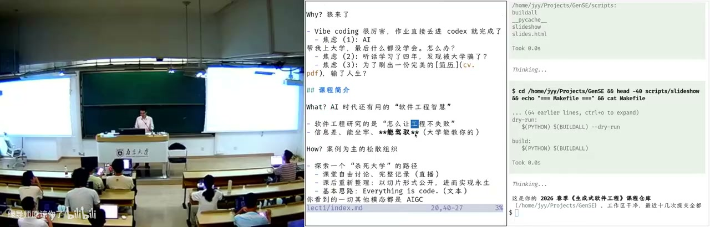
<figcaption>画面 09:22 · 讲义即源码，AI 造幻灯片</figcaption>
</figure>

说到怎么上课，他打开课前写好的 markdown 讲义：那是 source of truth，按 F5 播放时紫色部分就是 GPT-5.6 现场「添油加醋」加的，背后是一个叫 mix lights 的 skill。他还有一个「AI 梗同学」的 skill，会生成三个 sub agent、赋不同 personality，在隔离上下文里各干各的，主 agent 汇总，用算力换智力；他换了几版提示词，再让另一个模型盲评哪版幻灯片更好，连图都是生成的。他把自己定位成演员：上课是表演加即兴，课后回看录像，把讲得不够好的例子切片重新整理回代码里——everything is code，于是课程可以数字永生，哪天他不教操作系统了，B 站录像也能被全世界的人拿去定制。也正因此，他说这门课是想试试「能不能杀死大学」。

### 14:31–20:30 · 四条规定与通过制考核

<figure>
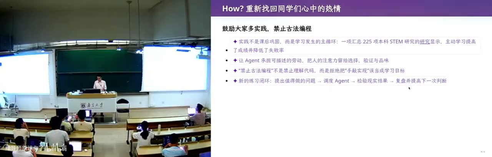
<figcaption>画面 14:33 · 四条规定与通过制考核</figcaption>
</figure>

接着是 the policy：他想帮大家找回「上课耽误学习」的感觉，所以第一条是允许甚至建议你们不来听课、把时间拿去做实践；第二条是禁止古法编程——他知道在座个个都是刷 LeetCode、被机试关小黑屋练出来的好手，但总有一天要变。第三条是 token 自费，他原本想拉赞助，看到选课人数就放弃了，还半开玩笑说手上没有付费 token 的同学「应该立即退学」，建议先充 100 块，课上演示除了生成幻灯片用更聪明的模型，其余全用便宜的 DeepSeek V4 Flash，夜里跑正合适他调侃的「梁文峰时间」。第四条是考核只要通过/不通过，他跟教务填的就是这个，因为同一个任务换个更强模型结果就差很多，分数在这个时代已经不那么重要，真正被检验的是四年后投出去的那份简历。他也承认为了走到保研那一步你仍然要有 GPA、仍然要 overfit 考题，甚至设想将来每台电脑都装监控，让 AI 来评判你的大学四年。

### 20:30–24:02 · 大模型只是一个概率分布

<figure>
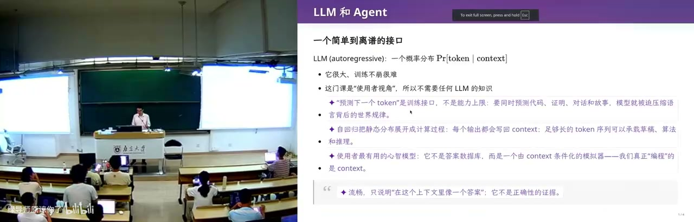
<figcaption>画面 20:32 · 大模型只是一个概率分布</figcaption>
</figure>

政策说完，技术部分他先泼冷水：今天不讲什么是大模型，大模型就是一个概率分布，和概率统计课上抛硬币的题没有区别——给它一本很长的书，它在书末尾不断预测下一个 token，一次吐一个字符；模型很大、训练很难，所以 frontier lab 才这么值钱，但这门课站在使用者视角。真正让他服气的是 2023 年 GPT-4 时代：他给五岁的孩子解释扫描电子显微镜，讲不下去，模型打的比方是——山的形状你看不见，就闭着眼睛往各方向扔石头，有的穿过去、有的弹回来，靠回声反推山形；他后来专门查了资料，这个比方是对的，而 GPT-5.6 现在还会给出更严谨的版本。对比之下，当年让模型生成点奇怪的东西还得反复调 prompt，今天就是一句话的事。

### 24:02–29:46 · 从预测下一个词到会试错

<figure>
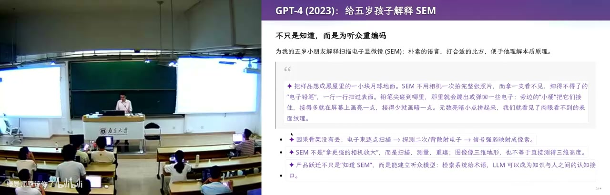
<figcaption>画面 24:04 · 从预测下一个词到会试错</figcaption>
</figure>

再往前一步就是 agent：既然模型能输出下一个 token，就能让它输出一个特殊的 token 去调用程序，程序跑完的结果再送回模型，形成 loop，它于是可以自主试错。他现场展示自己这套系统——窗口管理器调高了对比度、去掉顶栏方便投影，top 换成了更花哨的界面，敲 ls 自动变成 eza、find 变成 fd，这些配置他只给了一个 prompt，全交给 DeepSeek V4 Flash，错了它自己换法子重试；而去年上操作系统课时 agent 还各种出错、做不完就停，今年已经非常能用。他也承认 next token prediction 效率不高，放了一段 diffusion 模型从噪声一点点写出「AI is love」的过程，像人做梦越看越清楚，还有把上下文回头改、随手裁短这类研究方向。三个月后、一年后会不会又有突破，他不敢赌哪条路线赢，但确定世界会变得很不一样。

### 29:46–36:43 · 配置文件与装一台 Debian 系统

<figure>
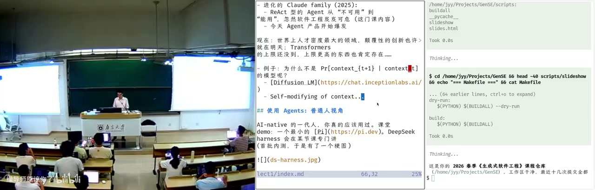
<figcaption>画面 29:48 · 配置文件与装一台 Debian 系统</figcaption>
</figure>

吓唬完人，他回到普通人的视角：先给 agent 一个合适的指令，再写点配置文件，比如仓库里的 AGENTS.md。他现场问「你是谁」，agent 答「生成式软件工程的教学辅助」；再问「你不就是个模型吗」，它解释这来自仓库 AGENTS.md 的配置，是「临时的基因」——所以用 agent 的第一原则是现在就开始用，第二原则是随时问他，上限是你的想象力。第一个例子是装机：他多年来带一个装了 Linux 的 U 盘插教室电脑启动，有一年把硬盘抹了、下一位老师出了教学事故；他自嘲 2021 年 7 月还是知乎上的「装机仙人」，现在只有一句话——去 mirrors.nju.edu.cn 找 Debian 13 镜像装进 U 盘，点睛之笔是让它先在 qemu 里启动、看到登录界面、建好用户再交付。之后 tile-based 窗口管理器怎么用，也是让 DeepSeek V4 Flash 写文档告诉他 super+Enter 开终端、super+D 开 launcher，他说自己一眼配置文件都没看过。

### 36:43–40:22 · 终端与邮件：学习曲线消失

<figure>
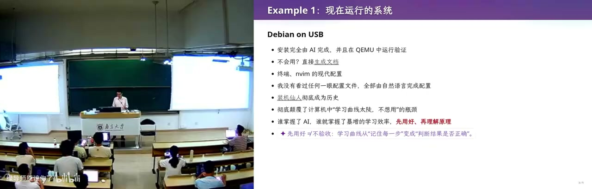
<figcaption>画面 36:45 · 终端与邮件：学习曲线消失</figcaption>
</figure>

他由此说 agent 彻底颠覆了 CS 里「学习曲线太长所以不想用」的瓶颈：以前照 B 站抄一个花里胡哨的终端，改 zshrc 一改就出错，现在它不仅帮你改，还事无巨细解释为什么，甚至提供情绪价值——他前几天在小红书上发帖说 token 比学生好用，因为可以骂它、它不还嘴。但代价是理解可能变浅：正确姿势是先用它把东西搞出来，再回头复盘，效率比从零搭积木高得多，只是你的理解和「真正好的理解」之间会有差距。第二个例子是邮件：他的 skill 里存着自己历史上回过的所有邮件，新邮件自动置已读、用他的口吻写好草稿，附件里的发票自动归档，他只在 Apple Reminders 里加一句「把上一张发票打印出来」，后台处理完就通过手表推给他——课上那台打印机真的响了。

### 40:22–48:01 · 用 AI 读书、读论文、读视频

<figure>

<figcaption>画面 40:24 · 用 AI 读书、读论文、读视频</figcaption>
</figure>

接着说读书：他曾经一年看几十本教科书，现在不看书了，但为了这门课又翻出《人月神话》，吐槽 The Mythical Man-Month 该译成「人月鬼话」，还有一本很紧凑的《软件设计的哲学》。他的读法是减法——假设人类已有的知识都是已知的，只把论文里真正新的那一点剥离出来，12 页的论文剩不下多少，再拿着原文和总结跟它 chat。视频也一样：给一个 BVID（比如上学期 1 小时 27 分钟的课），先整理成带时间点的图文时间轴，两帧间隔大到一定程度就截图拿到 ground truth，再让带他记忆的「AI 梗同学」把 trivial 的部分去掉，几分钟看完两小时。他提醒这会让人变浅，但会用 agent 的人和不会用的人学习效率差 10 倍到 100 倍——你想想那个没给你看的、效率是你 100 倍的人的简历长什么样。

### 48:01–51:57 · 课间翻车：用命令重插采集卡

<figure>
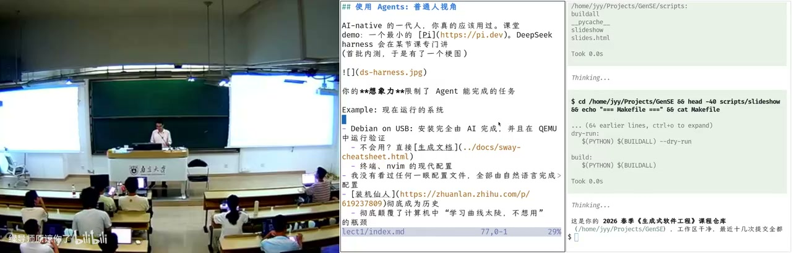
<figcaption>画面 48:03 · 课间翻车：用命令重插采集卡</figcaption>
</figure>

课间回来正好撞上一个现成的案例：直播用的 USB 采集卡断了，画面卡住，他当场一个 prompt 让 DeepSeek V4 Flash 去看系统的 USB 设备、把那个采集卡在软件层面重新接上——它用了些他没见过的 Linux 命令，以软件方式把采集卡「拔出来又插进去」，而接口在机箱后面他根本碰不到。他也顺带吐槽学校这套采集方案成本太高，觉得五百到一千块就能解决。这段插曲之后他提醒：这只是白板的 agent，装上客户端、配一个 DeepSeek V4 Flash 的 API 就能得到刚才所有能力，但 agent 远不止于此——按 CS 的定律，一件合理且你想做的事，百分之百也有别人想做，于是社区有脚本、有 skill hub、有插件生态。所以普通人下一步是：用插件把浏览器管起来，把电脑管起来。

### 51:57–55:02 · 浏览器是软件工程的奇迹

<figure>
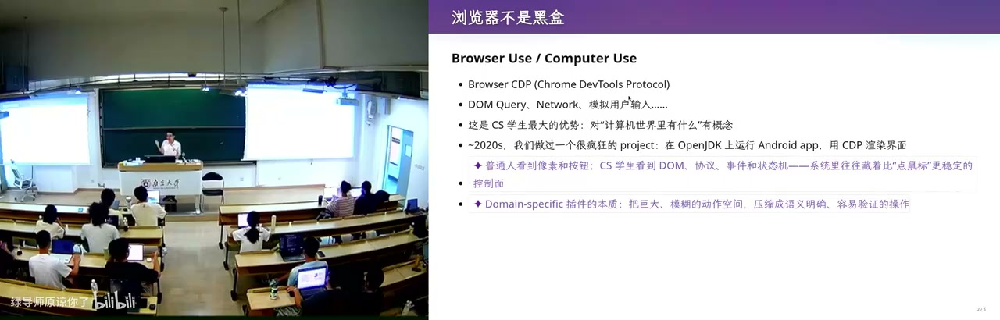
<figcaption>画面 51:59 · 浏览器是软件工程的奇迹</figcaption>
</figure>

他先说浏览器为什么值得管：它看起来只是显示网页，代码量却远超操作系统内核，还要处理图形、渲染、性能优化，是人类软件工程史上的奇迹之一，而它专门给开发者留了接口，就是 Chrome DevTools。现场按 F12，先把讨厌的浮层 delete 掉；网站一般还会在 console 里嵌招聘广告，他顺口说 B 站应该也有。更能说明问题的是把请求 copy as cURL，带着 cookie 和全部状态回到终端里重放——这是「古法」时代开发者的日常，但有了大模型，普通人也能吃到 DevTools 的全部红利。他提到 2020 年做过一个疯狂的 project：把 Android app 编译到 JVM 上跑，算出每个按钮的坐标和文本，却不走 Android 的渲染，直接在 Chrome 里画出一个能点的计算器。

### 55:02–1:00:08 · 让 agent 填教务系统，然后抢课

<figure>
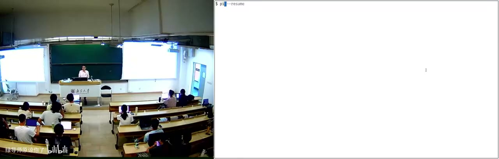
<figcaption>画面 55:04 · 让 agent 填教务系统，然后抢课</figcaption>
</figure>

于是他挑了所有人都讨厌的教务系统做演示：先扫码登录，教学周历一格没填，他让 agent「随便用什么 AI 把它填起来」，还特意叮嘱不要读课程目录——因为仓库里就是这门课的讲义。DeepSeek V4 Flash 果然不听指令，先翻车，中间还不断自问这一步合不合理；它先试了直接注入事件，不行，改成模拟点鼠标，才把格子一个个填上。走通一次之后，这个 session 里的路径就留了下来，可以沉淀成确定性脚本，甚至形成记忆——「你就得到了一个自动选课抢课的系统」。他也说明自己用 Flash 是因为快，换最一线的模型会更听话；而他要对付的，是本科生院非要人填的那张表。

### 1:00:08–1:05:10 · UNIX 管道与个人能力飞轮

<figure>
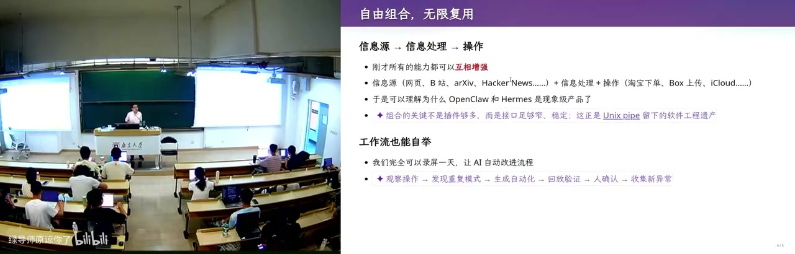
<figcaption>画面 1:00:10 · UNIX 管道与个人能力飞轮</figcaption>
</figure>

他强调这不是一个孤立的炫技案例，而是一整个生态：UNIX 的哲学能成立，靠的是管道让程序自由组合、无限复用，1+1 大于 2；今天 skill 也一样，读网页的 skill、提记忆和脚本的 skill 可以互相调用，组合起来成百上千倍放大个人能力。他自己的用法是搭一个信息处理系统：AI 早报的 RSS、B 站的推送、arXiv、Hacker News 这些信息源进去，中间是各种用自然语言写的 skill，一行代码不用写，输出是对他有用的知识，飞轮就转起来了。也正因为此，他觉得现在这类个人 agent 产品是现象级的——虽然作为 CS 从业者他并不惊讶，甚至讨厌让 agent 自己总结 memory（会记错该记的、记住不该记的），宁可走自己的流程写进数据库。他还建议录一天屏让 AI 挑毛病：初学阶段，你的流程里一定还有很大提升空间。

### 1:05:10–1:09:20 · CS 视角：把需求编译成流程

<figure>
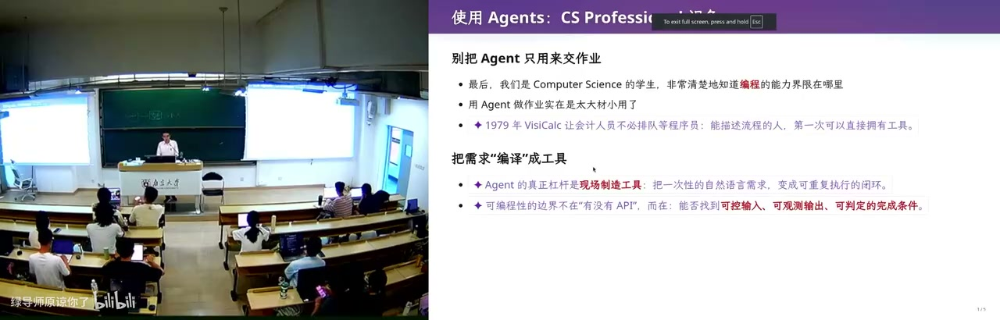
<figcaption>画面 1:05:12 · CS 视角：把需求编译成流程</figcaption>
</figure>

接下来换成 CS 从业者的视角：如果你们只是让 agent 把操作系统作业做了，就太小看它了——一般人能提需求，但不知道需求做不做得成、怎么 prompt 才能确定性完成，而 CS 的人知道什么东西该以代码复用、什么东西该以 skill 复用。他的例子是改卷统分：往年这活是丢给助教拿计算器加，今年他搭了条流水线，桌上一个俯拍摄像头对准试卷固定位置，按一次回车拍一张，离线用本地 27B 千问识别姓名、学号、每个小分写进文本文件。第二阶段反序再来，他左手回车、右手拿笔，语音把每个人的小分逐个播报，他逐条核对——不信任 OCR，要对每个学生负责；核对完把脚本算出的总分抄到卷面，加法绝不让大模型做。最后自动汇总到教务处的 Excel 模板，抽样检查再提交；他也很清楚，140 张卷子直接丢给最好的模型说「帮我统分」，收敛不到这么快的方案。

### 1:09:20–1:14:56 · 二维码：把数据从机房偷出来

<figure>
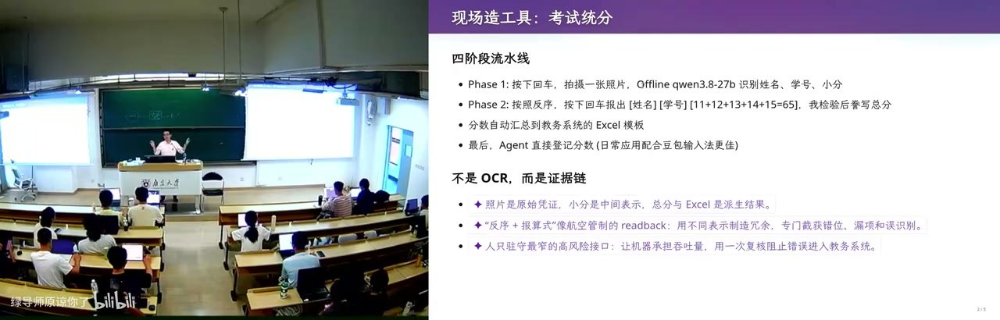
<figcaption>画面 1:09:22 · 二维码：把数据从机房偷出来</figcaption>
</figure>

说完这些他回到软件工程，先做了一个小产品：假设你在金融公司，数据能进不能出，U 盘能拷进去但拷不出来，机器不跑不信任的程序、不显示不信任的网页，唯一漏洞是远处可以悄悄射频。他做的是一个 Excel——用 Excel 公式把任意字符串编码成一串二维码，按住 F9 刷新就是一段循环播放的二维码动画，偷偷把每一帧拍下来，数据就出去了；全部用 Excel 2019 之前就兼容的公式实现，打开就是合法 Excel，连这个 Excel 都是 AI 生成的。他还顺带讲了更野的路子：上下抖鼠标是 0、左右抖是 1，远程桌面里做虚拟网卡，上过操作系统和计算机网络的人知道需要哪些组件，就能把它写出来。小结是普通人能做的四件事——学习、总结、用 computer use / browser use 操作一切，以及因为 everything is code，连 3D 打印的东西都能由 Python 生成。

### 1:14:56–1:21:23 · AI 能做完，但产品会暴毙

<figure>
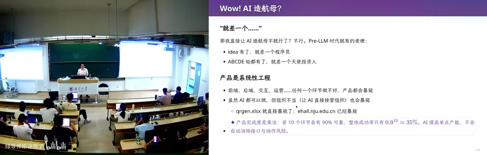
<figcaption>画面 1:14:58 · AI 能做完，但产品会暴毙</figcaption>
</figure>

不过他说 AI 不是完美的：老梗是「idea 都有了，就差一个程序员」，产品却是系统性工程——做一个外卖网站要前端、后端、交互、运营，任何一环做不好都直接暴毙，AI 每一环都会，但组织不好一样死。教务系统就是活例子：学校每年花巨额的钱让公司维护，因为每加一个功能都得靠它；他在用 browser use 时还发现隐藏字段，苏州校区建成前系统里根本没有「校区」这一列，产品经理一句「两个校区选课要分开」，代码就开始烂。接着是他自己做的受控实验：spec 写得很明确——用 Excel 2019 兼容公式把任意字符串转成二维码动画，GPT-5.3 第一次思考了 25 分钟，输出超过 32K token 被截断，无人监管跑了 6 小时。DeepSeek V4 Pro 夜里跑，第二天早上发现是硬编码——先用 Python 算好 base64 贴进公式框，输入字符串一改就失效；两个模型都「完成了任务」，但生成的都是没法维护的代码。

### 1:21:23–1:24:46 · 先设计一门中间语言

<figure>

<figcaption>画面 1:21:25 · 先设计一门中间语言</figcaption>
</figure>

这种死法和教务系统完全一样：知道需求、直接实现、陷进维护泥潭，而他的做法只用少量 prompt，在 200K 上下文里就让 GPT-5.3 做出了第一个正确版本。办法是不让它直接写二维码，而是先设计一套像编译器基础设施的东西——比如 XOR 这样的位运算符号系统，做成 Python 类，既能翻译成 Python 直接执行，也能翻译成 Excel 公式。这样只需分别验证两件事：翻译到 Excel 的公式对不对、编码出来的每个像素对不对，最后一次成型，代码干净也不长。而前面那两份 AI 代码，他让它们把工作区换个位置，都要修两个小时——因为全是硬编码，改一点公式就通不过验证；他把这归因于后训练：模型上手解决问题的欲望太强，而软件工程的第一步恰恰是不要扩大、先做最简单不会失败的版本。

### 1:24:46–1:30:44 · 三个空间与它们之间的 gap

<figure>
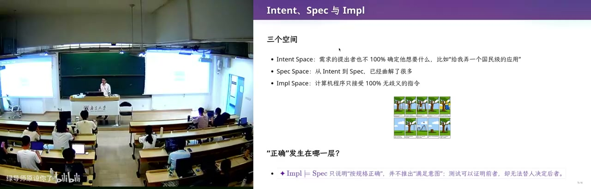
<figcaption>画面 1:24:48 · 三个空间与它们之间的 gap</figcaption>
</figure>

他把问题抽象成三个空间：intention 是你脑子里想的，比如老板说「我要做一个国民级应用」，或者「做个小程序挣一个亿」；specification 是它要有几个界面、每个界面什么功能、什么架构、数据库 schema 分几张表、选 KV 还是关系型；implementation 才是代码，同一个 spec 也有大量实现方式。gap 真实存在：校长一句「我们要一个教务系统，把学校所有同学相关的事情信息化」，到公司手里就要拆成无数选择，每个选择结果都截然不同。他放了一张很老的梗图——客户说的、产品经理理解的、分析师设计的、宣传的、最后造出来的完全不是一回事。而今天补 gap 的方式是「猜」：后训练给 reward，做对、测试通过就有奖励，模型被训成立即上手、尽快完成，这和你从大一先学 C 语言、把 implementation space 摸熟再上软件工程课的路子正好相反。

### 1:30:44–1:35:00 · 焦油坑与被训成的做题家

<figure>
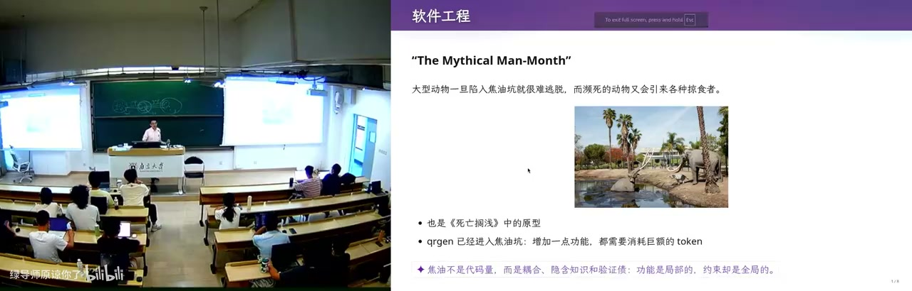
<figcaption>画面 1:30:46 · 焦油坑与被训成的做题家</figcaption>
</figure>

接着是《人月神话》的焦油坑：大型动物陷进去就出不来，濒死的动物还会引来一群掠食者一起陷进去——一个团队或产品已经开始失败时，加人只会让它更失败。AI 也一样，当它已经开始产出 slop，你投入更多 token 只会让它在烂东西上再往起浮一点，直到你付不起 token；教务系统每年加功能、学校每年花纳税人的钱，就是这个形状。软件工程研究的是 gap 真实存在时怎么把一件足够大的事做成，这套方法论是投了 billions of dollars、管过很多聪明人却陷进焦油坑换来的教训；南大做程序分析与测试的老师就在做——代码已经生成了，能不能自动生成测试、做审查，在它不满足 spec 或潜在不满足 intention 时给你一个 warning。他还提醒，越靠前的需求杠杆越大，而你们从高考到现在做的题全是五分钟能解出来的，和模型的 reward 一样，你也被训成了做题家。

### 1:35:00–1:39:58 · 古法编程已死，软件工程没死

<figure>
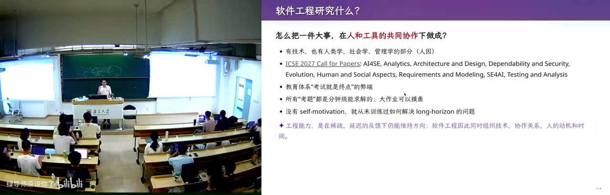
<figcaption>画面 1:35:02 · 古法编程已死，软件工程没死</figcaption>
</figure>

顺着「你也被训成做题家」，他先把失败的定义钉住：从 intention 到 specification 再到 implementation，翻译错了就是失败——做出来的不是要的，或者满足不了正确性、性能。他承认模型有足够智能设计出漂亮的 DSL，只是强化学习只奖励机械完成任务，第一反应永远是先上手做题；也许有一天它能从见过的东西里翻出好设计，那这门课可能没上完就过期了。收尾的判断是：古法编程已经死了，单个任务上 AI 无人能敌；软件工程暂时还没死。他留了一问：保研面试时导师问「为什么我要招你，而不是买一个 200 刀的 Claude Max」，GPT-5.6 答得不错——找到值得解决的问题，把未知拆成便宜的实验，用证据让坏方向及时停下，并对长期结果负责——但它现在做不到；今天的内容他会重新切片，先发生肉版供对比。

<!-- live:end -->

## 章节详解

### 1. 能力被日用品化
<figure>

<figcaption>画面 00:33 · 课程简介</figcaption>
</figure>

**画面解读：** 先用 1975 年 Altair 到 ChatGPT 的能力日用品化史垫底，再讲两份焦虑与被判零分的完美简历——筛选信号已换成不可复制的作品；随后交代四条规矩，并区分概率分布与能调工具试错的 agent。

**⭐ 核心：** 计算机史的主线不是性能，是把昂贵能力变成日用品。1975 年第一台 PC（视频念作「泰尔 8800」，即 Altair 8800），配图是 AI 生成的。互联网把人连起来——主讲小学快毕业时装 ICQ，随机加到地球另一端的人，对方打字飞快而他只会 hello；腾讯的山寨版当时叫 OICQ。再到移动互联网，「一夜之间菜场卖菜的人都有支付宝和微信两个二维码」。最后是 2022 年 ChatGPT。

**🔧 实操：** 无（纯叙事）。

**⚠️ 易错：** 这不是历史课，是垫前提——每次跳跃后，上一代人熟练的技能都会贬值。

> 💡 核心提炼：先看清「这次被日用品化的是哪种能力」，它很可能就是你打算学四年的那个。

### 2. 两份焦虑与一份零分简历

**⭐ 核心：** 焦虑一，「AI 替我上大学」——老师用豆包出题、学生用豆包做作业，闭环里唯一没受训练的是学生；作业链接丢进 codex 就行，「蒋老师操作系统课第八个实验帮我实现」一句话结束。焦虑二，听话型学生认真上完四年，发现学会的东西 AI 都会。

**🔧 实操：** 他展示一份 AI 生成的简历，个人信息被替换成 Unicode 方块（复制出来是黑方块），CCF 论文 accepted、一堆实习奖项，却被打**零分**：没有 GitHub、没有主页、没有 preprint——「再投就等于不存在」。

**⚠️ 易错：** 他不是骂学生，是指出筛选信号失效——人人都有奖项论文时，能区分的只剩「别人做不出的东西」。

> 💡 核心提炼：战场已从「我有什么证书」转到「我有没有不可复制的作品链接」。

### 3. 大学剩下的，与四条规定
<figure>

<figcaption>画面 31:59 · 实操 (1)</figcaption>
</figure>

**画面解读：** 现场实操：两条原则是现在就开始用、随时问他。装 Debian 先在 qemu 里启动验证再交付，终端配置全交给模型，邮件草稿按历史风格自动生成，读论文用减法只剥离真正新的那点。

**⭐ 核心：** 大学真正给的只有两样——**信息差**（拥有别人不知道的信息才能做别人做不到的事，比如独一份往年试卷）与**驾驭别人驾驭不了的东西**，这门课给后者。

**🔧 实操：** 上课方式很怪——课前先写 markdown 讲义，约束 AI 讲什么；按 F5 播放时**紫色部分**是 GPT-5.6 现场添油加醋加上去的。「AI 梗同学」skill 生成三个 sub agent，赋不同 personality，在隔离上下文里各干各的，主 agent 汇总，用算力换智力。四条规定：允许不到课去实践；**禁止古法编程**；**token 自费**（没有付费 token 的同学「应该立即退学」，建议每人充 100 块）；考核**通过/不通过**，因为分数已不那么重要。

**⚠️ 易错：** 他说不清评分标准，也承认现实——为了走到保研那一刻，你仍要 GPA、仍要 overfit 考题。听课型学生「既不用到课，也不用看直播」，但别读成不用学。

> 💡 核心提炼：讲课 = 表演 + 复盘 + 回填源码；评价权从分数挪到简历——四年后检验你的只有那份投出去的简历。

### 4. 从概率分布到 agent

**⭐ 核心：** 「什么是大模型」他不讲：大模型就是概率分布，和概率课抛硬币没区别，给一段长文本，不断预测下一个 token，一次一个字符。但**这门课站在使用者视角**。
🔧实操（他第一次被按在地上打）：2023 年 GPT-4 时代给五岁孩子解释扫描电子显微镜，他讲不下去；模型的比方是——山看不见形状，你往各方向扔石头，有的穿过有的弹回，靠回声反推山形。他事后查证，这比方是对的。

**⚠️ 易错：** agent 的关键不是「更会聊」，而是模型能输出**特殊 token** 调程序、结果再送回模型，在 loop 里自主试错。去年操作系统课的 agent 各种出错、做不完就停，今年非常能用。

> 💡 核心提炼：大模型是分布，agent 是这个分布接上了工具与重试——跃迁来自「能试错」。

### 5. 普通人的四个案例
<figure>

<figcaption>画面 49:15 · 视频恢复—实操 (2)</figcaption>
</figure>

**画面解读：** 用 agent 读长视频：给一个 BVID 就整理成带时间点的图文时间轴，两帧间隔够大就截图拿真值，再让带记忆的 agent 去掉琐碎部分，两小时的课几分钟看完；代价是理解可能偏浅。

**⭐ 核心：** 两条原则——**现在就开始用**、**随时问他**。问「你是谁」，它答「生成式软件工程的教学辅助」；再问「你不就是个模型吗」，它解释这来自仓库里 AGENTS.md，是「临时的基因」。

**🔧 实操：** 
- **装机**：以前是知乎「装机仙人」（2021 年 7 月）。现在一句话：去 mirrors.nju.edu.cn 找 debian 13 镜像装到 U 盘，**用模拟器验证**——让它在 qemu 里启动、看到登录界面、建好用户再交付。（他自曝曾把教室电脑硬盘抹掉，下一位老师出了教学事故。）
- **终端**：配置文档由模型读系统生成，他「没看过一眼配置文件」。
- **邮件**：skill 存着他历史上回过的所有邮件，新邮件自动置已读、用他的口吻写草稿；发票自动归档；备忘录加一句「把上一张发票打印出来」，后台处理完推到手表——课上真打出来了。
- **读书读论文**：重读《人月神话》（他说该译作「人月鬼话」）。读法是减法：假设人类已有知识全都已知，把论文里**真正新的那点东西**剥离出来，12 页剩不下多少。
- **读视频**：给一个 BVID（比如 1 小时 27 分钟的课），整理成图文时间轴，两帧间隔够大就截图拿 ground truth，再让带他记忆的 agent 去掉 trivial 部分——几分钟看完两小时。

**⚠️ 易错：** 代价是理解可能比从零搭积木浅；模型也会不听指令，flash 常翻车，他用它只因为快。

> 💡 核心提炼：会用与不会用 agent，学习效率差 10 到 100 倍；这差距不写在简历上，却决定简历长什么样。

### 6. 生态：从浏览器到飞轮

**⭐ 核心：** 一个任务只要合理，按 CS 定律「百分之百也有别人想做」，社区就会有脚本和 skill。普通人下一步是**用插件把浏览器和电脑管起来**。浏览器是软件工程奇迹，代码量远超操作系统内核；DevTools 极其强大。

**🔧 实操：** F12 删掉广告、copy as cURL 带 cookie 在终端重放。现场更狠：讨厌教务系统填表，让 agent 用 DevTools 把空着的教学周历填掉（还叮嘱「不要读我的课程目录」），agent 先不听指令、翻车、反思、试事件注入失败、换模拟点击成功；走通一次路径就能沉淀成脚本——「你就得到了一个自动选课抢课的系统」。

**⚠️ 易错：** 他承认这里有伦理张力（对付本科生院），没回避——能力走通一次就变成可复用资产。

> 💡 核心提炼：UNIX 管道伟大是因为程序能自由组合；skill 同理，组合起来才是个人能力的百倍放大器。

### 7. CS 视角：改卷流水线
<figure>

<figcaption>画面 1:05:19 · 实操 (3)</figcaption>
</figure>

**画面解读：** 把浏览器交给 agent：F12 删广告、带 cookie 的 cURL 到终端重放；现场让它用浏览器把教学周历填掉，先翻车、事件注入失败，改模拟点击才成功，走通一次即沉淀成脚本，于是有了自动抢课系统。

**⭐ 核心：** 一般人只会说「帮我把作业做了」，CS 出身的人知道**把需求编译成什么形式可以复用**。

**🔧 实操：** 本地一个 27B 千问 + Ollama。桌面俯拍摄像头对准试卷固定位置，按一次回车拍一张，离线用千问识别姓名、学号、每个小分写进文本文件；第二阶段反序再来，语音播报小分，他逐条核对（不信任 OCR，要对每个学生负责）；核对完把脚本算出的总分抄到卷面——**加法绝不让大模型做**；最后汇总到教务处 Excel 模板，抽样检查再提交。140 张卷子直接丢给最好的模型说「帮我统分」，收敛不到这么快的方案。

**⚠️ 易错：** 价值不在自动化，而在**把不确定性挡在关键步骤外**——识别可以错，加法不能错。

> 💡 核心提炼：专业能力今天表现为「知道 AI 的边界在哪，并把边界设计进流程」。

### 8. 二维码案例：同一 spec 的两种死法

**⭐ 核心：** 场景设在金融公司，数据能进不能出，机器管控、不信任程序不跑、不信任网页不显，唯一漏洞是远处悄悄射频。于是他写了个 Excel：任意字符串编码成**二维码动画**（每帧循环播放），偷偷录下来数据就出去了；全用 Excel 2019 之前兼容的公式实现，打开就是合法 Excel。
🔧实操（关键对照）：受控实验把 spec 直接丢给 GPT-5.3，它思考 25 分钟、输出超 32K token 被截断，无监管跑了 6 小时；deepseek v4 pro 夜里跑，第二天发现是硬编码 base64（Python 算好贴进公式框），字符串一改就失效。两者都「完成了任务」，但代码无法维护，和教务系统同一死法：知道需求 → 直接实现 → 陷入维护泥潭。他的做法是少量 prompt + 200K 上下文：先设计中间语言/DSL（像编译器基础设施），既可翻译成 Python 执行，也可翻译成 Excel 公式，只需分别验证「翻译对不对」「每个像素对不对」，一次成型、代码干净。反证：把工作区换个位置，两份 AI 代码都要修两小时。

**⚠️ 易错：** AI 栽在小 corner case 上，第一秒就被带歪——它会想做「对任意输入都正确」的东西，而软件工程第一步是不要扩大、做最简单不会失败的版本。

> 💡 核心提炼：AI 有足够智能设计漂亮 DSL，但第一反应永远是先上手做题；这门课要补的正是「先设计」。

### 9. 三个空间、焦油坑与收尾
<figure>

<figcaption>画面 1:26:48 · 软件工程</figcaption>
</figure>

**画面解读：** 收在软件工程：同一份 spec 的两种死法——直接实现只剩硬编码，先设计中间语言再分别翻译验证才一次成型；由此讲到意图→规格→实现之间的 gap、焦油坑，最后是导师那句「为什么招你而不是买一个 Claude Max」。

**⭐ 核心：** 需求只在三个空间流转——intention（「我要一个国民级应用」）、specification（几个界面、什么功能、关系型还是 KV、schema 怎么分表）、implementation，gap 真实存在；经典梗图是「客户说的、产品经理理解的、分析师设计的、宣传的、最后造出来的」。模型补 gap 的方式是**猜**：后训练给 reward，做对、测试通过就有奖励，它被训成「立即上手、尽量快完成」。

**⚠️ 易错：** 他引《人月神话》的焦油坑——已失败的团队加人只会更失败；AI 已产出 slop 时，投更多 token 只会让它在烂东西上再浮一点，直到你付不起 token。他也点出：你从高考到现在做的题全是分钟级能解决的，和模型的 reward 一样，你也被训成了做题家。软件工程里杠杆最大的是**需求**，越早的 gap 放大得越厉害。
🔧收尾：古法编程已死，软件工程暂时没死，但这门课可能上到一半就过期。他留一问：保研面试时导师问「为什么我要招你，而不是买一个 200 刀的 Claude Max？」GPT-5.6 答得不错——「找到值得解决的问题，把未知拆成便宜的实验，用证据让坏方向及时停下，并对长期结果负责」——但直言它现在做不到。

> 💡 核心提炼：这门课赌的是「设计品味可以被训练」，既包括 AI，也包括你。

## 关键数字与例子

| 数字 / 例子 | 语境 | 说明 |
| --- | --- | --- |
| 1975 / Altair 8800 | 开场历史线 | 能力日用品化起点 |
| 2022 ChatGPT | 第四次跳跃 | 增长最快的产品 |
| 五岁孩子 + 扫描电镜 | GPT-4 时代 | 好比方 = 真知识 |
| 思考 25 分钟 / 32K token / 6 小时 | GPT-5.3 直做 QR | 「做完」≠「能维护」 |
| 200K 上下文 + 少量 prompt | 他的正确姿势 | 先设计中间语言 |
| 12 页论文 | 读论文法 | 减法式阅读 |
| 1h27m 视频 → 几分钟 | B 站理解 | 带记忆 agent 去 trivial |
| 10 倍 / 100 倍 | 会用与不会用 agent | 竞争不在同一量级 |
| 140 张卷子 / 27B 千问 | 改卷流水线 | 边界内自动化 |
| 100 块 token / 200 刀 Claude Max | policy 与收尾 | 自费、不可替代性 |

## 速查卡

| 概念 | 一句话 | 标记 |
| --- | --- | --- |
| 古法编程 | 手写代码、靠考试练出的编程，本课禁止 | ☠️ 已死 |
| 大模型 | 学出来的概率分布，逐 token 预测 | ⭐ 使用者视角 |
| agent | 特殊 token + 工具 + loop 试错 | ⭐ 最强形态 |
| AGENTS.md | 仓库配置，agent 的「临时基因」 | 🔧 第一课 |
| 两个原则 | 现在就开始用 / 随时问他 | 🔧 上手 |
| 三个空间 | intention→spec→impl，之间全是 gap | ⭐ 全课主线 |
| gap 的补法 | 模型靠猜，人靠设计 | ⚠️ 核心分歧 |
| DSL | 一次设计、双向翻译、分别验证 | 🔧 正确解法 |
| Chrome DevTools | 让 agent 操作浏览器，走通即沉淀脚本 | ⚠️ 能力与风险同源 |
| 焦油坑 | 已失败的产品加人/加 token 只会更失败 | ⚠️ 人月神话 |

## 我的判断

这堂课的锋利处不在「AI 很强」，而在它把「强」拆成两个可验证的实验：同一个 spec 交给两个旗舰模型，产出能跑却处处硬编码的死代码；他自己用中间语言做一遍，代码干净可维护。这个对照同时解释了「AI 为什么能替代你」和「为什么还需要你」。硬伤有两处：他说不清评分标准，一边说分数不重要、一边承认学生仍要 overfit 考题；「不要来上课」隐含已有自驱力和 token 预算，对南大 CS 成立，对更广人群则是幸存者偏差。至于「三个月后这门课可能就过期」的自嘲，反而是全场最诚实的一句——他演示的每个 skill 都是当下模型的产物，模型一变方法论就得重写，而这恰好说明他要教的东西（先设计、控边界、验证翻译）比工具活得久。
