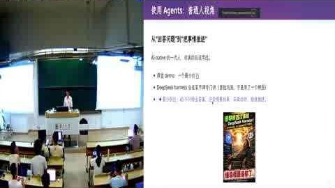
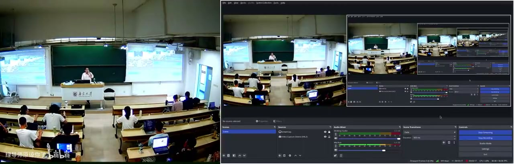
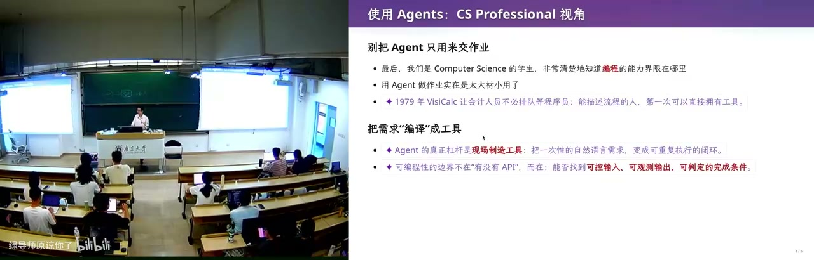
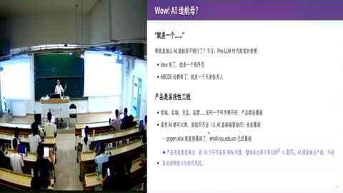

# 欢迎来到未来 · 26 生成式软件工程（NJU）第 01 讲

> 一句话说清：这不是讲大模型原理的课，而是在 agent 已能替你把活干完的时代，重新回答「CS 学生该学什么、软件工程为什么还没死」。

## 一句话结论

古法编程已经死了，单任务上 AI 无人能敌；但软件工程暂时没死——因为 intention→specification→implementation 之间的 gap 只能靠「先设计再实现」补，而这正是被 reward 训成做题家的模型最不愿做的事。

## 官方章节时间轴

| 时间 | 章节 |
|---|---|
| 00:00–29:44 | 课程简介 |
| 29:44–48:34 | 实操 (1) |
| 48:34–1:05:10 | 视频恢复—实操 (2) |
| 1:05:10–1:14:40 | 实操 (3) |
| 1:14:40–1:40:00 | 软件工程 |

## 分段大纲

| 序号 | 章节 | 核心内容 |
| --- | --- | --- |
| 1 | 能力日用品化 | 1975 第一台 PC → ICQ → 移动互联网 → 2022 ChatGPT |
| 2 | 为什么开这门课 | 「AI 替我上大学」的焦虑；完美简历被判零分 |
| 3 | 大学与 policy | 信息差、驾驭力；不上课、禁古法编程、token 自费、通过制 |
| 4 | 从大模型到 agent | 概率分布、next token、特殊 token 调工具成 loop |
| 5 | 普通人的用法 | 装机、邮件草稿、读书读论文、读 B 站视频 |
| 6 | 生态组合 | Chrome DevTools + skill = 信息飞轮 |
| 7 | 改卷流水线 | 摄像头 OCR + 脚本算分 + 人工核对 |
| 8 | 二维码案例 | 同一 spec 两种死法：硬编码 vs 先设计中间语言 |
| 9 | 三个空间 | gap 从哪来；焦油坑；导师之问 |

## 章节详解

### 1. 能力被日用品化
<figure>

<figcaption>画面 00:33 · 课程简介</figcaption>
</figure>

**画面解读：** 先用 1975 年 Altair 到 ChatGPT 的能力日用品化史垫底，再讲两份焦虑与被判零分的完美简历——筛选信号已换成不可复制的作品；随后交代四条规矩，并区分概率分布与能调工具试错的 agent。

**⭐ 核心：** 计算机史的主线不是性能，是把昂贵能力变成日用品。1975 年第一台 PC（视频念作「泰尔 8800」，即 Altair 8800），配图是 AI 生成的。互联网把人连起来——主讲小学快毕业时装 ICQ，随机加到地球另一端的人，对方打字飞快而他只会 hello；腾讯的山寨版当时叫 OICQ。再到移动互联网，「一夜之间菜场卖菜的人都有支付宝和微信两个二维码」。最后是 2022 年 ChatGPT。

**🔧 实操：** 无（纯叙事）。

**⚠️ 易错：** 这不是历史课，是垫前提——每次跳跃后，上一代人熟练的技能都会贬值。

> 💡 核心提炼：先看清「这次被日用品化的是哪种能力」，它很可能就是你打算学四年的那个。

### 2. 两份焦虑与一份零分简历

**⭐ 核心：** 焦虑一，「AI 替我上大学」——老师用豆包出题、学生用豆包做作业，闭环里唯一没受训练的是学生；作业链接丢进 codex 就行，「蒋老师操作系统课第八个实验帮我实现」一句话结束。焦虑二，听话型学生认真上完四年，发现学会的东西 AI 都会。

**🔧 实操：** 他展示一份 AI 生成的简历，个人信息被替换成 Unicode 方块（复制出来是黑方块），CCF 论文 accepted、一堆实习奖项，却被打**零分**：没有 GitHub、没有主页、没有 preprint——「再投就等于不存在」。

**⚠️ 易错：** 他不是骂学生，是指出筛选信号失效——人人都有奖项论文时，能区分的只剩「别人做不出的东西」。

> 💡 核心提炼：战场已从「我有什么证书」转到「我有没有不可复制的作品链接」。

### 3. 大学剩下的，与四条规定
<figure>

<figcaption>画面 31:59 · 实操 (1)</figcaption>
</figure>

**画面解读：** 现场实操：两条原则是现在就开始用、随时问他。装 Debian 先在 qemu 里启动验证再交付，终端配置全交给模型，邮件草稿按历史风格自动生成，读论文用减法只剥离真正新的那点。

**⭐ 核心：** 大学真正给的只有两样——**信息差**（拥有别人不知道的信息才能做别人做不到的事，比如独一份往年试卷）与**驾驭别人驾驭不了的东西**，这门课给后者。

**🔧 实操：** 上课方式很怪——课前先写 markdown 讲义，约束 AI 讲什么；按 F5 播放时**紫色部分**是 GPT-5.6 现场添油加醋加上去的。「AI 梗同学」skill 生成三个 sub agent，赋不同 personality，在隔离上下文里各干各的，主 agent 汇总，用算力换智力。四条规定：允许不到课去实践；**禁止古法编程**；**token 自费**（没有付费 token 的同学「应该立即退学」，建议每人充 100 块）；考核**通过/不通过**，因为分数已不那么重要。

**⚠️ 易错：** 他说不清评分标准，也承认现实——为了走到保研那一刻，你仍要 GPA、仍要 overfit 考题。听课型学生「既不用到课，也不用看直播」，但别读成不用学。

> 💡 核心提炼：讲课 = 表演 + 复盘 + 回填源码；评价权从分数挪到简历——四年后检验你的只有那份投出去的简历。

### 4. 从概率分布到 agent

**⭐ 核心：** 「什么是大模型」他不讲：大模型就是概率分布，和概率课抛硬币没区别，给一段长文本，不断预测下一个 token，一次一个字符。但**这门课站在使用者视角**。
🔧实操（他第一次被按在地上打）：2023 年 GPT-4 时代给五岁孩子解释扫描电子显微镜，他讲不下去；模型的比方是——山看不见形状，你往各方向扔石头，有的穿过有的弹回，靠回声反推山形。他事后查证，这比方是对的。

**⚠️ 易错：** agent 的关键不是「更会聊」，而是模型能输出**特殊 token** 调程序、结果再送回模型，在 loop 里自主试错。去年操作系统课的 agent 各种出错、做不完就停，今年非常能用。

> 💡 核心提炼：大模型是分布，agent 是这个分布接上了工具与重试——跃迁来自「能试错」。

### 5. 普通人的四个案例
<figure>

<figcaption>画面 49:15 · 视频恢复—实操 (2)</figcaption>
</figure>

**画面解读：** 用 agent 读长视频：给一个 BVID 就整理成带时间点的图文时间轴，两帧间隔够大就截图拿真值，再让带记忆的 agent 去掉琐碎部分，两小时的课几分钟看完；代价是理解可能偏浅。

**⭐ 核心：** 两条原则——**现在就开始用**、**随时问他**。问「你是谁」，它答「生成式软件工程的教学辅助」；再问「你不就是个模型吗」，它解释这来自仓库里 AGENTS.md，是「临时的基因」。

**🔧 实操：** 
- **装机**：以前是知乎「装机仙人」（2021 年 7 月）。现在一句话：去 mirrors.nju.edu.cn 找 debian 13 镜像装到 U 盘，**用模拟器验证**——让它在 qemu 里启动、看到登录界面、建好用户再交付。（他自曝曾把教室电脑硬盘抹掉，下一位老师出了教学事故。）
- **终端**：配置文档由模型读系统生成，他「没看过一眼配置文件」。
- **邮件**：skill 存着他历史上回过的所有邮件，新邮件自动置已读、用他的口吻写草稿；发票自动归档；备忘录加一句「把上一张发票打印出来」，后台处理完推到手表——课上真打出来了。
- **读书读论文**：重读《人月神话》（他说该译作「人月鬼话」）。读法是减法：假设人类已有知识全都已知，把论文里**真正新的那点东西**剥离出来，12 页剩不下多少。
- **读视频**：给一个 BVID（比如 1 小时 27 分钟的课），整理成图文时间轴，两帧间隔够大就截图拿 ground truth，再让带他记忆的 agent 去掉 trivial 部分——几分钟看完两小时。

**⚠️ 易错：** 代价是理解可能比从零搭积木浅；模型也会不听指令，flash 常翻车，他用它只因为快。

> 💡 核心提炼：会用与不会用 agent，学习效率差 10 到 100 倍；这差距不写在简历上，却决定简历长什么样。

### 6. 生态：从浏览器到飞轮

**⭐ 核心：** 一个任务只要合理，按 CS 定律「百分之百也有别人想做」，社区就会有脚本和 skill。普通人下一步是**用插件把浏览器和电脑管起来**。浏览器是软件工程奇迹，代码量远超操作系统内核；DevTools 极其强大。

**🔧 实操：** F12 删掉广告、copy as cURL 带 cookie 在终端重放。现场更狠：讨厌教务系统填表，让 agent 用 DevTools 把空着的教学周历填掉（还叮嘱「不要读我的课程目录」），agent 先不听指令、翻车、反思、试事件注入失败、换模拟点击成功；走通一次路径就能沉淀成脚本——「你就得到了一个自动选课抢课的系统」。

**⚠️ 易错：** 他承认这里有伦理张力（对付本科生院），没回避——能力走通一次就变成可复用资产。

> 💡 核心提炼：UNIX 管道伟大是因为程序能自由组合；skill 同理，组合起来才是个人能力的百倍放大器。

### 7. CS 视角：改卷流水线
<figure>

<figcaption>画面 1:05:19 · 实操 (3)</figcaption>
</figure>

**画面解读：** 把浏览器交给 agent：F12 删广告、带 cookie 的 cURL 到终端重放；现场让它用浏览器把教学周历填掉，先翻车、事件注入失败，改模拟点击才成功，走通一次即沉淀成脚本，于是有了自动抢课系统。

**⭐ 核心：** 一般人只会说「帮我把作业做了」，CS 出身的人知道**把需求编译成什么形式可以复用**。

**🔧 实操：** 本地一个 27B 千问 + Ollama。桌面俯拍摄像头对准试卷固定位置，按一次回车拍一张，离线用千问识别姓名、学号、每个小分写进文本文件；第二阶段反序再来，语音播报小分，他逐条核对（不信任 OCR，要对每个学生负责）；核对完把脚本算出的总分抄到卷面——**加法绝不让大模型做**；最后汇总到教务处 Excel 模板，抽样检查再提交。140 张卷子直接丢给最好的模型说「帮我统分」，收敛不到这么快的方案。

**⚠️ 易错：** 价值不在自动化，而在**把不确定性挡在关键步骤外**——识别可以错，加法不能错。

> 💡 核心提炼：专业能力今天表现为「知道 AI 的边界在哪，并把边界设计进流程」。

### 8. 二维码案例：同一 spec 的两种死法

**⭐ 核心：** 场景设在金融公司，数据能进不能出，机器管控、不信任程序不跑、不信任网页不显，唯一漏洞是远处悄悄射频。于是他写了个 Excel：任意字符串编码成**二维码动画**（每帧循环播放），偷偷录下来数据就出去了；全用 Excel 2019 之前兼容的公式实现，打开就是合法 Excel。
🔧实操（关键对照）：受控实验把 spec 直接丢给 GPT-5.3，它思考 25 分钟、输出超 32K token 被截断，无监管跑了 6 小时；deepseek v4 pro 夜里跑，第二天发现是硬编码 base64（Python 算好贴进公式框），字符串一改就失效。两者都「完成了任务」，但代码无法维护，和教务系统同一死法：知道需求 → 直接实现 → 陷入维护泥潭。他的做法是少量 prompt + 200K 上下文：先设计中间语言/DSL（像编译器基础设施），既可翻译成 Python 执行，也可翻译成 Excel 公式，只需分别验证「翻译对不对」「每个像素对不对」，一次成型、代码干净。反证：把工作区换个位置，两份 AI 代码都要修两小时。

**⚠️ 易错：** AI 栽在小 corner case 上，第一秒就被带歪——它会想做「对任意输入都正确」的东西，而软件工程第一步是不要扩大、做最简单不会失败的版本。

> 💡 核心提炼：AI 有足够智能设计漂亮 DSL，但第一反应永远是先上手做题；这门课要补的正是「先设计」。

### 9. 三个空间、焦油坑与收尾
<figure>

<figcaption>画面 1:26:48 · 软件工程</figcaption>
</figure>

**画面解读：** 收在软件工程：同一份 spec 的两种死法——直接实现只剩硬编码，先设计中间语言再分别翻译验证才一次成型；由此讲到意图→规格→实现之间的 gap、焦油坑，最后是导师那句「为什么招你而不是买一个 Claude Max」。

**⭐ 核心：** 需求只在三个空间流转——intention（「我要一个国民级应用」）、specification（几个界面、什么功能、关系型还是 KV、schema 怎么分表）、implementation，gap 真实存在；经典梗图是「客户说的、产品经理理解的、分析师设计的、宣传的、最后造出来的」。模型补 gap 的方式是**猜**：后训练给 reward，做对、测试通过就有奖励，它被训成「立即上手、尽量快完成」。

**⚠️ 易错：** 他引《人月神话》的焦油坑——已失败的团队加人只会更失败；AI 已产出 slop 时，投更多 token 只会让它在烂东西上再浮一点，直到你付不起 token。他也点出：你从高考到现在做的题全是分钟级能解决的，和模型的 reward 一样，你也被训成了做题家。软件工程里杠杆最大的是**需求**，越早的 gap 放大得越厉害。
🔧收尾：古法编程已死，软件工程暂时没死，但这门课可能上到一半就过期。他留一问：保研面试时导师问「为什么我要招你，而不是买一个 200 刀的 Claude Max？」GPT-5.6 答得不错——「找到值得解决的问题，把未知拆成便宜的实验，用证据让坏方向及时停下，并对长期结果负责」——但直言它现在做不到。

> 💡 核心提炼：这门课赌的是「设计品味可以被训练」，既包括 AI，也包括你。

## 关键数字与例子

| 数字 / 例子 | 语境 | 说明 |
| --- | --- | --- |
| 1975 / Altair 8800 | 开场历史线 | 能力日用品化起点 |
| 2022 ChatGPT | 第四次跳跃 | 增长最快的产品 |
| 五岁孩子 + 扫描电镜 | GPT-4 时代 | 好比方 = 真知识 |
| 思考 25 分钟 / 32K token / 6 小时 | GPT-5.3 直做 QR | 「做完」≠「能维护」 |
| 200K 上下文 + 少量 prompt | 他的正确姿势 | 先设计中间语言 |
| 12 页论文 | 读论文法 | 减法式阅读 |
| 1h27m 视频 → 几分钟 | B 站理解 | 带记忆 agent 去 trivial |
| 10 倍 / 100 倍 | 会用与不会用 agent | 竞争不在同一量级 |
| 140 张卷子 / 27B 千问 | 改卷流水线 | 边界内自动化 |
| 100 块 token / 200 刀 Claude Max | policy 与收尾 | 自费、不可替代性 |

## 速查卡

| 概念 | 一句话 | 标记 |
| --- | --- | --- |
| 古法编程 | 手写代码、靠考试练出的编程，本课禁止 | ☠️ 已死 |
| 大模型 | 学出来的概率分布，逐 token 预测 | ⭐ 使用者视角 |
| agent | 特殊 token + 工具 + loop 试错 | ⭐ 最强形态 |
| AGENTS.md | 仓库配置，agent 的「临时基因」 | 🔧 第一课 |
| 两个原则 | 现在就开始用 / 随时问他 | 🔧 上手 |
| 三个空间 | intention→spec→impl，之间全是 gap | ⭐ 全课主线 |
| gap 的补法 | 模型靠猜，人靠设计 | ⚠️ 核心分歧 |
| DSL | 一次设计、双向翻译、分别验证 | 🔧 正确解法 |
| Chrome DevTools | 让 agent 操作浏览器，走通即沉淀脚本 | ⚠️ 能力与风险同源 |
| 焦油坑 | 已失败的产品加人/加 token 只会更失败 | ⚠️ 人月神话 |

## 我的判断

这堂课的锋利处不在「AI 很强」，而在它把「强」拆成两个可验证的实验：同一个 spec 交给两个旗舰模型，产出能跑却处处硬编码的死代码；他自己用中间语言做一遍，代码干净可维护。这个对照同时解释了「AI 为什么能替代你」和「为什么还需要你」。硬伤有两处：他说不清评分标准，一边说分数不重要、一边承认学生仍要 overfit 考题；「不要来上课」隐含已有自驱力和 token 预算，对南大 CS 成立，对更广人群则是幸存者偏差。至于「三个月后这门课可能就过期」的自嘲，反而是全场最诚实的一句——他演示的每个 skill 都是当下模型的产物，模型一变方法论就得重写，而这恰好说明他要教的东西（先设计、控边界、验证翻译）比工具活得久。
