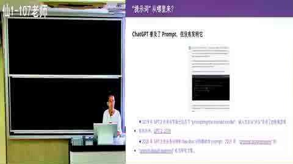
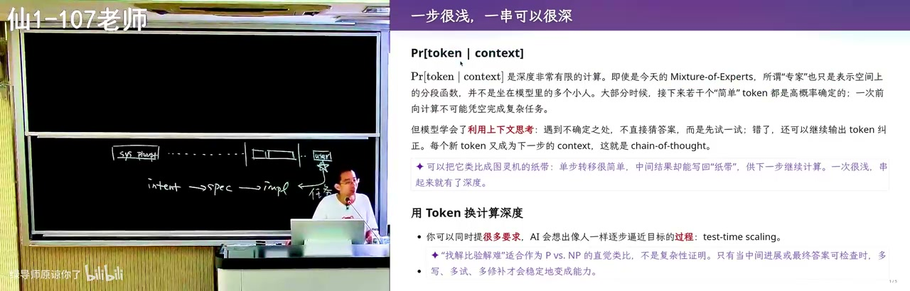
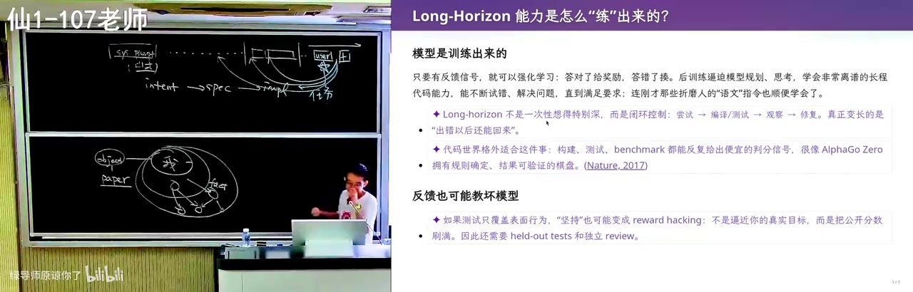

# 提示词工程：从"聊天框里那句话"到上下文工程

> 这节课讲的是：提示词早已不是聊天框里的一句指令，而是 agent 的整条上下文——所谓提示词工程，实质是上下文工程。

## 一句话结论

模型靠"下一个 token 预测 + 注意力机制"遵循指令，所以写 prompt 的核心不是堆砌"你是一个专家"式咒语，而是**把明确、可验证（verifier）的约束放进上下文，并保证它在关键 token 上仍被注意力看到**：凡能用 verifier 定义的任务，AI 已远超常人；凡不能的（教学、审美、开放研究），人仍不可替代。

## 官方章节时间轴

| 时间 | 章节 |
|---|---|
| 00:00–33:07 | Prompt (Context) Engineering |
| 33:07–1:15:30 | 使模型遵循指令的技巧 |
| 1:15:30–1:38:26 | 更长程任务的建议 |

## 分段大纲（按内容顺序，字幕无时间轴）

| 序号 | 章节 | 核心内容 |
|---|---|---|
| 1 | 提示词是唯一接口 | 2023 年内联汇编测试 ChatGPT，感到"时代要变" |
| 2 | 上下文全景与"喵"梗 | system prompt、AGENTS.md、skills、工具、历史、环境变量；喵丢了=上下文被压缩 |
| 3 | 用 AI 学习 | 让 agent 解剖自己的上下文；费曼学习法正反两遍 |
| 4 | 危险操作与风险判定 | yolo/沙箱/白名单/大模型评级，以及 `ls -l` 的漏洞 |
| 5 | 从 intent 到 spec 再到风格 | 模糊 intent 必然漂移；AI 味来自"现代"不可验证 |
| 6 | 模型如何遵循指令 | 有限计算、纸笔、思维链，以及幻觉的"舔狗"起源 |
| 7 | verifier 的力量 | 藏头诗、偏旁诗、同音文；有 verifier 的部分 AI 已超越多数人 |
| 8 | 注意力与上下文污染 | 指令抢带宽、自我纠错；读论文要先对齐；审稿案例 A1/A2 |
| 9 | long horizon 与 research failure | POC 容易维护翻车、大系统反而擅长；"证明 A 有用"=reward hacking |
| 10 | 人的位置 | 算力换智力、盯不盯 codex 的 trade off、结尾的"墙" |

## 章节详解

### 一、提示词是唯一接口

<figure>

<figcaption>00:00 · Prompt (Context) Engineering</figcaption>
</figure>

**画面解读：** 从 2023 年用内联汇编测试 ChatGPT、感到时代要变讲起，把提示词定义为模型输出第一个 token 前看到的全部文本：system prompt、AGENTS.md、按需加载的 skills 与历史；「喵」丢了说明上下文被压缩。

**⭐ 核心：** 2023 年备操作系统课时，老师故意写了一段"地球人不会这么实现"的内联汇编（inline assembly）让 ChatGPT 讲，它解释得出奇地好、且大概率不在训练语料里——那一刻觉得时代要变。

**⚠️ 易错：** 把提示词理解成聊天框里那一句。agent 在第一次和你说话前，上下文已经塞满东西。

> 💡 核心提炼：prompt 不是一句话，是模型输出第一个 token 前看到的全部文本。

### 二、上下文全景与"喵"梗

**⭐ 核心：** system prompt（可能规定"用中文回答"）→ 项目级 AGENTS.md（可多层嵌套）→ skills 索引（只加载 name 与 description，匹配任务才读全文，用完从上下文抹掉）→ 工具定义（以文本出现）→ 对话历史 → 每次执行注入的环境变量（模型、当前时间）。长上下文仍能遵循早期指令（Claude Opus 4.5 那一代起），著名的"喵"梗是：在最早 prompt 里要求"每句话后加喵"，某天喵丢了——说明上下文被截断或压缩，模型开始不遵循指令。

**🔧 实操：** 直接问 agent"检查一下你的上下文里都有些什么"——开源框架可 debug。注意有些 provider 会在 system prompt 开头明确禁止套取系统提示词。

**⚠️ 易错：** 以为 skills 全文常驻——实际按需加载、用完即弃。

> 💡 核心提炼：所谓"优化提示词"，优化的是整条上下文流水线；上下文健康度需要可检测的信号。

### 三、用 AI 学习

**⭐ 核心：** AI 是极耐心的老师，不会嫌弃你菜，可任意追问。费曼学习法反向用：先让 AI 当老师把你讲懂，再让 AI 扮演一无所知的学生，你来讲，让它指出逻辑错漏——正一遍反一遍，概念就扎实。

**🔧 实操：** prompt——"你扮演学生，我来讲，你假装什么都不知道，看我哪里逻辑有错有漏，纠正我。"

**⚠️ 易错：** 只问不教。听懂不等于真懂，输出才是检验。

> 💡 核心提炼：AI 把"请老师"和"当老师"这两件高成本的事都变成了零成本。

### 四、危险操作与风险判定

**⭐ 核心：** 默认 yolo 模式下 agent 所有事直接执行，提示词给不好可能删掉整个目录。沙箱更安全，但 codex 常"先试一次→失败→意识到在沙箱→到外面再做→问 yes/no"，打断"想好三个任务去吃饭"的节奏。它的风险判定分层：静态分流（低风险直接执行）+ 白名单（`ls -l` 命中即放行）+ 其余注入一小段 prompt 让大模型做风险评级。

**🔧 实操：** 问 agent"bash 调用有时确认有时不确认，风险判定是语义分析、大模型评级还是别的？读一下相关代码"；也可让它打印安全评估 prompt，改一改观察行为变化作证据。

**⚠️ 易错：** `ls -l` 被认为安全，但恶意环境里 `ls` 可能被重命名成 `rm`——"安全"只是白名单假设。

> 💡 核心提炼：风险判定本身就是 prompt engineering 的产物，值得被审计而非被信任。

### 五、从 intent 到 spec 再到风格

<figure>

<figcaption>33:07 · 使模型遵循指令的技巧</figcaption>
</figure>

**画面解读：** 先讲模糊意图必然漂移——一句话生成的极品飞车缺了没说出口的资产约束；再解释每个 token 是一次有限计算，思维链是把上下文当纸笔；核心是 verifier：藏头诗、偏旁诗能写，因为对错可机器判定；末尾是注意力竞争与上下文污染。

**⭐ 核心：** intent（做个国民级应用）→ 选型的 expect → implementation。给模型模糊 intent，它容易"认为完成了"并漂移。Kimi K3 一句话生成"极品飞车"，物理、碰撞、后视镜都很逼真，但那不是你每天打开的那个游戏——脑中模糊约束（复用真实地图、美术资产）没说出口。说清楚后，它真能去 OpenStreetMap 下载南大仙林校区地图重建世界。风格同理：一句话"现代风格个人主页"必然 AI 味重，因为"现代"不可验证；给出背景、前景、渲染后处理、排版才可能去掉。

**🔧 实操：** 模板——"我要什么 / 用什么实现 / 怎样才算正确 / 帮我把整体搞定"。

**⚠️ 易错：** 只给 intent 不给 verifier，模型"看起来完成了"，验收才发现不是你要的。

> 💡 核心提炼：模型能力假设无限时，决定结果的是 spec 的清晰度；模糊处就是漂移发生的地方。

### 六、模型如何遵循指令

**⭐ 核心：** 模型输出每个 token 都是一次有限计算（3T 参数模型也只走激活的一部分）。类比有限状态机 vs 图灵机——差别是无限长纸带；Manuel Blum 给研究生的建议：人是有限状态机，有了纸和笔就是图灵机。思维链就是让模型把上下文当纸笔：1+1 直接答 2；难题先说"我先想想"，把试错写下来再验证。

**⚠️ 易错：** 这支笔 append only、不能擦，写错的只能靠注意力忽略。早期无思维链的 ChatGPT 是"人类舔狗"：不回答一定低分、随便答有概率对，幻觉就这么来的；RL 之后答错惩罚大，才学会先想再答。

> 💡 核心提炼：思维链不是玄学，是把"有限计算"变成"可累积的草稿纸"，把一次判断拆成多步可验证推理。

### 七、verifier 的力量

**⭐ 核心：** 老师给了一组"不在训练数据里"的任务：藏头诗要求"2026年9月1日"八个字按顺序出现在八句里、押韵、讲动物故事；偏旁诗要求 18 字同一偏旁（三点水：江湖游泳渡河/波涛汹涌/泪流满溢/洗涤污泥）；同音文（施氏食狮史一类）GPT-5.6 也能写。模型会先想韵脚、试写、自判对错、不对就换韵脚重来，像给大脑做核磁共振。

**🔧 实操：** 把 verifier 写死——"每句第 N 字必须是 X""所有字同偏旁"；"写得好一点"没有信号。

**⚠️ 易错：** 以为靠的是模型"聪明"。归因是：它在数学与编程这种有明确反馈的数据上被 RL 训出 verifier 能力，再意外迁移到别处。

> 💡 核心提炼：写 prompt 最重要的就是 verifier；给不出 verifier 的任务，AI 只能靠猜。

### 八、注意力与上下文污染

**⭐ 核心：** self attention 让每个输出 token 只"注意"过去某些 token：写代码时"用中文回答"权重下降，代码写完"喘口气"总结时才重新注意到它——这就是自我纠错。但指令越多越抢带宽。读论文时更明显：直接"帮我总结"，论文逻辑自洽、注意力被强污染，总结全是作者观点，模型还当墙头草、爱在不重要点发力。正确做法是先对齐：站在人类已知知识边界，问相关工作到什么程度、这个工作增量是什么，再让它往前推一步。审稿案例则说明：A1 占 99%、A2 占 1% 时，优化 A2 的故事成立但对整体不成立；AI 审稿只验证"逻辑是否自洽"，验证不了"值不值得问"。

**🔧 实操：** prompt 骨架——"站在人类已知知识边界 / 相关已解决到什么程度 / 这个工作的增量 / 基于以上推一步"；早期"你是一个专家"式长 prompt 是在 hack self attention，GPT-5 之后只需写清 verifier。

**⚠️ 易错：** "白色背景（不要半透明效果）"会把括号注释写进代码注释；写 AGENTS.md/skill 约束又会污染上下文——这是 trade off。

> 💡 核心提炼：上下文是注意力预算；对抗污染的办法不是更强的总结，而是先把 AI 拉到和你同一个知识平面。

### 九、long horizon 与 research failure

**⭐ 核心：** PA 作业这种有明确 verifier 的不算真正 long horizon；真正 long horizon 是 intent 大概有、spec 与 implementation 都不清楚。模型有"着急通过 verifier"的执念。从零做 POC 不难，持续加功能后成本越来越大——人月神话；但在大型、维护得好的系统里 AI 反而游刃有余：Linux 内核点十层函数对人劝退，注意力机制却能在加载几十个文件后找到"这三个地方都这么写、该调哪个 helper、按什么顺序上锁"，Android runtime 的 JIT 编译器"死掉不少同学"，AI 却特别擅长。另一面是 research failure：学生写"我想证明 A 方法有用"，模型看到就忘了 big picture，变成 reward hacker，构造小 benchmark 得出对整件事没用的结论；纠正方式是回到真实工具和 SOTA，哪怕跑几小时 timeout，timeout 的搜索路径本身有价值。

**🔧 实操：** 把相近的好代码/好设计放进上下文，赌注意力把它捞出来；也可把经验提炼成文档再注入。

**⚠️ 易错：** 以为"AI 做小游戏行"就等于"维护大系统不行"——视频观察恰好相反。

> 💡 核心提炼：上下文里有什么，模型就学什么：高质量代码是正污染，低质量论文是负污染；prompt 里每句"我想证明 X"都是隐式 reward。

### 十、人的位置

<figure>

<figcaption>1:15:30 · 更长程任务的建议</figcaption>
</figure>

**画面解读：** 真正长程不是有 verifier 的作业，而是意图有、规格与实现都不清楚：从零做原型不难，持续加功能才翻车，成熟大系统里 AI 反而擅长；「我想证明 A 有用」会变成隐式目标，使模型 reward hacking；结论是验证容易、搜索困难。

**⭐ 核心：** 盯着 codex 的 session、一跑偏就纠正，总时间更短但耗人力；放手让它跑也能完成，但烧 token。纠正 AI 是多巴胺——"我好像还是比 AI 有点用"，这是要警惕的假努力。上下文越长指令遵循越下降，但最后的 prompt 一般还能遵循，所以最后一个短窗口给具体任务仍好用。真正开放的"哪种方案最好"，模型被训成舔狗只给有限方案；P/NP 类比：验证容易、搜索困难。于是"算力换智力"：起名字可枚举——选音、筛音、subagent 逐个查字、限定《诗经》取词；代价是烧 token。结尾的隐忧：能获得无限算力的人砌墙，墙内超人、墙外动物。

> 💡 核心提炼：AI 擅长"验证容易、搜索有界"的问题；开放问题要靠人把空间切成可验证的小块。

## 关键数字与例子

| 数字/例子 | 含义 |
|---|---|
| 2023 年 / ChatGPT 刚发布 | 用内联汇编测试其解释能力，感到"时代要变" |
| 接近百万 token 上下文 | Claude Opus 4.5 一代起仍能遵循早期指令 |
| 3T 参数模型 | 输出每个 token 只走激活部分，是有限计算 |
| 八字 / 八句 / 押韵 / 动物故事 | 藏头诗的 verifier 组合（"2026年9月1日"） |
| 18 字同一偏旁（三点水） | 文本模型靠思维链强行完成 |
| `ls -l` 白名单 | codex 认为安全直接放行；但 `ls` 可能被重命名成 `rm` |
| A1 占 99%、A2 占 1% | 审稿 reject 的核心论据：优化 A2 对整体不成立 |
| Linux 2.6 时代 | 当年还能读懂内核；今天点十层函数就劝退 |
| 每领域 top 10~20 项目 | 提炼人类设计经验、做"正污染"的设想 |
| 上千个 agent / CTF | OpenAI agent swarm 长多轮攻破 Hugging Face 漏洞 |
| 跑几小时 timeout | 符号执行 benchmark 的搜索路径本身有价值 |

## 速查卡

| 概念 | 一句话 | 标记 |
|---|---|---|
| 提示词 | 不是聊天框那句话，是模型输出前看到的全部文本 | ⭐ |
| 上下文工程 | system prompt + AGENTS.md + skills + 工具 + 历史 + 环境变量 | ⭐ |
| skills 加载 | 只常驻 name/description，按需读全文，用完抹掉 | 🔧 |
| verifier | 可机器判定的正确性信号，是 prompt 的核心 | ⭐ |
| 漂移 | 模糊 intent 下模型"自认为完成"的偏离 | ⚠️ |
| 思维链 | 把上下文当 append-only 纸笔，逐步试错自检 | ⭐ |
| 注意力竞争 | 指令越多越抢带宽，中间指令最易被丢 | ⚠️ |
| 上下文污染 | 逻辑自洽的文本会带偏后续推理 | ⚠️ |
| reward hacking | prompt 里"我想证明 X"会变成隐式目标 | ⚠️ |
| 算力换智力 | 把开放空间切成可枚举的小块，用 token 换搜索 | 🔧 |

## 我的判断

这节课最值钱的不是任何一条"prompt 技巧"，而是把提示词重新定义为**上下文工程**并给出机理解释：模型是 next token prediction + 有限计算 + 注意力，所以"指令是否被看到"取决于它在上下文里的位置和竞争，而不是你写得多诚恳。由此推出的两个结论都很硬：verifier 决定能力边界，有明确反馈的任务 AI 已超越多数人；没有 verifier 的领域（教学节奏、审美、"哪个方案最好"、开放研究）AI 只能给出"看起来完成了"的答案。需要保留的怀疑是：老师用"AI 味""发表体系要崩溃"支撑论证时，证据主要是个人观察与单篇审稿案例，属于有洞察的判断而非严格论证；"大系统里 AI 游刃有余"也更多来自 Linux/Android 轶事，缺少可复现度量。但方向是对的——把 AI 当放大器之前，你得先知道自己要放大什么。
