# 软件仓库管理（NJU 生成式软件工程 第 03 讲）

> 这节课表面在讲 git 的命令与对象，实际在讲一句话：仓库就是「用原子化改动（atomic change）推进的一串快照」。

## 一句话结论

git 的本质是**一个可回溯的目录树数据结构**——只在改动路径上复制、其余靠指针共享，所以百万文件的项目也只需极小增量就能存下整棵快照树；而真正难学的不是 `add/commit/push`，是水面下那套 best practice（提交信息、提交粒度、`.gitignore`、原子提交、线性历史），每一条都是血和泪的教训。

---

## 官方章节时间轴

| 时间 | 章节 |
|---|---|
| 00:00–24:40 | 开场 & 版本管理 |
| 24:40–1:03:08 | Git 入门与一些  最佳实践 |
| 1:03:08–1:40:14 | 学习 Git |

## 分段大纲

| 序号 | 章节 | 核心内容 |
|---|---|---|
| 1 | 开场：AI 又进步了 | GPT6 的惊喜在空间感知与数学，编程「品味」没学会；代码越来越紧凑，人类越来越不想 review |
| 2 | 还要不要学基础 | 汽车刚发明时司机必须懂原理，今天上车说一句就走；结论仍是「要学」，但怎么学老师说自己也不知道 |
| 3 | 软件是什么 | 课本定义是「代码+文档的集合」；老师定义为「人类需求在信息世界里的投影」，今天这个投影是**一个目录** |
| 4 | 前 git 时代 | U 盘拷代码、压缩包发邮件、`作业V1/V2/最终版`；第一个博士生大一存 U 盘、大二 U 盘坏 |
| 5 | git 的核心承诺 | 快照 + 时间回溯；`clone/pull` 取代发邮件；mis submit 脚本打包≈CI/CD 雏形 |
| 6 | 怎么学 | 「惊人的注意力」+ virtual implement：先自己想一遍再对比；用香港路牌 vs 南京地铁学 UI 的 first principle |
| 7 | init/add/status/commit | `git init` 只多一个隐藏的 `.git`；提交要写清「改了什么」 |
| 8 | message 与反例 | `I added some cool stuff` 是一万个提交后的灾难；让 AI 审提交，它按严重程度排序开骂 |
| 9 | 编译产物与 .gitignore | `.exe` 不该入库；每次构建带日期/hash/本机指纹必然冲突；`.DS_Store` 被 `git add .` 误收 |
| 10 | merge 冲突 | 面试问「冲突后看到什么」几乎没人答得出；`<<<< ==== >>>>`、HEAD/incoming、解决后要新 commit |
| 11 | git 从哪来 | Linux 1991–2002 靠邮件补丁；BitKeeper 之后 2005 年 Linus 自造；SVN 存 delta 是走错的路 |
| 12 | 底层对象模型 | 改一个文件只复制到根的路径，其余挂指针；`.git/objects` 里只有 blob/tree/commit |
| 13 | 可视化验证 | learn git branching 是模拟；现场 web coding 一个解析真实 `.git` 的工具；分支是指针，HEAD 是指向指针的指针 |
| 14 | 水面下的冰山 | conventional commits、中英文空格一致性、及时 commit 的审计/二分/备份价值、linear history |
| 15 | 项目管理与架构 | 先单线程跟高智力模型定接口（pure function + 十几行状态），再开三个 agent 并行迭代 |

---

<!-- live:start -->
## 课堂实录（按时间顺序）

### 00:00–05:00 · 开场：GPT-6 的进步与局限

<figure>

<figcaption>画面 00:36 · 开场：GPT-6 的进步与局限</figcaption>
</figure>

老师先接上前几节课的 AI 案例，说 AI 能把你生活里各种不顺心的事挡掉，还能蒸馏成 skills 让流程更顺。GPT-6 发布后他用下来是有惊喜：做复杂任务更快、更省 token，但编程上的「品味」没学会，写出的代码越来越紧凑，人类越来越不想去 review。他判断 OpenAI 的路线是先把数学学会——数学有全球共识、能被 grounding 住，再拿它去学空间感知，比如鲁班锁该先抽哪一块、骰子的展开图对应哪一面、立方体投影怎么想象。

### 05:00–09:00 · 空间感知、机械臂与汽车类比

<figure>

<figcaption>画面 05:02 · 空间感知、机械臂与汽车类比</figcaption>
</figure>

承接上面的判断，他讲自己组里做了小半年的 3D 打印：GPT-5.6 空间感差，得靠多轮对话才能做出合规模型，而 GPT-6 一句话直出就搞定了光栅玩具——从左看和从右看是两个图案的那种。第二天小红书上就有人用 GPT-6 一帧一帧地指挥机械臂抓取、叠衣服，已经到 state of art。于是他回到「AI 时代还要不要学数据库、操作系统」：一百年前汽车跑十几公里就出故障，司机必须懂原理；今天在地下车库说一句就到地方，人已经不理解整个系统了，但他今天的答案仍然是要学，只是「以后该怎么学」他自己也还不知道。

### 09:00–13:30 · 从建一个空目录开始做软件

<figure>

<figcaption>画面 09:02 · 从建一个空目录开始做软件</figcaption>
</figure>

从这里他进入正题：真正做一个项目的第一件事不是下载，而是建一个目录、给它起个名字，然后开始 web coding。空目录里该放什么，是从老师打开过的工程、从 GitHub 网页上「哦原来要有这个文件」里学来的；一个目录加一堆文件，最后要变成能交付的东西。而现在 agent 给你的只是 localhost 的地址，因为你不说「要被全世界看到」，它就把你当开发者，先起一个本地 dev server；你应该在 intent 里把这件事说清楚。他也给出标准定义——代码、文档等等的集合，但他自己的说法是「软件是人类需求在信息世界里的一个投影」，今天这个投影就是一个目录；教室里那张升降桌也在跑软件，高度显示 106 厘米。

### 13:30–17:00 · U 盘时代与 git 的承诺

<figure>

<figcaption>画面 13:32 · U 盘时代与 git 的承诺</figcaption>
</figure>

他说写个 hello.c、编出 hello 就已经在做软件了，只是不符合今天的 best practice。他第一个博士生 2012 年入学，大一嫌来回机房拷代码麻烦就把代码存 U 盘，大二 U 盘坏了，作业全没了；老师自己上学时交作业是打个压缩包发邮件。这些土办法只解决了「存」，git 解决的是「存 + 比较和恢复历史」：有了 clone 和 pull，作业更新不用给每个同学发压缩包，上课说一句就行。他课上的提交脚本自动打包上传，已经像个 CI/CD 的雏形。

### 17:00–21:00 · 用惊人注意力读 readme

<figure>

<figcaption>画面 17:02 · 用惊人注意力读 readme</figcaption>
</figure>

他强调这门课几乎每节都要讲的一句：今天知识不重要，重要的是你们的学习意识。大家打开过无数 GitHub 项目，却很少注意细微差别——有的项目有某个文件有的没有，有的 readme 极长、满是 Unicode 字符拼的目录框图，是典型的 AI slop；有的老项目 readme 很短，看完三个链接就把你送到想去的地方。他用香港路牌对比南京地铁站：香港每个岔口正前方一定有牌子告诉你三条路是什么，南京却常常要环顾四周、走很远去找一张地图。差别就是 first principle——在出问题的地方把需要的信息全放进来，做 UI 时也该用最少的方式把不同人要的 A、B、C 一次呈现。

### 21:00–24:30 · 先自己想一遍再对比

<figure>

<figcaption>画面 21:02 · 先自己想一遍再对比</figcaption>
</figure>

承接路牌那个例子，他说这套对比可以变成肌肉记忆，而支撑它的是他自己那种「惊人的注意力」。具体方法是 virtual implement：看到别人的方案之前，先在脑子里自己做一遍，一致说明已经掌握；不一致有两种情况，要么成熟方案更精巧，学过来就成了自己的知识，要么你的更好——一万次里才有一次，但那种惊喜的正反馈很强。所以读论文、读别人写的 git 仓库、甚至读 AI 生成的东西都可以用这个办法；他看 readme 的习惯就是先想「我会怎么写」再对比。

### 24:30–29:00 · 面试三问与 merge 冲突现场

<figure>

<figcaption>画面 24:32 · 面试三问与 merge 冲突现场</figcaption>
</figure>

接着他切到 git：GitHub 让分发代码前所未有地方便，连 npm 的配置都放在上面，成了 AI 时代的底层基础设施。上周末推免面试他问「什么是 git」「git rebase 是什么」，大家还能说两句；但问「merge 冲突之后会观察到什么」几乎全军覆没——要么没真用过，要么 agent 啪啪啪修好、说测试通过、你看一眼就过了。真停下来看，现场是文本里一堆等号和箭头、冲突两侧代码同时展示，还有 HEAD、incoming 这类标记，IDE 会多出 accept incoming change 之类的按钮，逐块选完还要新建一个 commit 才算 resolve；git 的取舍就是把决策权交回你手上，像地铁标识一样把信息都放在出事的地方。

### 29:00–33:30 · SVN 存增量，git 存快照

<figure>
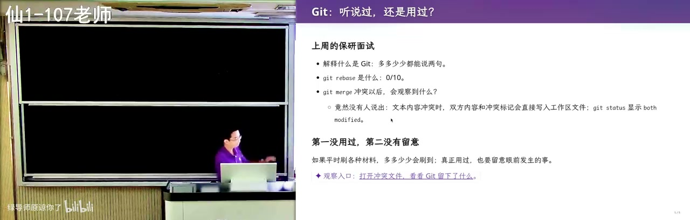
<figcaption>画面 29:02 · SVN 存增量，git 存快照</figcaption>
</figure>

他先回到没有 git 的年代：上学时同学就是把目录复制成作业V1、作业V2、作业最终版，这其实已经满足「手滑改错想回上一版」的需求——如果能列出所有版本、切到任意一版，你就发明了一个没有分支合并的简化 git，跟室友同时改一个文件的需求再逼出合并。git 之前大家用 SVN，SVN 存的是「变化」：改一行存一个 patch，再改再存一个，看起来非常高效，但项目一长就把人拖进泥潭，想回到早期版本得一个个往回退。git 存快照，回到任意版本一秒到位；它的作者就是 Linux 的作者，1991 到 2002 年 Linux 靠邮件列表发补丁、每天有人把补丁并进主干再 release，中间用过 BitKeeper，Linus 受不了才在 2005 年做了 git。

### 33:30–38:00 · init 之后只多一个 .git

<figure>

<figcaption>画面 33:32 · init 之后只多一个 .git</figcaption>
</figure>

他说这正是「从已有经验推出下一个概念」：我们需要的只是项目级的时间回溯。于是他现场开一个空 terminal，git init 之后目录里只多一个默认隐藏的 .git，这就完了——项目从此是被 git 版本管理的仓库，可以从远端拿代码，也能推上去。接着写个 hello.c，git add hello.c、git status 就能看到工作区里的文件；快照要带 message，因为以前用复制目录时版本信息只能塞进目录名。他提醒很多同学把 git 当作业V1、V2、V3 用，但推荐做法是修 bug、加功能、改脚本文档这些任何一次有意义的改动之后立即 commit，弹出来的是 nano，写一行「我做了什么」保存退出就提交成功。

### 38:00–42:30 · 让 AI 审我的提交信息

<figure>

<figcaption>画面 38:02 · 让 AI 审我的提交信息</figcaption>
</figure>

提交完他带大家看真实项目里别人怎么协作：有的提交大、装一个 feature，有的很小、只 fix 一点东西。然后他现场追问「我刚才这个 commit 符合 best practice 吗」，AI 一秒钟就答：提交信息可读性有问题，代码本身也有问题——他故意写的是 I added some cool stuff，完全看不出做了什么。他解释 git 虽然存快照，但项目本质是 V1 经一次修改变成 V2，message 要写清改了什么、为什么，顺着 message 就能看出修了多少 bug、加了什么需求、经历了什么重构；如果一万个提交都是 cool stuff，那这个特性就不该存在。他还演示了空提交：git 会拒绝，但 agent 知道怎么强制做，偶尔用来触发 CI 或在打 tag 之外做一次 finalize 可以，不能大量做。

### 42:30–47:00 · 冰山之下：git add .

<figure>
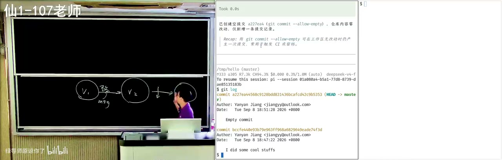
<figcaption>画面 42:32 · 冰山之下：git add .</figcaption>
</figure>

他把话题拉回「水面下的冰山」：add、commit、push 一下午就能学，真正值钱的是每一条血泪换来的 best practice，而这些你转手问 AI，两小时就能讲清楚，比他在课上即兴讲得好。接着现场做反例：改了三五个文件，用 git add . 一次全加，git 完全不阻止，完全合法，再提交；然后让 AI 按严重程度给这个提交排序，AI 开口就骂「提交信息毫无信息量」「主观废话」，并建议用祈使句、现在时描述动机，提 conventional commits 前缀。第二条批评是提交粒度混杂：hello 是编译产物，根本不该进版本库，应该写进 .gitignore、由构建系统产出。

### 47:00–51:30 · 编译产物与二进制冲突

<figure>
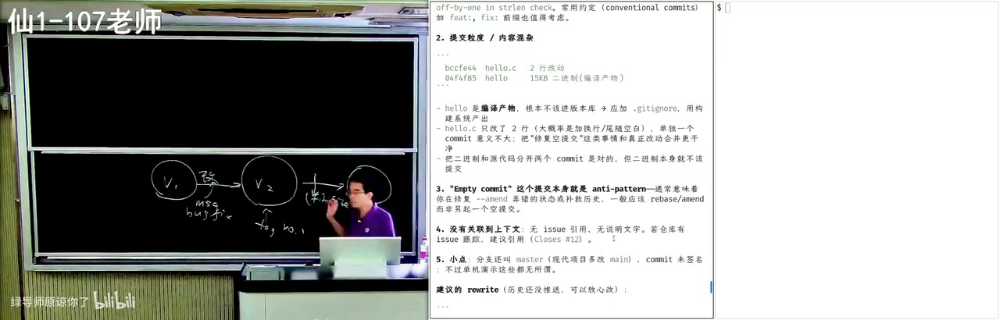
<figcaption>画面 47:02 · 编译产物与二进制冲突</figcaption>
</figure>

他顺着编译产物往下讲：作业V1、V2 的压缩包里 exe 一定在，但 git 要防的是版本库膨胀——一万个文件、一百个合作者，每个人环境不同，编出来的东西带日期、带 hash、带你本机指纹，同样的源码编出的 hello 也可能不一样，一提交就产生二进制冲突，而二进制几乎无法合并，图片也一样。他让 agent 收拾这个仓库，AI 的答复是丢弃空提交和编译产物两段历史、新建 main、重写成两个单一职责的提交，还贴心指出这个仓库没有 remote、不会影响别人。他提醒注意 headline message 的写法，在 message 里写 fix #3，GitHub 会自动关掉对应 issue；这些只有反复用才分得出初学者和有经验的人。

### 51:30–56:00 · 编译不过的代码不许提交

<figure>
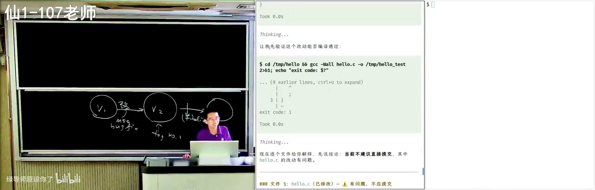
<figcaption>画面 51:32 · 编译不过的代码不许提交</figcaption>
</figure>

他进一步说，现在你们都是 agent native，git status 这类手打命令已经算「古代手艺」，但概念还得有。他让 agent 在每次操作前逐个检查文件变化，故意给一段编译不过的代码让它提交，模型不但拒绝，还修好并解释：提交应当是一个完整自洽的快照，提交编译不过的代码等于让仓库处于坏状态。接着演示两件他喜欢的功能：git blame 告诉你每一行是哪次提交改的；git bisect 把提交历史当成一个「前缀全是 0、后缀全是 1」的数组，用二分找第一个引入 bug 的提交——前提是你手上有能检查出 bug 的东西。

### 56:00–1:00:30 · 研究生仓库里的高血压时刻

<figure>
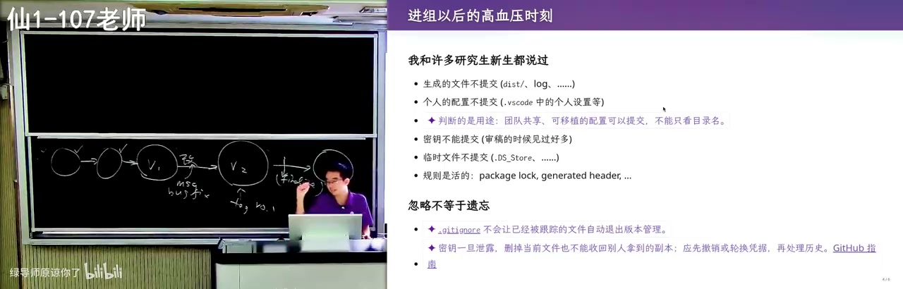
<figcaption>画面 56:02 · 研究生仓库里的高血压时刻</figcaption>
</figure>

他说这也是为什么每次有新同学进组、开了仓库，他都要经历一次「高血压时刻」：dist、log 这些生成的文件被提交上来，个人 VS Code 配置、C 盘硬编码路径也在，别人机器上根本复现不了，更吓人的是审稿时能捡到还活着的 API key。最典型的是 .DS_Store：macOS 的 Finder 打开目录就留下索引、点开头默认隐藏，ls 看不到，但 git add . 会把它收进去。他也承认规则没那么绝对：package-lock.json、用另一套工具链生成的 header 恰恰该提交，让别人不装那套依赖也能编译；他以前研究「检查项目是否符合 best practice 并给 warning」的工具，现在这些都被大模型杀死了。

### 1:00:30–1:05:00 · hook 与大写小写之辩

<figure>
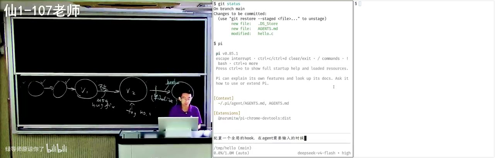
<figcaption>画面 1:00:32 · hook 与大写小写之辩</figcaption>
</figure>

更严肃的项目里他开始用 hook：agent 需要他输入时叮一声，或者在 pre-commit 上挂几十条检查规则——他为了这些规则该用全大写还是全小写纠结了很久，最后让 AI 解释，它从 RFC 里引了 style check 的惯例，还分析了他为什么觉得全大写更强。他强调这种细节问一句就长进一点。然后他转进「git 到底怎么工作」：不重讲操作系统课那一段，只讲一个头——git 是一个持久化的数据结构，持久化的内容就是目录树，版本一到版本五说到底是在存一棵棵目录树。

### 1:05:00–1:09:30 · 只复制路径，其余挂指针

<figure>
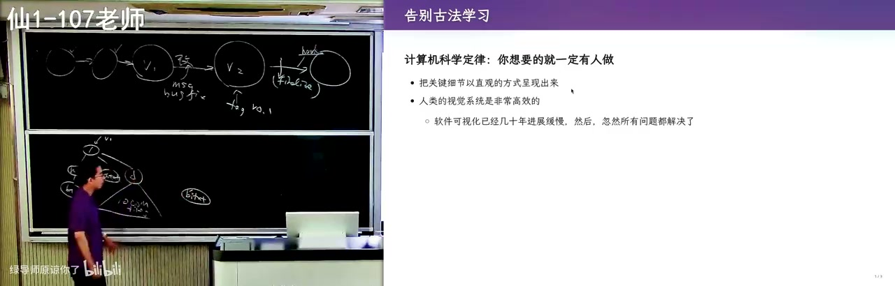
<figcaption>画面 1:05:02 · 只复制路径，其余挂指针</figcaption>
</figure>

承接目录树的说法：从 V1 造 V2 不必复制所有文件，改的是 B.txt，就必须造一个新的 B.txt，但它到根的路径要复制一份，根下的 A.txt 和另一个目录 D 直接用指针指过去。所以哪怕项目里有 100 万个文件，只要目录不是一千层深——每层索引都是指数级展开——你付出的只是一个很小的增量。落到磁盘上，.git/objects 里全是按 hash 索引的普通文件，只有三类对象：blob 是字节序列、tree 是目录（带 644、755 的 mode 和名字）、commit 指向 tree。他说一个大学生从 first principle 出发完全能设计出这个东西，但纸面讲完不踏实，得看真仓库——他推荐过 learn git branching，那是古法可视化编程的巅峰之作，用动画演示 status、commit、checkout 的效果。

### 1:09:30–1:13:30 · 现场写一个 git 可视化工具

<figure>

<figcaption>画面 1:09:32 · 现场写一个 git 可视化工具</figcaption>
</figure>

他说这件事今天可以直接 web coding：他一句话让 agent 做了个工具，提示词是「实现一个 git 命令行工具，把真实仓库里的主要概念完整可视化，任何对象都要从文件系统里的真实文件出发」——和 learn git branching 那种模拟出来的模型不同，这里解析的是真的 .git，还要求它持续监听目录变化、用动画展示。演示时他直接删掉一个文件，右边树上那个节点就没了；main 分支上最早一次提交是 I did some cool stuff，里面是一个空的 hello.c，来自 .git/objects 下真实的 blob，字节序列解压后可以看到那个小文件 31 字节压出来反而只有 23 字节，不划算。

### 1:13:30–1:18:30 · 分支是指针，HEAD 指向指针

<figure>
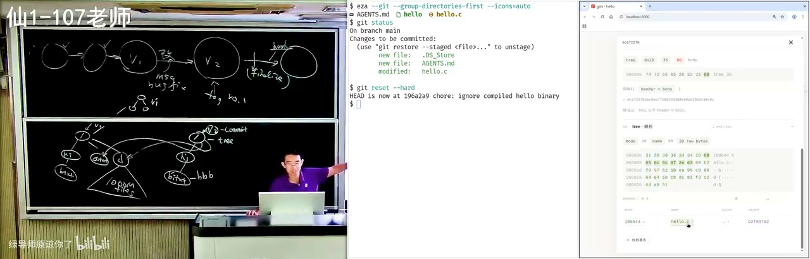
<figcaption>画面 1:13:32 · 分支是指针，HEAD 指向指针</figcaption>
</figure>

接着他看二进制 hello 的 blob（头部有可执行文件的魔数）和 tree object：磁盘上 52 字节解压出 43 字节，内容是 644 hello.c、755 hello 这样的 mode 加名字。然后让工具建两个分支，动画里能看到 refs/heads/ 下多出文件——所谓分支就是一个指针，HEAD 是指向指针的指针。最后展示 merge 冲突状态：两个开发者都重构了同一段代码，冲突落在未提交区，index 里 git 悄悄留了 base、ours、theirs 三份，工作区那份才是带尖括号的；resolve 之后临时文件消失，生成的 merge commit 有两个 parent。

### 1:18:30–1:23:30 · 给三四年级小朋友教 Python

<figure>
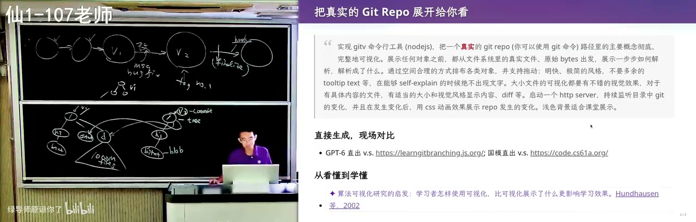
<figcaption>画面 1:18:32 · 给三四年级小朋友教 Python</figcaption>
</figure>

演示完他顺口说 web coding 最大的乐趣是跟着它学，知识会爆炸式增长，又举了 CS61A 那个在线 IDE（code.cs61a.org）——如假包换的 Python IDE，能跑作业。他自己也做了一个：既是网页应用、也能打成 Electron 的 exe，架构是他把关的，界面全是 AI slop 但他不管代码质量，因为要拿去给三四年级的小朋友上第一节 Python 课。第一课得让孩子觉得好玩：把一个整数变成字符串、把 unicode 编码成整数再解码回来、hello 乘十打印十份；汉诺塔配一个能前后拖的调试器，每次递归前只告诉你该移哪一块。

### 1:23:30–1:28:30 · 从方块下落到求职门槛

<figure>
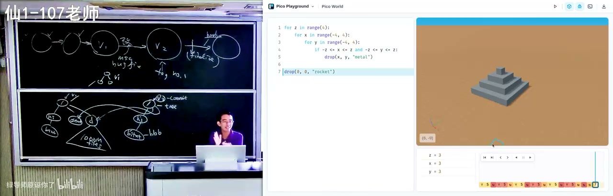
<figcaption>画面 1:23:32 · 从方块下落到求职门槛</figcaption>
</figure>

再往下是更能玩起来的东西：给小朋友一个 API 和一个世界，一个二重循环让方块从上往下掉，可以往前也可以往后拖，左边的坐标轴被他骂着改正确了；还有 3D 打印的叠块、斐波那契递归、插入排序一步一步比较。他说这些课件靠一个编译 skill 就能把任何东西编出来，他甚至试了国产的便宜模型 DeepSeek Flash，效果已经可用。由此他把话拉回现实：愿意花时间把细节做好的人在求职市场上越来越值钱，因为一旦有人学会，招人的单位就会拿这个标准来衡量——问一个研究生「git merge 之后会发生什么」他毫无概念，对比一个每个概念都被 AI 帮着真正消化过、能从零构建的人，竞争力完全不同。

### 1:28:30–1:33:30 · 中英文空格与及时提交的理由

<figure>
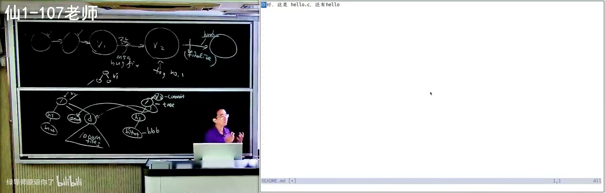
<figcaption>画面 1:28:32 · 中英文空格与及时提交的理由</figcaption>
</figure>

他承认今天名义上讲 git，实际讲的是 best practice，而那些 AI 给的提交也不完美：前面 message 是英文一行标题加详细解释，后来就开始中英文混着写。他顺手立了几个规矩：conventional commits 要求 feat、fix 这类 type 前缀加冒号加空格；markdown 里中文和英文之间要有一个空格，而且必须前后一致，他最难受的就是同一个文档里一会儿有一会儿没有——AI 恰好会把这些细节做好。为什么必须及时提交，他给的具体账是：项目复杂以后改动越多越容易错，一个一万行的 V2 里埋了 bug，后面修了 100 个 bug 都说不清是谁引入的，小提交才能冤有头债有主，能 review、能 revert、能 bisect，还能在电脑物理损坏前先 push 一份互联网备份。他还提到 agent 会试图调 gh 或 glab，失败了就退回古法写 git 命令；装了 gh 以后 fetch issue、看 assign 给自己的、再 close 掉，都能纳入 agent 的工作流。

### 1:33:30–1:40:13 · 小步快照与多 agent 并行

<figure>
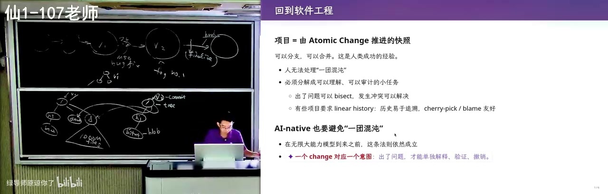
<figcaption>画面 1:33:32 · 小步快照与多 agent 并行</figcaption>
</figure>

最后他给整节课落一句话：把项目组织成用 atomic change 推进的一串快照，所有 best practice 都从这句推出来——随时开分支试错，失败就扔掉、成功就合回来，还能同时推进多条主线而不互相干扰。项目管理的本质是人类处理不了一团混沌，所以要把需求拆成可理解、可审计的小任务；严肃项目现在更流行 linear history，因为 rebase、cherry-pick、blame 对 AI 都容易，历史好追溯也更省 token。他自己的做法是先在架构设计阶段用单线程和高智力模型把接口定死：尽量做成 pure function，全局共享状态只有十几行，禁止 agent 去看库函数实现；架构定了再开三个 terminal 让 agent 并行迭代，agent.md 里写清协作规则（不许调视觉模型、不许开浏览器任务），旁边一块屏实时看效果，哪里不满意就骂它，几万 token 就能做出这样的 playground。他也说 agent 能力还在涨，等它快一千倍，版本控制该怎么管只能下节课再聊。

<!-- live:end -->

## 章节详解

### 1. 从「建一个目录」开始：软件是什么

<figure>

<figcaption>画面 00:39 · 开场 & 版本管理</figcaption>
</figure>

**画面解读：** 开场谈 GPT6 的进步与「还要不要学基础」，再把软件定义为人类需求在信息世界的投影、今天就是一个目录；随后回溯前 git 时代——U 盘拷代码、作业V1/V2/最终版、压缩包发邮件，说明「想回到上一版」就足以推出 git。

**⭐ 核心：** 老师给软件下的定义不是课本的「代码+文档」，而是**「人类世界的需求在信息世界里的一个投影」**，今天的形态就是「一个目录，里面一堆文件，共同构成可交付的东西」。你写个 `hello.c`、编出 `hello`，就已经在做软件了——只是不符合现代 best practice。

**🔧 实操：** 不要靠 clone 别人的仓库来理解项目，先自己 `mkdir`、起个名字，再从空目录倒推「这里应该有什么」。老师反复用这个套路：**从已有经验推下一个概念**——「这不就是需求吗，那你自己就能发明一个 git」。

**⚠️ 易错：** 把「能跑」当「能交付」。视频里的笑话是「我又做了好几个 killer 级产品」，地址都是 `localhost`（字幕记作 5137，应为 Vite 默认 5173）——因为你没在 intent 里说「要被全世界看到」，AI 就把你当开发者，先起本地 dev server。

> 💡 核心提炼：项目 = 一个目录；软件工程 = 让这个目录能被持续接手。

### 2. 前 git 时代：复制粘贴也是版本管理

**⭐ 核心：** `作业V1/V2/最终版` 的土办法其实已满足最朴素的需求——**手滑改错了想回去看上一版**。这个需求本身就能推出 git 的雏形：既然能「列出所有版本、切到任意版本」，你就已发明了一个没有分支合并的简化 git。

**🔧 实操：** 第一个博士生（2012 年入学）大一嫌机房来回拷代码麻烦，把代码存 U 盘，大二 U 盘坏了，作业全没。老师自己上学时是打压缩包发邮件交作业，现在是网页上传——都是「管理项目的方式」。

**⚠️ 易错：** 把「复制目录」当版本管理。它回答不了「差在哪」「谁改的」「能否只回退这一处」。

> 💡 核心提炼：先有需求再有工具；git 是被「我想回到过去」逼出来的。

### 3. 学习方式：惊人的注意力 + virtual implement

**⭐ 核心：** 这门课几乎每节都讲——**知识不重要，学习意识重要**。大家打开过无数 GitHub 项目，却很少留意「为什么这个有那个文件、那个没有」「为什么这个 README 短得清爽，那个像 AI slop」。差异就是信号。

**🔧 实操：** 读论文/读代码的方法是 **virtual implement**：看到方案前，先在脑子里自己做一遍；一致→已掌握；不一致→要么成熟方案更精巧（学它），要么你的更好（一万次里有一次的惊喜）。老师看 README 的习惯就是先想「我会怎么写」再对比。

**⚠️ 易错：** 带着中学「老师说做 A 就只做 A」的心态——「你就有点像今天干活的 AI，被强化学习成只做这一件事，绝不碰一点点，因为最省时间」。

> 💡 核心提炼：把「对比」变成肌肉记忆，你就在任何场景下都在接收信息。

### 4. git 的核心承诺与最小实操

**⭐ 核心：** `git init` 之后项目多一个隐藏的 `.git` 目录，**这就完了**——从此这个目录是被版本管理的仓库，可以建快照、在任意时间点之间穿梭。

**🔧 实操：** `git init` → 写 `hello.c` → `git add hello.c` → `git status` 看工作区 → `git commit`（弹编辑器写 message）→ 保存退出即成功。

**⚠️ 易错：** 把 git 当「作业V1/V2/V3」用，很多同学真的这么干。推荐 practice 是**任何一次有意义的改动（修 bug、加功能、调文档）之后立即 commit**，而不是攒成「大版本」。

> 💡 核心提炼：commit 不是存档点，是「一次可解释的意图」。

### 5. commit message：被低估的工程资产

<figure>

<figcaption>画面 25:54 · Git 入门与一些  最佳实践</figcaption>
</figure>

**画面解读：** 从 git init 只多一个隐藏的 .git 讲起；重点是提交信息——「I added some cool stuff」是灾难，让 AI 审一遍还会开骂。接着讲编译产物与 .gitignore、merge 冲突现场，以及 git 起源于 Linux 的邮件补丁。

**⭐ 核心：** git 存的是快照，但项目本质是「V1 经一次修改变成 V2」。message 要写出**改了什么、为什么**，让后来者顺着 message 读出历史轨迹：修了多少 bug、加了什么需求、经历了什么重构。

**🔧 实操：** 现场让 agent 审自己的提交，AI 按严重程度排序：「提交信息毫无信息量」「主观废话」；建议用祈使句、现在时描述动机，并提 conventional commits 前缀。message 里写 `fix #3` 还能让 GitHub 自动关 issue。

**⚠️ 易错：** 一万个提交全写 `I did some cool stuff`——那这个特性就不该存在，直接叫 V1→V2 就行。

> 💡 核心提炼：message 是写给三个月后的自己和同事的，不是写给 git 的。

### 6. 反例：`git add .`、编译产物与二进制冲突

**⭐ 核心：** `git add .` 完全合法，git 不拦你，但它是最典型的坏 practice 入口。`.exe` 是编译产物，不该进版本库，应写进 `.gitignore`，由构建系统产出。

**🔧 实操：** 为什么不能提交二进制？① 版本库膨胀（一万个文件、一百个合作者）；② 各环境编出的东西不同——带日期、带 hash、带你本机指纹，**同样源码也会冲突**；③ 二进制冲突几乎无法合并。

**⚠️ 易错：** `.DS_Store`。macOS Finder 自动留索引，点开头默认隐藏，`ls` 看不到但 `git add .` 会收进去。规则又没那么绝对：`.github/workflows`、`package-lock.json`、用另一套工具链生成的 header，有时**恰恰应该提交**（让没该工具链的人也能编译）。视频没给统一判据，只说「没有绝对的规则」。

> 💡 核心提炼：版本库只放「人写的、需协作与回溯的东西」，不放「机器每次都能重新生成的中间物」——例外要能说清理由。

### 7. merge 冲突：责任落到你手上的那一刻

**⭐ 核心：** 面试问「什么是 git」「git rebase 是什么」还能说两句，问「merge 冲突之后会观察到什么」几乎全军覆没——**没真用过，或用了也从不停下来看**：agent 啪啪啪修好，说测试通过，你看一眼觉得 OK。

**🔧 实操：** 冲突现场是文本里的 `<<<<<<<`、`=======`、`>>>>>>>`，两侧代码同时展示，还有 HEAD / incoming 标记；IDE 多出 `accept incoming change` 按钮，逐块选完**再新建一个 commit** 才算 resolve。原理和地铁标识一样（first principle）：**在出问题的地方把需要的信息全放进来**。

**⚠️ 易错：** 把冲突当「报错」而不是「待你决策的合并点」。让 agent 在不同分支开发时，冲突依然高发。

> 💡 核心提炼：冲突不是 git 的失败，是 git 把决策权显式交还给你。

### 8. git 从哪来：一条走错的路和一条对的路

**⭐ 核心：** 1991–2002 年 Linux 内核靠邮件列表发补丁 + 作业式版本维护，中间用过 BitKeeper（字幕音近「git keeper」），2005 年 Linus 受不了，做了个「绝对简单、概念正确」的工具——git 比想象的年轻。

**🔧 实操：** **SVN 存变化（delta/patch）**，改一行存一个 patch，看似高效，但项目一长就进泥潭：想回到早期版本得一个个往回退。**git 存快照**，「回到某版本」一步到位。这是「first principle 优先于局部高效」的典型。

**⚠️ 易错：** 以为版本控制的重点是「省空间」。省空间次要，**随时精确回到任意状态**才是主目标。

> 💡 核心提炼：高效要服从正确；delta 存储是局部最优、全局灾难。

### 9. 底层：目录树 + 写时复制 + 三类对象

**⭐ 核心：** git 是**持久化的数据结构**，持久化内容是目录树。改一个文件不必复制整棵树，只要把「该文件到根的路径」复制一份，其余用指针指过去。目录不会很深（没人建 1000 层），每层索引指数级展开，所以百万文件的项目「只需创建一个很小的增量」。

**🔧 实操：** `.git/objects` 里是普通文件、按 hash 索引，三类对象——**blob**（字节序列）、**tree**（目录，含 `644 hello.c`、`755 hello` 的 mode 与名字）、**commit**（指向 tree，merge commit 有两个 parent）。现场解压可见：一个小文件 31 字节压缩后解出 23 字节（小文件压缩反而浪费），头部写着 `blob 15`。

**⚠️ 易错：** 把分支当「一份拷贝」。分支只是 `refs/heads/` 下的一个指针文件，HEAD 是「指向指针的指针」；merge 时 git 在 index 里悄悄留了 base/ours/theirs 三份，工作区那份才带尖括号。

> 💡 核心提炼：理解了「只复制路径、其余共享」，就理解了 git 为什么又快又省。

### 10. 水面下的冰山：best practice 与项目管理

<figure>
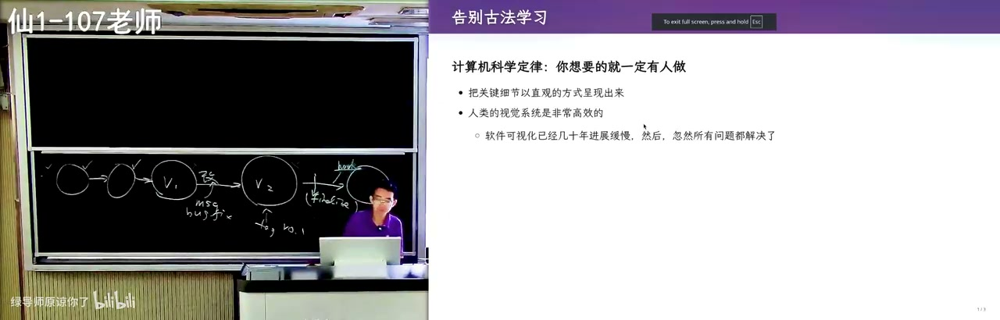
<figcaption>画面 1:03:11 · 学习 Git</figcaption>
</figure>

**画面解读：** 深入 .git/objects：只有 blob、tree、commit，改一个文件只复制到根的路径、其余挂指针，百万文件也只要很小增量；分支只是 refs 下的指针，HEAD 指向指针的指针。冰山之下是小步提交、bisect、blame。

**⭐ 核心：** `add/commit/push` 一下午就会，区分水平的全是 best practice。**及时 commit 的四个理由**：① 改动越多越易引入多个 bug，大 commit 出问题冤无头债无主；② 小提交可审计、可 revert、可 bisect（历史是前缀全 0 后缀全 1 的数组，找第一个 1）；③ `git blame` 能定位每行是哪次提交改的；④ 提交后立即 push，等于多一份互联网备份。

**🔧 实操：** conventional commits（`feat:`/`fix:` + 冒号 + 空格）、markdown 里中英文间加空格并保持一致、严肃项目要求 linear history（反正 AI 做 rebase/cherry-pick 很容易）。架构上：先用单线程和高智力模型定接口（尽量 pure function、全局共享状态只有十几行），再开三个终端让 agent 并行迭代，用 `agent.md` 写清协作规则（不许调视觉模型、不许开浏览器任务）——这样的项目几万 token 就能做出来。`gh` CLI 则把 issue、assign、close 纳入 agent 工作流。

**⚠️ 易错：** 以为「AI 都能检查所以规范不重要」。老师研究过的「检查项目是否符合 best practice 并给 warning」的工具，「所有这些东西都被大模型杀死了」——前提是你得知道该问什么。

> 💡 核心提炼：项目管理的本质是人处理不了一团混沌，必须把需求拆成可理解、可审计的小任务；小步提交是为了让错误可定位、协作可并行。

---

## 关键数字与例子

| 数字 / 例子 | 含义 |
|---|---|
| `hello.c` → 目录 | 最小的软件工程项目形态 |
| 2012 入学 / 大一存 U 盘 / 大二坏 | 「无版本管理」的事故代价 |
| 1991–2002 / 2005 | Linux 靠邮件补丁的年代 / Linus 造出 git 的年份 |
| 31 字节 → 23 字节、52 → 43 | 现场解压 `.git/objects` 的真实大小 |
| `blob 15` / `644` / `755` | blob 对象头；文件与可执行文件的 mode |
| 一万个 `I did some cool stuff` | commit message 失效的极端反例 |
| 一万行大 commit + 100 个后续 bug | 为什么必须小步提交 |
| 100 万文件 / 1000 层深目录 | 快照增量小；深目录是反例 |
| 十几行状态 + 十几行组装 | 好项目的核心共享状态量 |
| 两天碎片时间 | 现场那个 git 可视化工具的总成本 |

---

## 速查卡

| 概念 | 一句话 | 标记 |
|---|---|---|
| 软件 | 人类需求在信息世界的投影，今天是「一个目录」 | ⭐核心 |
| 快照 vs delta | git 存快照，SVN 存 patch，后者回退要一步步退 | ⭐核心 |
| `.git` | `git init` 唯一的产物，默认隐藏 | 🔧实操 |
| commit message | 写「改了什么、为什么」，祈使句现在时 | ⭐核心 |
| `git add .` | 合法但危险，会把 `.DS_Store`、`.exe` 一起收进去 | ⚠️易错 |
| `.gitignore` | 拦编译产物；但 lock 文件、生成 header 可能要提交 | ⚠️易错 |
| merge 冲突 | 两侧同时展示，解决后要新 commit | ⚠️易错 |
| blob / tree / commit | 字节序列 / 目录 / 指向 tree 的提交 | ⭐核心 |
| 分支 / HEAD | refs 里的指针 / 指向指针的指针 | 🔧实操 |
| bisect / blame | 二分找第一个坏提交 / 定位每行归属 | 🔧实操 |
| atomic change | 一切 best practice 的总根 | ⭐核心 |

---

## 我的判断

这节的标题是「软件仓库管理」，但作者自己最后说破了：「虽然我好像在讲 git，其实我讲的是 best practice。」这定位诚实且聪明——命令层面的 git 一下午就会，真正的门槛是「什么时候该 commit、message 怎么写、什么该入库」，而这套东西课堂上讲不清，只能靠对比和追问习得。所以他把大量篇幅花在演示「怎么让 AI 审我的提交」上，本质是教一种元技能：把 AI 当随时在线的资深同事，而不是自动补全。

要挑刺也明显：最锋利的洞察（快照 vs delta、写时复制、blob/tree/commit）只用十来分钟、语速飞快，对象模型停在「三类对象」——packfile、reflog、submodule、大仓库性能、二进制治理全没碰。前半节关于 GPT6、空间感知、自动驾驶的铺陈占了近三分之一，对「为什么要学基础」是很好的说服，对「仓库管理」这个标题却是溢价。这节课的价值不在知识密度，而在示范一种「对细节保持注意力」的工作方式——这恰恰也最难被抄走。
