# 软件仓库管理（2）：git 的裂缝与 agent 时代的版本管理

> 从「文件系统为什么管不好项目」讲到 git 的裂缝、jj 把 change 变成一等公民，最后推演：当提交从「人·小时」变成「agent·秒」，版本控制该换一套并发控制模型。

## 一句话结论

版本控制系统是为「单核、慢速、要开会」的人类设计的；git 已露裂缝（merge 丢作者归属、rebase 全换 commit id、stash 难管），jj 用「change 是一等公民」补一刀，而 agent 时代的答案是：**乐观并发换成悲观锁，只保快照、不再 blame**。

## 官方章节时间轴

| 时间 | 章节 |
|---|---|
| 00:00–35:53 | 重新设计版本管理系统 |
| 35:53–1:03:48 | 为Agent设计版本管理系统 |
| 1:03:48–1:38:29 | 从零开始一个新项目 |

## 分段大纲

| 序号 | 章节 | 核心内容 |
|---|---|---|
| 1 | 作业开场 | lab1 个人助手；让你亲手踩一遍焦油坑 |
| 2 | 项目是什么 | intent → spec → code；ReadMe 宜短 |
| 3 | 文件系统的原罪 | 历史遗留 + 关联丢失 → 技术债与 traceability |
| 4 | 未来的仓库 | 实体关系图落进 repo.db；AI 生成视图 |
| 5 | git 的裂缝 | 两路 merge 作者漂移、rebase 造新 id |
| 6 | jj | change 一等公民、无 staging、改一字即提交 |
| 7 | 慢人与快 agent | 小时级 → 秒级；worktree 的意外价值 |
| 8 | 不再 blame | agent 不会被开除；历史从追责变修复 |
| 9 | 并发换向 | git 像乐观并发；agent 时代该上锁 |
| 10 | 工具之外 | 难的是任务分解与人月神话 |
| 11 | 现场 demo | 「每句都对，整体错了」；MVP 与文件优先 |
| 12 | 收尾 | 记住现在、历史、教训 |

<!-- live:start -->
## 课堂实录（按时间顺序）

### 00:00–05:16 · 作业开场：会成长的个人助手

<figure>

<figcaption>画面 00:37 · 作业开场：会成长的个人助手</figcaption>
</figure>

开场先交代 lab1「会成长的个人助手」：不限做法、可以 vibe code，由机器人按链接验收，这周日还调休补周二的课、要讲软件架构。他举了几个自用例子——把专业课资料和研究组文献整理成个人数据库、把反复要填的姓名学号身份证号交给 agent、再把数据库和邮箱关联成 always on 的后台循环，一两百块的嵌入式设备就能在宿舍常跑。之所以布置这个作业，是想让人亲手踩一次焦油坑：AI 一上手就会做出一堆看着合理、却让维护越来越难的决定，直到你下决心删库重做；而下一个 lab 会和它强冲突，逼你越改越崩。

### 05:16–07:52 · ReadMe 只写初衷和两张截图

<figure>
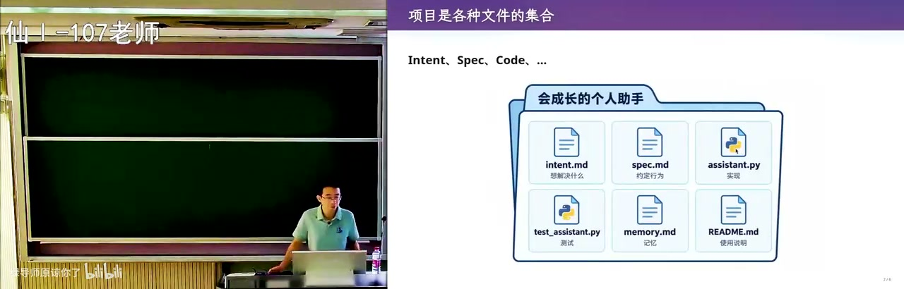
<figcaption>画面 05:18 · ReadMe 只写初衷和两张截图</figcaption>
</figure>

接着复习上节课的框架：项目就是各种文件的集合，intent、设计文档、ReadMe 都在里面；他反对 AI 写超长 ReadMe，认为只需写清最初想做什么产品、能达到什么效果、配两张截图，再加上最重要的设计——就像说服一个会写代码的同学跟你创业，你讲清 intent，spec 和实现交给对方补。粒度上是 intent → spec（选什么数据库、什么语言、项目结构、每个模块的接口）→ code implementation，这些文件很自然需要一个容器管起来。而今天大家用文件系统管项目，本质是历史原因：五六十年代操作系统能给的存储只有文件，关系数据库还没发明，所以别无他法。

### 07:52–12:50 · 文件系统装不下隐藏关联

<figure>
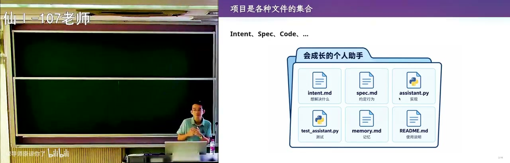
<figcaption>画面 07:54 · 文件系统装不下隐藏关联</figcaption>
</figure>

文件系统真正的毛病是装不下隐藏关联：你让 AI 把链表换成更高效的树来优化性能，代码改了，可某个 markdown 里还写着「本项目用链表」，写文档时还没有代码，这条关联从来没被强制连上，不一致只会越来越多，这就是技术债。更麻烦的是以后没人说得清是文档对还是代码对——当时的 chat 没了，换了电脑，git reflog 里只剩几条 change 日志；软件工程研究这件事很久了，他举的 2014 年综述就叫 traceability（可追踪性）。等打压缩包发给合作者都维护不下去，才有了 SVN、git，他顺势问下一个是什么，并预告今天要讲的工具（jj）可能比 git 更好用。

### 12:50–17:36 · 实体关系图装进 repo.db

<figure>
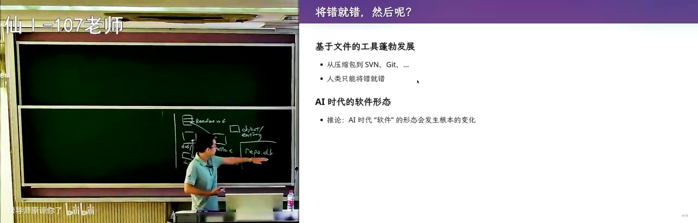
<figcaption>画面 12:52 · 实体关系图装进 repo.db</figcaption>
</figure>

他更愿意设想：如果人几乎不再写代码，文档就该切成很多切片、变成对象或实体，靠关系连起来——文档被这段代码实现、测试用例对应那几条要求，连出来是一张有环的图，树状的文件系统根本装不下，那就放进一个数据库，他叫它 repo.db。人已经没法用 UNIX 那套工具维护这样的仓库，办法是用魔法打败魔法：训练 AI 去理解它，让 AI 自动维护所有 artifacts 的一致性——文档说链表，实现就必须是链表。小步前进的哲学照搬 git：你跟 AI 说「我对幻灯片样式不满意」，它只挑出相关的代码、测试和文档，生成一个看板视图（就是数据库里 view 的意思），改完从 V0 到 V1 还是那个 repo.db。他甚至预判从此不用再看代码，虽然自己那点古法编程的掌控欲还没放下。

### 17:36–22:46 · 旧知识仍有用：rebase 场景

<figure>
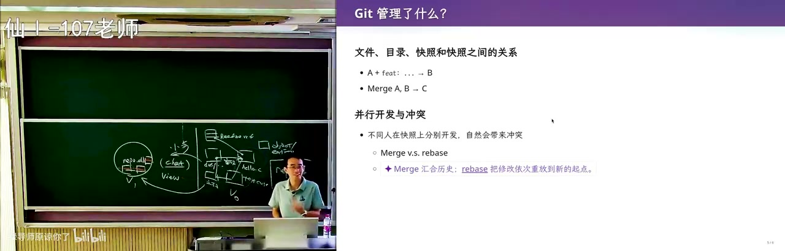
<figcaption>画面 17:38 · 旧知识仍有用：rebase 场景</figcaption>
</figure>

他顺口吐槽现在的 IDE 一打开默认就是 agent mode、古法编程的掌控欲没处放，但承认这可能就是未来，并安慰大家：他推演时用的全是课上学的经典概念——数据库的视图、实体与关系、git 的小步前进。有已毕业的同学留言说学生时代很少合作、rebase 和 merge 的场景太少，他回应说去互联网社区走一圈，contributing.md 铺天盖地，总会看到「必须在自己分支上 rebase、保持线性历史」。他还说高中「不考就不用学」的思维会留下 gap，AI 时代的斩杀线先把低端脑力劳动清零，据他看到的报道中国会计从业者可能有上千万，所以经典课程里的软件工程智慧还得学。

### 22:46–26:00 · 两路 merge 让作者变成 A

<figure>
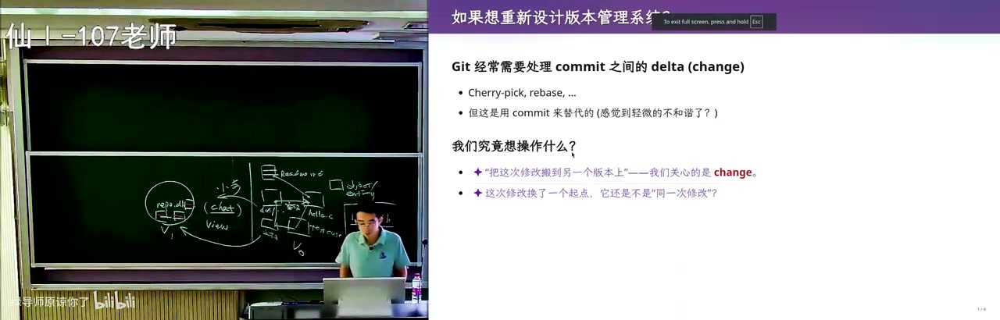
<figcaption>画面 22:48 · 两路 merge 让作者变成 A</figcaption>
</figure>

回到 git 本身的模型：它管的是快照（一个目录）以及快照之间的关系，A、B 两个开发者各自在自己的线上小步提交。原始 git 模型并不提倡 rebase，合并时更常见的是两路 merge——一个有两个 parent 的提交，把两条线的修改都继承下来。问题在于这个 merge 如果是 A 做的，B 写进去的内容作者就变成了 A；冲突由 A resolve 之后，B 改的代码 ownership 也归到 A，出现了隐形的作者修改。rebase 正是想解决这点，但这里埋着一个很大的风险。

### 26:00–30:05 · rebase 换掉全部 id

<figure>
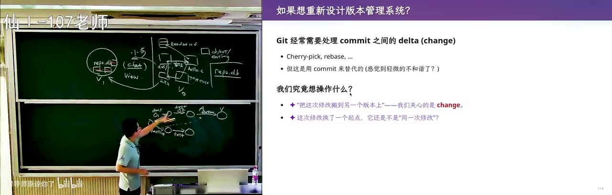
<figcaption>画面 26:02 · rebase 换掉全部 id</figcaption>
</figure>

风险在于搬运可能失败：B 加的测试用例也许和 feature 不兼容，或者两边根本改了同一处。成功的话一路线性合并很漂亮；一旦冲突就要 resolve，你会进入 rebase 模式、瞬间不知道该怎么办，只能让 agent 解释，而搬完 feature 还要搬 test，每搬一次都生成新提交、新 id，因为 base 被挪走了。所以他点出根子：我们真正关心的是「修改」，而 git 里没有 change 这个对象，只能用 commit 加 parent 来近似。一旦让 change 成为一等公民，就得到下一代工具 jj——底层和 git 兼容，rebase 时直接把 change 搬过去，连冲突记录都塞进 change 里。

### 30:05–35:54 · jj 取消暂存区，改一字节即提交

<figure>
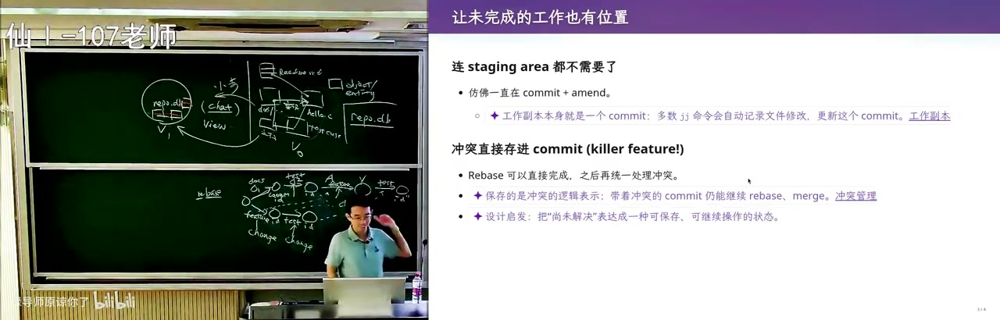
<figcaption>画面 30:07 · jj 取消暂存区，改一字节即提交</figcaption>
</figure>

jj 还有个很舒服的特点：不需要 staging area。经典痛点是 hello.c 改到一半既不能编译也过不了测试，导师电话一来要一分钟修 bug，你只能先 add 进 index 再 git stash；刚修一半又被叫走，stash 是个栈，堆几层就要管栈，还得 rebase stash。jj 的思路是：你随时随地都在编辑这个 repo，改一行减一行本身就是 change，所以改一个字节就立即提交，同时把上一次那个提交抹掉、用当前修改替代，永远处在已提交状态。他还说从这个起点往后推，能自己推出一套版本管理；对已经有 git 肌肉记忆的人难改，而你们还没形成记忆，可以先把对的设计记成肌肉记忆。

### 35:54–40:56 · 人是单线程，十分钟一个提交

<figure>
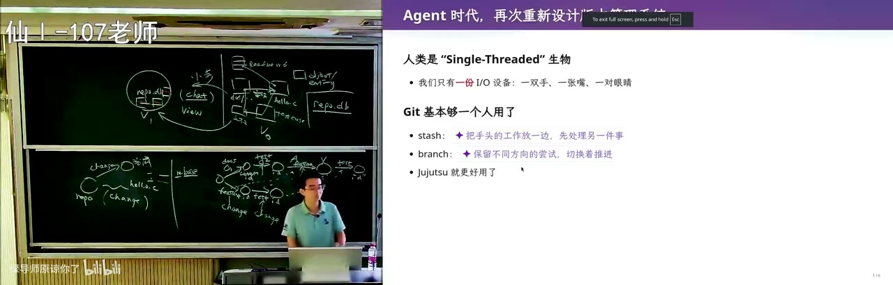
<figcaption>画面 35:56 · 人是单线程，十分钟一个提交</figcaption>
</figure>

他把话题拉回本课：这课不是软件工程，是生成式软件工程，要在 agent 时代重新设计版本管理——agent 用 git、用 jj 对人类是进步，对 agent 本身进步有限。因为所有版本控制系统都有个隐含假设：使用者是人，而人是单线程的生物；他借用操作系统并发课的画面——观察世界时手背在后面只能看，真要 write 就得闭眼扔粉笔，那一刻读到的值早已失效，人和人之间也有无法逾越的物理屏障，只有一双手、一张嘴、一对眼睛。以这种方式编辑代码产生 change 是以小时为单位，十几人的团队最多十分钟一个提交，比人和人沟通还慢：研究生写之前先问师兄一句、二三十秒，厂里每天早上开会半小时把 scope 切开。所以在古法编程时代 stash 是合理设计，导师第二次打断的概率很低，栈通常只有一层。

### 40:56–46:58 · 给每个 agent 一台开发机

<figure>
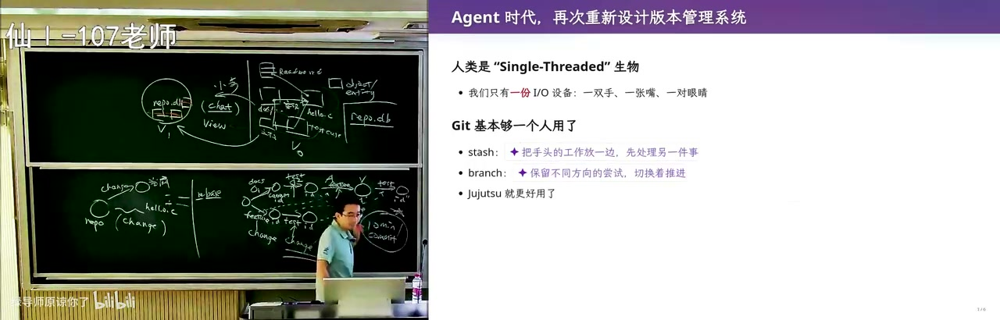
<figcaption>画面 40:58 · 给每个 agent 一台开发机</figcaption>
</figure>

但 agent 时代这件事变了：单个 agent 生产 artifacts 是分钟级，上下文还热的时候几十秒就能 fix 一个东西，秒级就能产生原子提交，而你还轻易能拉起十倍百倍的 agent team，为人设计的 git、jj 就有点跟不上（大项目要过测试流水线，几分钟的门控只能算减速）。最容易的实现是沿用人的模型：每个 agent 一台独立开发机或容器，指一个远端仓库，直接 instruct 它「你现在就是单人开发者，从 tmux 收命令」。现场他开了两个 tmux session、故意用 master/slave 命名，两个 slave 物理隔离互相看不见，各自开干；也可以放一个监工 agent，让 codex 设计、Claude review 互相打架，主 agent 只负责注入 prompt。工作在同一仓库会有麻烦，工作在不同 repo 就完全可行——可以互拉、冲突自己修、必要时给 master 发消息。

### 46:58–51:04 · 隔离环境：worktree 演示

<figure>
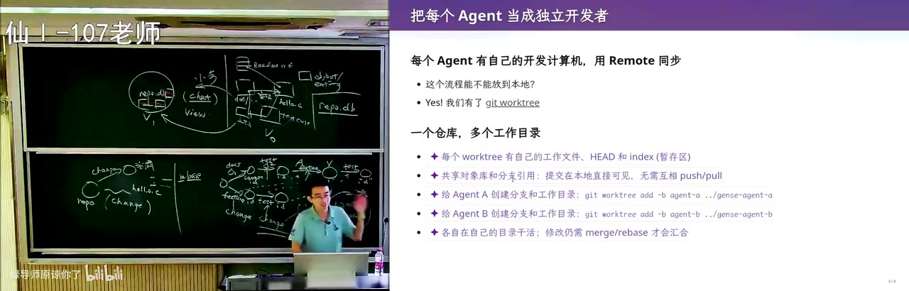
<figcaption>画面 47:00 · 隔离环境：worktree 演示</figcaption>
</figure>

于是他拿 workaround 试：问 agent「git work tree 能不能让两个 tmux session 都工作在 worktree」，这种在公众号上看到新点子就当场让 agent 试的用法他很推荐。演示里 worktree 相当于连到同一个 remote 的独立工作区，可以在隔离环境里独立提交；而 worktree 里的 .git 不是目录，是一个纯文本文件，内容 gitdir 指向 .git/worktrees/ 下面。这正说明 git 最大程度复用了操作系统的文件机制：那仍是一个带 HEAD、index、locks 的微型 git 目录，只是依附于原来的 .git。它在 AI 时代突然变得有用，因为本地提交互相可见、不必 push/pull，比开好几台虚拟机轻量，但有冲突仍然要 merge 或 rebase。

### 51:04–55:26 · 不再 blame，只留快照

<figure>
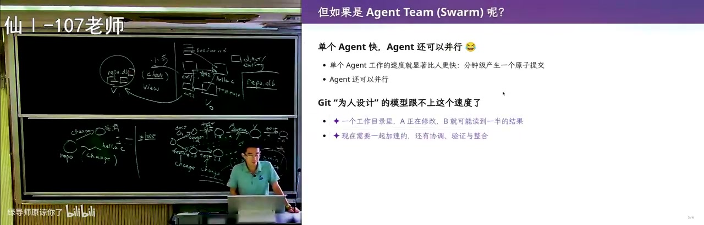
<figcaption>画面 51:06 · 不再 blame，只留快照</figcaption>
</figure>

回到 agent team 或 swarm，他先追问为什么需要版本控制：答案是人的限制塑造了工具，十分钟一个 commit、每天早会同步，都因为沟通成本太高——你给室友讲一道自己会做的数学题都讲不明白，所以 100 人团队拿不到十人团队的十倍效率，两三倍就不错，团队因此没法变大。于是有了快照、小步、改个 title 也一个 commit、每个 commit 可追溯：出问题能回到那个人做事的时间点，他还记得当天早会，能翻出当时的沟通记录，这就是 git blame 这类为人设计的特性。但 agent 不会被开除、也没有实习生背锅，而且每个 agent 都是同一模型的克隆体，同一个 prompt 大概率收敛到同一结果；历史的价值于是从「谁写错了」变成「我怎么修好」，快照仍要留（方向错了回退代价更小），提交里只留 lessons。

### 55:26–58:57 · git 像数据库里的乐观并发

<figure>
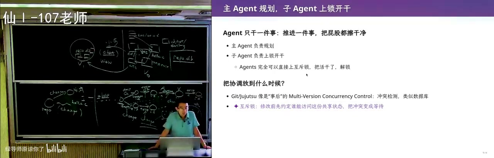
<figcaption>画面 55:28 · git 像数据库里的乐观并发</figcaption>
</figure>

他再把版本控制和数据库的并发控制对照：现在的 git 更像乐观并发控制，假设两个事务不会冲突，先各自往前跑，合并时大概率顺利。这个假设在数据库里通常成立——教务系统里每个同学只读自己那块、写自己那块，两个人同时选课也不冲突。事务里可以先 select 读一下、跑图灵完备的代码算、再 update，两个 update 互相读就形成循环依赖或死锁，检测到就 abort 回滚；git 这边则是早上开过会、scope 分好了，所以 merge 或 rebase 大多不打架。可如果 agent 快 1000 倍、主 agent 又一下子分很多任务出去，abort 会触发得更频繁——agent 能自己修，但该不该换一种并发控制模型？

### 58:57–1:04:04 · 转向悲观：给快照上锁

<figure>
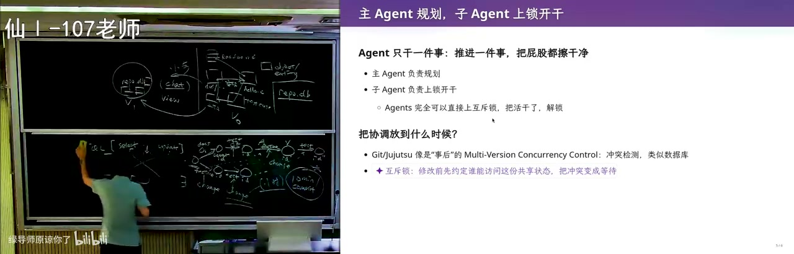
<figcaption>画面 58:59 · 转向悲观：给快照上锁</figcaption>
</figure>

他回到操作系统课学的办法：想访问可能冲突的资源就先上锁，别人再 lock 就得等 release，先一后二，不像乐观那样先跑了再说，而且必须在使用前 declare。既然 agent 动作这么快，就该偏向悲观的并发控制：主 agent 规划完立刻把项目某一部分锁上，最好让 git repo 或快照本身支持锁操作，把 scope 声明清楚，做完 commit 释放；别人想干的事被锁住就等着，几乎避免了所有冲突，比如文件级上锁就不会有两个 agent 同时改同一份测试或配置。他又补一句：互斥锁本质是不要并行、和并行硬件矛盾，但只要系统里还有大量互不冲突的线程在跑，悲观也依然高效。版本控制这条线到此讲完——从历史动机到 git、再到 jj 和未来的推演，他早就不手写 SQL 了。

### 1:04:04–1:08:25 · 难的不是工具，是任务分解

<figure>
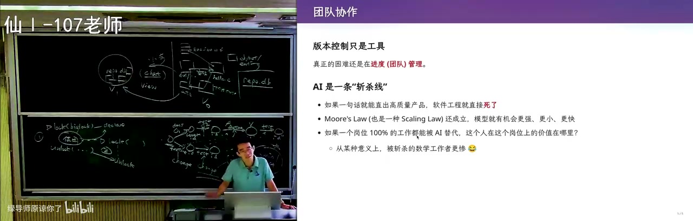
<figcaption>画面 1:04:06 · 难的不是工具，是任务分解</figcaption>
</figure>

但他强调版本控制终究只是工具，真正难的是进度和团队管理：之所以还需要软件工程，是因为现在没法一句话直出一个高质量产品，如果 AI 真能照老板一句「做一个 AI 时代的微信、社交爆款」就交付，软件工程就死了，只是斩杀线暂时还没到团队管理这一层。今天 AI 还不会做团队管理，因为每多一个人，沟通关系是平方级上升；团队里最稀缺的不是码农，而是能把「造一个微信」拆成十个十人小队、最后还能拼回去的 team leader，人月神话讲的就是这件事。所以你现在就可以把自己当主 agent，想清楚怎么分解任务、什么时候提交、什么时候合并——版本控制蒸馏了人类多年的经验，你可以在这之上长出自己的直觉。

### 1:08:25–1:14:30 · 汉诺塔只能单向移动

<figure>
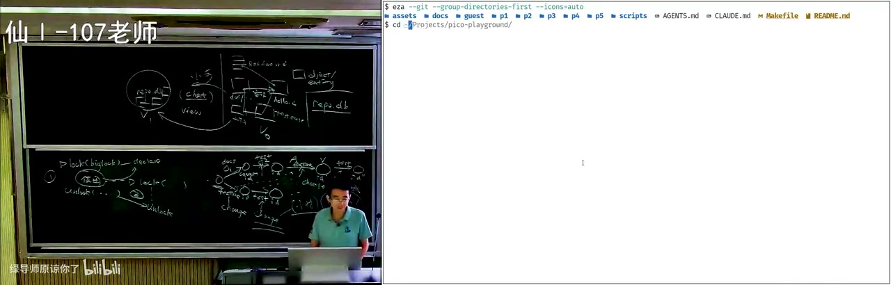
<figcaption>画面 1:08:27 · 汉诺塔只能单向移动</figcaption>
</figure>

他插了一个网上刷到的题：汉诺塔加一个额外要求——所有盘子只能往一个方向移动，两个盘子还行，三个盘子用常规解法就做不到了。最优解是盯着最大的盘子，它总得向右移一格、再向右移一格，剩下的靠归纳法递归保证最优。这题是小学生考级难度，但他真正要讲的是把它做成产品：卖给小学生，代码可以随时编辑，可视化随代码动，写错了能定位到出错的那一条语句；增值服务是 AI 助教，点「我要助教」就开始烧 token，按高于原价的 token 费记账，因为他能把自己这个老教师蒸馏成独门 prompt、给出个性化指导。要做这个信息系统，就有了学生和 AI 聊出来的那版设计。

### 1:14:30–1:18:10 · 不要数据库，要 git 管版本

<figure>
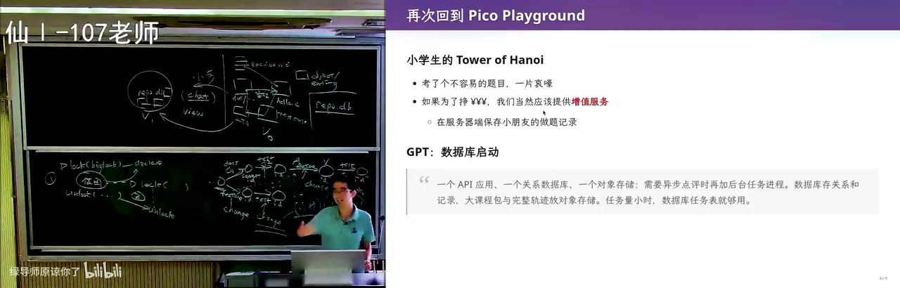
<figcaption>画面 1:14:32 · 不要数据库，要 git 管版本</figcaption>
</figure>

他转述那版设计的原话：一个 API 应用、一个关系数据库、一个对象存储，异步点评再加后台任务进程；课程包与完整轨迹放对象存储，任务量小时数据库任务表就够用——这是软件工程课上最正常的答案，但他不喜欢。他拿 Overleaf 举例：它能把项目导出成 git repo，克隆到本地让 codex 为每个 .tex 文件起子任务修语法，比忍受网页界面舒服得多；放到 playground 上，学生每改一次、点一次运行就自动 git commit，申请 AI 助教转圈时就从那个提交上分叉，点评作为一条分支留下。算成本的话，产生这些提交的代价远小于把其余东西 persist 下来，数据库压缩更小、性能更高，但那不是他要的，本质需求是版本管理。所以他宁可在最早阶段把小朋友的代码直接放进自己的代码库里跑 git 历史，等目录格式、commit message 格式都收敛了再迁数据库。

### 1:18:10–1:22:25 · 现场把需求直接丢给 agent

<figure>
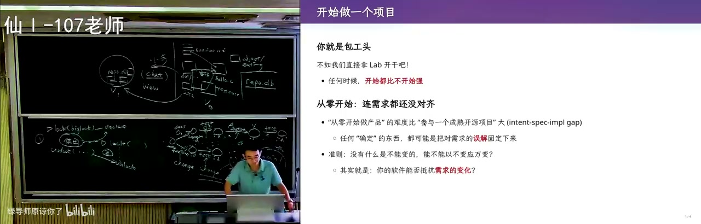
<figcaption>画面 1:18:12 · 现场把需求直接丢给 agent</figcaption>
</figure>

演示前他先给原则：项目早期不要用 multi-agent，你就是包工头，找一个你能用到的最强 agent 多轮对话，现在开始干就比什么都好。他当场打开课程作业、承认完全没准备，两种启动方式里选了直接回车，然后观察：一线模型常先进 plan mode 确认事实、再生成 workflow，像 Claude Code 会现写一段 TypeScript、里面放一个 agent 函数、用自然语言当参数，甚至带循环。结果它压根没进 plan，直接开干，每秒 300 token 的生成速度让他直呼恐怖。他也点出最危险的地方：提示词里每个词 self-attention 都会看到，AI 被训练成 prompt 的舔狗，对开放需求会过度遵循，最后交出一个满足字面指令、却不是你要的东西。

### 1:22:25–1:26:24 · 想法和规格之间的 gap

<figure>
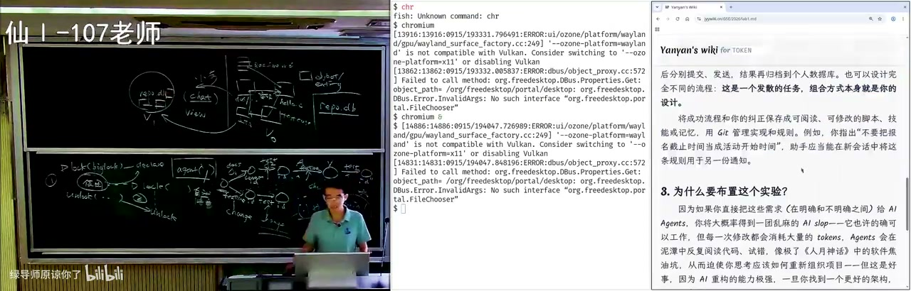
<figcaption>画面 1:22:27 · 想法和规格之间的 gap</figcaption>
</figure>

他随即点明实验要求的言外之意只有一句：实现一个持续为你工作的个人助手，其余条目都只是解读；于是问自己第一个 feature 该做什么、最近一个月最大的痛点是什么——对在座的人是高效学习与复习，最好 agent 能自动从外网收集资料、层次化归档、再给一个好用的界面。他判断 agent 十有八九没做这个，追问后果然看到它在做 database，S mail 部分完全没动。这正说明你脑袋里的 intent 和交给它的 spec 之间有巨大 gap：他举的那件线上办事，真正想要的是一个 browser use agent，能在各种网页上替他操作，具体哪个系统只是测试出口，在教务系统上做太多设计反而是过度设计。回头看它 README 里每件事都对、没有一个错误，最终得到的却是你不想要的东西——它甚至没建 git repository。

### 1:26:24–1:30:47 · 先建空仓库，再迈一小步

<figure>
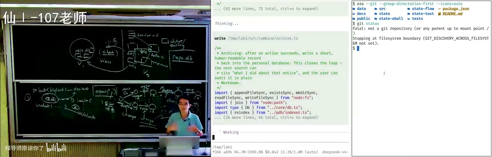
<figcaption>画面 1:26:26 · 先建空仓库，再迈一小步</figcaption>
</figure>

他借这个反例讲协作：成熟的产品经理在写下第一行代码之前，就要跟团队谈清项目怎么管、协作怎么做、每天什么时候开会，而 agent 直接上手，把它当成用一次就丢的东西。所以回到脑袋里的模型：第一件事一定是创建一个空仓库，再往前只迈一小步。现在 AI 从零做一个 slop 的难度，比它进到成熟项目里做维护性任务要小得多，而软件工程真正的要求是「以不变应万变」——你的架构能不能抵抗未来需求的根本变化。这也是他一再回到版本管理三件事的原因：记住现在、记住历史、记住教训。

### 1:30:47–1:33:57 · MVP：别做没人要的东西

<figure>
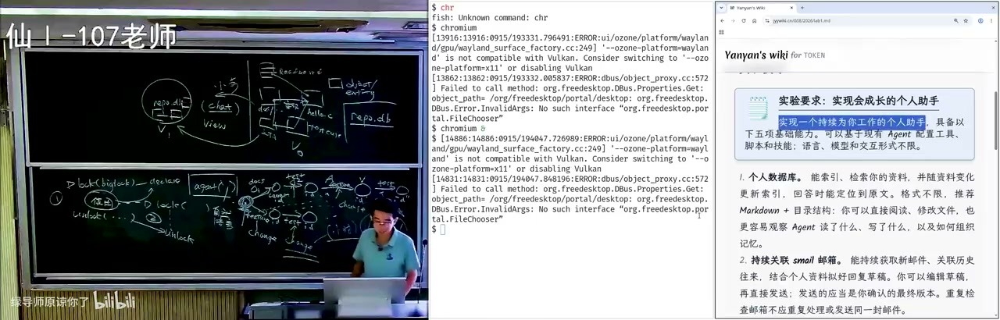
<figcaption>画面 1:30:49 · MVP：别做没人要的东西</figcaption>
</figure>

他回到 demo 看提交记录：agent 倒是做了一个提交，界面上已经能提交奖学金申请、准备退课，引擎全是真代码、手机端是真 HTTP 服务，只有邮箱部分是模拟的；架构也很典型，入口层、编排层、能力层、数据层，但它是当成一套业务逻辑系统在做，看起来已经像一个教务系统了，风险很大（他下节课就讲教务系统）。更主流的最佳实践是从零构建时先做 MVP（minimal viable product），因为 the biggest risk in product development is building something nobody wants——它做的绝大部分正好不是他要的。MVP 逼你想清楚绝对要的需求：对个人助手就是提升学习效率和工作效率这两条，想清之后第一版可以完全没有数据库。

### 1:33:57–1:38:25 · 早期 prompt 决定项目走向

<figure>
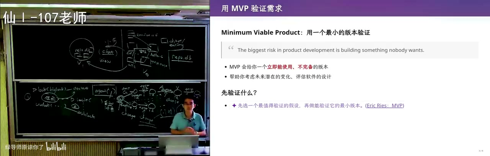
<figcaption>画面 1:33:59 · 早期 prompt 决定项目走向</figcaption>
</figure>

他接着算这笔账：一旦带上数据库，每次数据库重构都要让 agent 做迁移；而文件目录你自己在文件管理器里就能调，心智负担完全不同——人从小学电脑课就在调目录，面对 database schema 却要先做一次概念翻译，很多同学还没学过数据库课。他自己回邮件的 agent 到今天都没用数据库：agent 收邮箱、把 email id 和解析出的回复草稿、邮件分类放到共享云盘，再由下一级流水线处理，关键是先想清有哪几级流水线、它们靠什么协作，而希望邮件和资料都跟云盘同步，本身就是一次需求更改。最后他收束到两种开发方式：上来就一个大设计、拖着技术债往后加功能，还是从最小处得到一个精巧架构；他用 git 管学生的提交，直到遇到性能瓶颈才考虑迁数据库，所以最早那几句 prompt 对项目走向影响最大。下周日讲软件架构与构造，今天下课。

<!-- live:end -->

## 章节详解

### 1. 作业开场：为什么让你亲手做一遍

<figure>

<figcaption>画面 04:18 · 重新设计版本管理系统</figcaption>
</figure>

**画面解读：** 从实验一「会成长的个人助手」让你亲手踩一次焦油坑讲起，说项目是意图→规格→代码的分层、ReadMe 该短；再论证文件系统管项目是历史遗留——文档说链表、代码已换成树且无强制关联，这就是技术债与可追踪性，于是设想改成存关系的 repo.db。

**⭐ 核心：** lab1「会成长的个人助手」不限做法、选做自愿、由机器人按链接验收。目的是体验 tar pit（焦油坑）：AI 一上手就会做出很多**看着合理、却让项目越来越难维护**的决定，直到你删库重做。他预告下一个 lab 与它强冲突，逼你越改越崩。

**⚠️ 易错：** 把需求整包丢给 AI——「看起来都在能力范围内」正是陷阱。

> 💡 核心提炼：考的不是功能，是让你亲身体验一次「AI 帮你挖坑」。

### 2. 项目是什么，ReadMe 该写什么

**⭐ 核心：** 项目是文件集合，分层为 intent（做什么产品、什么效果）→ spec（数据库、语言、接口、结构）→ code。他反对 AI 写超长 ReadMe：只需初衷 + 两张截图 + 最重要的设计。

**⚠️ 易错：** 把 spec 和 intent 混进一份长文档，等于把「为什么做」稀释掉。

> 💡 核心提炼：ReadMe 是给未来合作者看的一页纸，不是给 AI 交的作业。

### 3. 文件系统的原罪

**⭐ 核心：** 用文件系统管项目纯属**历史遗留**——1950/60 年代只有文件，关系数据库还没发明。它丢失了大量不适合用文件表达的信息：一条文档里你为什么这么想、测试的输入输出与断言。

例子：AI 把链表换成树，代码干净了，但某个 markdown 里随手写着「用链表管理数据」。文档先写、代码后到，两者**没有强制关联**——这就是 technical debt。等你想追问「文档对还是代码对」，聊天记录没了、换了电脑，只剩一点变更日志，**根本判断不了**。这就是研究了很久的 **traceability（可追踪性）**：文档、测试、乃至一行代码的关联能否在演进中维持（他引 2014 年一篇综述）。

**⚠️ 易错：** 以为打压缩包发出去能撑住协作——撑不住，才有 SVN、才有 git。

> 💡 核心提炼：文件系统只是「恰好能存」，丢掉的是关联，付出的是技术债。

### 4. 未来的仓库：图数据库 + AI 生成视图

**⭐ 核心：** 如果人几乎不写代码，仓库就不该是文件树，而是**切片化的实体**：文档、实现、测试各自是 object，「实现此文档」「此测试验证此文档」是关系——一个有环的图，树状表达不了，天然该进 `repo.db`。人类没法用 UNIX 工具维护，就「用魔法打败魔法」：训练 AI 理解 repo、自动维护 artifacts 一致性。

**🔧 实操：** 小步前进时绝大部分内容与这步无关；让 AI 按 chat 把相关文件、测试、文档「摘出来」，生成**视图（view，借数据库的概念）**，以看板问你要改什么，改完从 v0 到 v1。前提是 everything is code。

**⚠️ 易错：** 他讨厌 Cursor 默认进 agent mode——那是掌控欲的冲突，不是技术判断。

> 💡 核心提炼：模型没变，变的是底层从文件树换成图、界面从文件列表换成视图。

### 5. git 的模型与裂缝

**⭐ 核心：** git 管目录快照；一次修改 = commit + 与 parent 的关系，**没有独立 change 对象，用 commit 顶替**。

裂缝一（merge）：两路合并有两个 parent，历史保住了，但 ownership 会漂——B 写的代码经 A 解决冲突后，作者追成了 A。

裂缝二（rebase）：把 B 的提交挪到 A 之后，成功则线性；一冲突「瞬间不知道该怎么办」。更麻烦的是**每搬一次就造一个新 commit 新 id**（base 变了），搬 feature 可能失败、搬 test 又失败，历史被反复改写。

> 💡 核心提炼：git 缺的不是功能，是 change 这个一等公民；缺了它，rebase 只能靠重造 commit 假装「搬一个修改」。

### 6. jj：把 change 变成一等公民

**⭐ 核心：** 底层与 git **完全兼容**（可直接当 git 用），但引入 change：rebase 搬的是 change，冲突记录跟着 change 带下去，到终点再 resolve。

**🔧 实操：** jj **没有 staging area**。他讲 git 最讨厌的场景：改到一半编译不过、导师来电话要一分钟修 bug，只能 stash；再被打断再 stash，于是要管 stash stack，还得 rebase stash。jj 近乎「改一个字节就立即 commit」，并**抹掉上一次的 commit**、用当前修改替代——你永远处于已提交状态。

**⚠️ 易错：** jj 不消灭冲突，只是把冲突装进 change 带走。

> 💡 核心提炼：git 的设计者当年没想到 rebase 影响这么大，概念模型没想干净——这是留给下一代的机会。

### 7. 慢人与快 agent

<figure>

<figcaption>画面 36:07 · 为Agent设计版本管理系统</figcaption>
</figure>

**画面解读：** git 有两道裂缝：merge 丢作者归属、rebase 每搬一次就造新 id；jj 让 change 成一等公民、改一字节即提交。再论证版本控制假设「人单核、小时级」，agent 却秒级提交，所以要 worktree、不再需要 blame、并发换成悲观锁。

**⭐ 核心：** 现有 VCS 的隐含假设是「使用者是人」，而人是 **single-core**：并发里 load/store 不能同时；人观察世界时手背在身后，要 write 时必须闭眼，读到的值已过期。所以人以**小时**为单位写代码，一个模块十几人已不小，团队最细也就 **10 分钟一个提交**；而问一句只要二三十秒，或早上开会半小时切好 scope——这就是 stash 合理的原因（打断会发生，但「修到一半再被打断」概率低，stash 通常只有一层）。

agent 呢？分钟级，上下文热时几十秒甚至几秒一个原子提交，10x~100x 团队更是秒级；即便有测试流水线门控，整体仍被加速。**git 这套为人设计的模型跟不上了。**

**🔧 实操：** 土办法是每个 agent 一台容器 + 各自 clone，主 agent（他自称 master，两个 session 叫 slave）协调、看报告；也可 codex 设计 + claude review 互相打架。更轻的是 **git worktree**：共享同一个 git 目录、各自独立提交、**本地互相可见不必 push**。他让 agent 现场演示并解释 `.git` 有两种形态：普通仓库里是目录，worktree 里是一个文本文件，内容 `gitdir:` 指向主仓库的 tree——git 最大程度复用了操作系统的机制。

**⚠️ 易错：** worktree 不解决冲突，有冲突仍要 merge/rebase。

> 💡 核心提炼：git 的形状 = 人的带宽；带宽一变，前提就塌了。

### 8. 不再需要 blame

**⭐ 核心：** 为什么需要版本管理？因为人有物理屏障（你不能理解我的思想，我只有一双手一对眼睛），沟通成本高，团队越大效率越低——100 人做不到 10 人的 10 倍，**2~3 倍就不错**，所以团队长不大，所以要快照、小步、可追溯。

但 agent team 里 **blame 失去意义**：人被 blame 多了会被开掉，agent 没有「被开除」的能力；模型还是同构克隆，同 prompt 大概率收敛到相同结果——不必知道哪个提交引入错误，**只要知道这里错了、修好它**。历史价值从「谁写错了」变成「我怎么修好」。

**⚠️ 易错：** 不是不要历史。方向走错时回退到某个 snapshot 远比往前硬修便宜，只是一般不再回头看细节。

> 💡 核心提炼：保快照、不追责；git log 从审计档案降级成演化笔记。

### 9. 并发控制换向：从乐观到悲观

**⭐ 核心：** git 像数据库的**乐观并发控制**——假设不冲突，先跑，提交时才发现问题再 rollback。这假设在教务系统里成立：每人读写自己那块数据，全局冲突概率极低。

但 agent 快百倍千倍、主位一次分出去很多任务，就更频繁触发冲突乃至死锁（两事务互等对方持有的对象）。真正的机会是换成操作系统课那种**悲观锁**：先 declare 对某 scope 的使用权（「一把大锁保平安」），锁住再改、改完 commit，别人想锁同一处就等释放；粒度可到**文件级**，避免两个 agent 同改一个测试或配置。因为 agent 够多，串行化一部分后整体仍能推进。

**⚠️ 易错：** 锁不是消灭并行，是把并行退回串行的一小段；要的是 scope 划分能力，不是无限上锁。

> 💡 核心提炼：agent 时代的 VCS = 快照 + change + 锁。这是本课最像「设计题答案」的一句。

### 10. 工具之外：真正难的是团队管理

**⭐ 核心：** 版本控制只是工具，蒸馏的是人类经验；真正难的是进度与团队管理。AI 今天仍不会做团队管理，因为**每多一个人，沟通关系平方级上升**（《人月神话》）——所以最难招的不是码农，是能把「造个微信」拆成 100 人 × 10 个小团队、拼起来还是整体的人。

**🔧 实操：** 现在就把自己当主 agent，练「怎么分解任务、什么时候提交、什么时候合并」。

> 💡 核心提炼：工具会换代，任务分解不会；平方级沟通成本是 AI 也压不平的墙。

### 11. 现场 demo：「每句都对，整体错了」

**⭐ 核心：** 他**没有预先准备**，直接把作业丢给 agent。结果做出了入口层/编排层/能力层/数据层、`assistant.db`、手机端 HTTP 服务，最后还有一个提交——但**没有邮箱、没初始化 git 仓库**，做的其实是一个「看起来像教务系统」的业务系统。原因：提示词里每个词 self-attention 都看到，模型被训成「prompt 的舔狗」会**过度遵循**；而需求是开放讨论稿，言外之意只有一句「实现一个持续为你工作的个人助手」。他要的先是 **browser-use agent**（一号只是测试出口），在教务系统上做设计属于过度设计。

**⭐ 核心：** 更该从 **MVP** 起步——*the biggest risk in product development is building something nobody wants*。他只要两条：提升学习/工作效率，所以第一版**可以没有数据库**。

**🔧 实操：** **先文件系统，别急上数据库**。目录膨胀了让 agent 一句「按这个组织提炼数据库」即可；一旦有数据库，每次重构都要迁移，而调目录的心智负担远低于调 schema。他自己的回邮件 agent 就**没有数据库**：收信 → email id 与草稿、分类放进共享云盘同步 → 下一级流水线处理。

**⚠️ 易错：** 早期 prompt 对项目走向影响最大。

> 💡 核心提炼：架构要能以不变应万变——需求根本变化时改动是否可控，这才是软件工程区别于 OS/数据库课的地方。

### 12. 收尾：版本管理就三件事

<figure>

<figcaption>画面 1:04:36 · 从零开始一个新项目</figcaption>
</figure>

**画面解读：** 现场把作业直接丢给 agent：它做出入口层、编排层、能力层和一个数据库，却没有邮箱、也没初始化仓库，成了「看着像教务系统」的业务系统——每句都对、整体错了。于是回到最小原型：先文件系统别急上数据库；收尾是记住现在、历史与教训。

**⭐ 核心：** **记住现在**（必须有 repository 把文件管起来）、**记住历史**（删掉的东西有一天要捞回来）、**记住教训**（看清自己怎么演进、怎么失败、怎么换条路）。

> 💡 核心提炼：这三件事在古法编程与 agent 时代都成立，变的是实现方式，不是目的。

## 关键数字与例子

| 数字 / 例子 | 含义 |
|---|---|
| 1950/60 年代 | 系统只给文件、关系数据库未发明 → 文件管项目是遗留 |
| 2014 年综述 | traceability 引用文献的年份（review 更早的文章） |
| 十几人 | 一个模块的团队规模，已不算小 |
| 10 分钟 | 十几人 × 小时级 ⇒ 团队最细的提交粒度 |
| 1→10→100 万→1 亿 | 用户规模扩张，spec 要回答的问题 |
| 100 / 1000 倍 | agent 比人快的量级（他先后说了两个） |
| 100 人 vs 10 人 | 效率只有 2~3 倍，不是 10 倍 |
| 3 年 | 那位研究生做「自动填表系统」做了 3 年，毕业时遇上 ChatGPT |
| 2 个 parent | merge 的父节点数；rebase 每次搬移产生新 commit id |
| 3 个盘子 | 汉诺塔「只能单向移动」变体，最优解是最大盘子总向右移一格 |

## 速查卡

| 概念 | 一句话 | 标记 |
|---|---|---|
| traceability | 文档/测试/代码的关联能否在演进中维持 | ⭐核心 |
| technical debt | 文档说链表、代码用树，且无强制关联 | ⚠️易错 |
| repo.db | 把 artifacts 与关系存成有环图，而非文件树 | ⭐核心 |
| view | AI 按当前小步摘出片段、生成看板 | 🔧实操 |
| commit ≈ change | git 无独立 change 对象，用 commit 顶替 | ⚠️易错 |
| jj | change 一等公民、无 staging area、改一字即提交 | ⭐核心 |
| stash | 「小时级提交 + 低打断率」催生的补丁设计 | ⚠️易错 |
| worktree | 共享 .git 的并行工作区，本地可见不必 push | 🔧实操 |
| 乐观 / 悲观 | git 像乐观并发；agent 时代按 scope 上锁 | ⭐核心 |
| 三件事 | 记住现在、记住历史、记住教训 | 💡收尾 |

## 我的判断

最锋利的一处不是讲 jj，而是**把工具的形状归因到人的带宽**：人 single-core、小时级、十几人就要开会，所以才有 commit、stash、blame、10 分钟粒度。这个归因一旦成立，「agent 快百倍所以 git 不够用」就不是修辞而是推论——这是全课唯一一处真正的第一性原理推导，其余多是类比。

但两处被绕过了。其一，**锁与「小步并行」矛盾**：他自己说「一把大锁保平安的本质是不要并行」，又说 agent 多所以整体仍快，中间缺「scope 怎么切才不互相等待」——而那正是他承认最难招的能力，难题只是搬了个位置。其二，「不再需要 blame」依赖「同构克隆会收敛」，可同一段里他也说「模型还有不确定性」：真收敛则多 agent 互审价值存疑，不收敛则「不必知道哪个提交引入错误」只是安慰。现场 demo 正好印证：每句都对、整体不要，这种偏差**没有任何一个 commit 该背锅，项目已经偏了**。

jj 那段漂亮但偏教学：「从 change 是一等公民就能自己发明 VCS」是好 prompt，不是证明。最后那句「你们还没形成肌肉记忆，直接用对的设计」最实用，也最易被误读成「不用学 git」——他讲的两小时恰恰全是 git 的模型。
