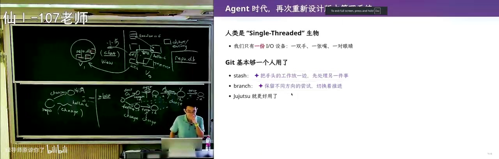

# 软件仓库管理（2）：git 的裂缝与 agent 时代的版本管理

> 从「文件系统为什么管不好项目」讲到 git 的裂缝、jj 把 change 变成一等公民，最后推演：当提交从「人·小时」变成「agent·秒」，版本控制该换一套并发控制模型。

## 一句话结论

版本控制系统是为「单核、慢速、要开会」的人类设计的；git 已露裂缝（merge 丢作者归属、rebase 全换 commit id、stash 难管），jj 用「change 是一等公民」补一刀，而 agent 时代的答案是：**乐观并发换成悲观锁，只保快照、不再 blame**。

## 官方章节时间轴

| 时间 | 章节 |
|---|---|
| 00:00–35:53 | 重新设计版本管理系统 |
| 35:53–1:03:48 | 为Agent设计版本管理系统 |
| 1:03:48–1:38:29 | 从零开始一个新项目 |

## 分段大纲

| 序号 | 章节 | 核心内容 |
|---|---|---|
| 1 | 作业开场 | lab1 个人助手；让你亲手踩一遍焦油坑 |
| 2 | 项目是什么 | intent → spec → code；ReadMe 宜短 |
| 3 | 文件系统的原罪 | 历史遗留 + 关联丢失 → 技术债与 traceability |
| 4 | 未来的仓库 | 实体关系图落进 repo.db；AI 生成视图 |
| 5 | git 的裂缝 | 两路 merge 作者漂移、rebase 造新 id |
| 6 | jj | change 一等公民、无 staging、改一字即提交 |
| 7 | 慢人与快 agent | 小时级 → 秒级；worktree 的意外价值 |
| 8 | 不再 blame | agent 不会被开除；历史从追责变修复 |
| 9 | 并发换向 | git 像乐观并发；agent 时代该上锁 |
| 10 | 工具之外 | 难的是任务分解与人月神话 |
| 11 | 现场 demo | 「每句都对，整体错了」；MVP 与文件优先 |
| 12 | 收尾 | 记住现在、历史、教训 |

## 章节详解

### 1. 作业开场：为什么让你亲手做一遍

<figure>

<figcaption>00:00 · 重新设计版本管理系统</figcaption>
</figure>

**画面解读：** 从实验一「会成长的个人助手」让你亲手踩一次焦油坑讲起，说项目是意图→规格→代码的分层、ReadMe 该短；再论证文件系统管项目是历史遗留——文档说链表、代码已换成树且无强制关联，这就是技术债与可追踪性，于是设想改成存关系的 repo.db。

⭐核心：lab1「会成长的个人助手」不限做法、选做自愿、由机器人按链接验收。目的是体验 tar pit（焦油坑）：AI 一上手就会做出很多**看着合理、却让项目越来越难维护**的决定，直到你删库重做。他预告下一个 lab 与它强冲突，逼你越改越崩。

⚠️易错：把需求整包丢给 AI——「看起来都在能力范围内」正是陷阱。

> 💡 核心提炼：考的不是功能，是让你亲身体验一次「AI 帮你挖坑」。

### 2. 项目是什么，ReadMe 该写什么

⭐核心：项目是文件集合，分层为 intent（做什么产品、什么效果）→ spec（数据库、语言、接口、结构）→ code。他反对 AI 写超长 ReadMe：只需初衷 + 两张截图 + 最重要的设计。

⚠️易错：把 spec 和 intent 混进一份长文档，等于把「为什么做」稀释掉。

> 💡 核心提炼：ReadMe 是给未来合作者看的一页纸，不是给 AI 交的作业。

### 3. 文件系统的原罪

⭐核心：用文件系统管项目纯属**历史遗留**——1950/60 年代只有文件，关系数据库还没发明。它丢失了大量不适合用文件表达的信息：一条文档里你为什么这么想、测试的输入输出与断言。

例子：AI 把链表换成树，代码干净了，但某个 markdown 里随手写着「用链表管理数据」。文档先写、代码后到，两者**没有强制关联**——这就是 technical debt。等你想追问「文档对还是代码对」，聊天记录没了、换了电脑，只剩一点变更日志，**根本判断不了**。这就是研究了很久的 **traceability（可追踪性）**：文档、测试、乃至一行代码的关联能否在演进中维持（他引 2014 年一篇综述）。

⚠️易错：以为打压缩包发出去能撑住协作——撑不住，才有 SVN、才有 git。

> 💡 核心提炼：文件系统只是「恰好能存」，丢掉的是关联，付出的是技术债。

### 4. 未来的仓库：图数据库 + AI 生成视图

⭐核心：如果人几乎不写代码，仓库就不该是文件树，而是**切片化的实体**：文档、实现、测试各自是 object，「实现此文档」「此测试验证此文档」是关系——一个有环的图，树状表达不了，天然该进 `repo.db`。人类没法用 UNIX 工具维护，就「用魔法打败魔法」：训练 AI 理解 repo、自动维护 artifacts 一致性。

🔧实操：小步前进时绝大部分内容与这步无关；让 AI 按 chat 把相关文件、测试、文档「摘出来」，生成**视图（view，借数据库的概念）**，以看板问你要改什么，改完从 v0 到 v1。前提是 everything is code。

⚠️易错：他讨厌 Cursor 默认进 agent mode——那是掌控欲的冲突，不是技术判断。

> 💡 核心提炼：模型没变，变的是底层从文件树换成图、界面从文件列表换成视图。

### 5. git 的模型与裂缝

⭐核心：git 管目录快照；一次修改 = commit + 与 parent 的关系，**没有独立 change 对象，用 commit 顶替**。

裂缝一（merge）：两路合并有两个 parent，历史保住了，但 ownership 会漂——B 写的代码经 A 解决冲突后，作者追成了 A。

裂缝二（rebase）：把 B 的提交挪到 A 之后，成功则线性；一冲突「瞬间不知道该怎么办」。更麻烦的是**每搬一次就造一个新 commit 新 id**（base 变了），搬 feature 可能失败、搬 test 又失败，历史被反复改写。

> 💡 核心提炼：git 缺的不是功能，是 change 这个一等公民；缺了它，rebase 只能靠重造 commit 假装「搬一个修改」。

### 6. jj：把 change 变成一等公民

⭐核心：底层与 git **完全兼容**（可直接当 git 用），但引入 change：rebase 搬的是 change，冲突记录跟着 change 带下去，到终点再 resolve。

🔧实操：jj **没有 staging area**。他讲 git 最讨厌的场景：改到一半编译不过、导师来电话要一分钟修 bug，只能 stash；再被打断再 stash，于是要管 stash stack，还得 rebase stash。jj 近乎「改一个字节就立即 commit」，并**抹掉上一次的 commit**、用当前修改替代——你永远处于已提交状态。

⚠️易错：jj 不消灭冲突，只是把冲突装进 change 带走。

> 💡 核心提炼：git 的设计者当年没想到 rebase 影响这么大，概念模型没想干净——这是留给下一代的机会。

### 7. 慢人与快 agent

<figure>

<figcaption>35:53 · 为Agent设计版本管理系统</figcaption>
</figure>

**画面解读：** git 有两道裂缝：merge 丢作者归属、rebase 每搬一次就造新 id；jj 让 change 成一等公民、改一字节即提交。再论证版本控制假设「人单核、小时级」，agent 却秒级提交，所以要 worktree、不再需要 blame、并发换成悲观锁。

⭐核心：现有 VCS 的隐含假设是「使用者是人」，而人是 **single-core**：并发里 load/store 不能同时；人观察世界时手背在身后，要 write 时必须闭眼，读到的值已过期。所以人以**小时**为单位写代码，一个模块十几人已不小，团队最细也就 **10 分钟一个提交**；而问一句只要二三十秒，或早上开会半小时切好 scope——这就是 stash 合理的原因（打断会发生，但「修到一半再被打断」概率低，stash 通常只有一层）。

agent 呢？分钟级，上下文热时几十秒甚至几秒一个原子提交，10x~100x 团队更是秒级；即便有测试流水线门控，整体仍被加速。**git 这套为人设计的模型跟不上了。**

🔧实操：土办法是每个 agent 一台容器 + 各自 clone，主 agent（他自称 master，两个 session 叫 slave）协调、看报告；也可 codex 设计 + claude review 互相打架。更轻的是 **git worktree**：共享同一个 git 目录、各自独立提交、**本地互相可见不必 push**。他让 agent 现场演示并解释 `.git` 有两种形态：普通仓库里是目录，worktree 里是一个文本文件，内容 `gitdir:` 指向主仓库的 tree——git 最大程度复用了操作系统的机制。

⚠️易错：worktree 不解决冲突，有冲突仍要 merge/rebase。

> 💡 核心提炼：git 的形状 = 人的带宽；带宽一变，前提就塌了。

### 8. 不再需要 blame

⭐核心：为什么需要版本管理？因为人有物理屏障（你不能理解我的思想，我只有一双手一对眼睛），沟通成本高，团队越大效率越低——100 人做不到 10 人的 10 倍，**2~3 倍就不错**，所以团队长不大，所以要快照、小步、可追溯。

但 agent team 里 **blame 失去意义**：人被 blame 多了会被开掉，agent 没有「被开除」的能力；模型还是同构克隆，同 prompt 大概率收敛到相同结果——不必知道哪个提交引入错误，**只要知道这里错了、修好它**。历史价值从「谁写错了」变成「我怎么修好」。

⚠️易错：不是不要历史。方向走错时回退到某个 snapshot 远比往前硬修便宜，只是一般不再回头看细节。

> 💡 核心提炼：保快照、不追责；git log 从审计档案降级成演化笔记。

### 9. 并发控制换向：从乐观到悲观

⭐核心：git 像数据库的**乐观并发控制**——假设不冲突，先跑，提交时才发现问题再 rollback。这假设在教务系统里成立：每人读写自己那块数据，全局冲突概率极低。

但 agent 快百倍千倍、主位一次分出去很多任务，就更频繁触发冲突乃至死锁（两事务互等对方持有的对象）。真正的机会是换成操作系统课那种**悲观锁**：先 declare 对某 scope 的使用权（「一把大锁保平安」），锁住再改、改完 commit，别人想锁同一处就等释放；粒度可到**文件级**，避免两个 agent 同改一个测试或配置。因为 agent 够多，串行化一部分后整体仍能推进。

⚠️易错：锁不是消灭并行，是把并行退回串行的一小段；要的是 scope 划分能力，不是无限上锁。

> 💡 核心提炼：agent 时代的 VCS = 快照 + change + 锁。这是本课最像「设计题答案」的一句。

### 10. 工具之外：真正难的是团队管理

⭐核心：版本控制只是工具，蒸馏的是人类经验；真正难的是进度与团队管理。AI 今天仍不会做团队管理，因为**每多一个人，沟通关系平方级上升**（《人月神话》）——所以最难招的不是码农，是能把「造个微信」拆成 100 人 × 10 个小团队、拼起来还是整体的人。

🔧实操：现在就把自己当主 agent，练「怎么分解任务、什么时候提交、什么时候合并」。

> 💡 核心提炼：工具会换代，任务分解不会；平方级沟通成本是 AI 也压不平的墙。

### 11. 现场 demo：「每句都对，整体错了」

⭐核心：他**没有预先准备**，直接把作业丢给 agent。结果做出了入口层/编排层/能力层/数据层、`assistant.db`、手机端 HTTP 服务，最后还有一个提交——但**没有邮箱、没初始化 git 仓库**，做的其实是一个「看起来像教务系统」的业务系统。原因：提示词里每个词 self-attention 都看到，模型被训成「prompt 的舔狗」会**过度遵循**；而需求是开放讨论稿，言外之意只有一句「实现一个持续为你工作的个人助手」。他要的先是 **browser-use agent**（一号只是测试出口），在教务系统上做设计属于过度设计。

⭐核心：更该从 **MVP** 起步——*the biggest risk in product development is building something nobody wants*。他只要两条：提升学习/工作效率，所以第一版**可以没有数据库**。

🔧实操：**先文件系统，别急上数据库**。目录膨胀了让 agent 一句「按这个组织提炼数据库」即可；一旦有数据库，每次重构都要迁移，而调目录的心智负担远低于调 schema。他自己的回邮件 agent 就**没有数据库**：收信 → email id 与草稿、分类放进共享云盘同步 → 下一级流水线处理。

⚠️易错：早期 prompt 对项目走向影响最大。

> 💡 核心提炼：架构要能以不变应万变——需求根本变化时改动是否可控，这才是软件工程区别于 OS/数据库课的地方。

### 12. 收尾：版本管理就三件事

<figure>

<figcaption>1:03:48 · 从零开始一个新项目</figcaption>
</figure>

**画面解读：** 现场把作业直接丢给 agent：它做出入口层、编排层、能力层和一个数据库，却没有邮箱、也没初始化仓库，成了「看着像教务系统」的业务系统——每句都对、整体错了。于是回到最小原型：先文件系统别急上数据库；收尾是记住现在、历史与教训。

⭐核心：**记住现在**（必须有 repository 把文件管起来）、**记住历史**（删掉的东西有一天要捞回来）、**记住教训**（看清自己怎么演进、怎么失败、怎么换条路）。

> 💡 核心提炼：这三件事在古法编程与 agent 时代都成立，变的是实现方式，不是目的。

## 关键数字与例子

| 数字 / 例子 | 含义 |
|---|---|
| 1950/60 年代 | 系统只给文件、关系数据库未发明 → 文件管项目是遗留 |
| 2014 年综述 | traceability 引用文献的年份（review 更早的文章） |
| 十几人 | 一个模块的团队规模，已不算小 |
| 10 分钟 | 十几人 × 小时级 ⇒ 团队最细的提交粒度 |
| 1→10→100 万→1 亿 | 用户规模扩张，spec 要回答的问题 |
| 100 / 1000 倍 | agent 比人快的量级（他先后说了两个） |
| 100 人 vs 10 人 | 效率只有 2~3 倍，不是 10 倍 |
| 3 年 | 那位研究生做「自动填表系统」做了 3 年，毕业时遇上 ChatGPT |
| 2 个 parent | merge 的父节点数；rebase 每次搬移产生新 commit id |
| 3 个盘子 | 汉诺塔「只能单向移动」变体，最优解是最大盘子总向右移一格 |

## 速查卡

| 概念 | 一句话 | 标记 |
|---|---|---|
| traceability | 文档/测试/代码的关联能否在演进中维持 | ⭐核心 |
| technical debt | 文档说链表、代码用树，且无强制关联 | ⚠️易错 |
| repo.db | 把 artifacts 与关系存成有环图，而非文件树 | ⭐核心 |
| view | AI 按当前小步摘出片段、生成看板 | 🔧实操 |
| commit ≈ change | git 无独立 change 对象，用 commit 顶替 | ⚠️易错 |
| jj | change 一等公民、无 staging area、改一字即提交 | ⭐核心 |
| stash | 「小时级提交 + 低打断率」催生的补丁设计 | ⚠️易错 |
| worktree | 共享 .git 的并行工作区，本地可见不必 push | 🔧实操 |
| 乐观 / 悲观 | git 像乐观并发；agent 时代按 scope 上锁 | ⭐核心 |
| 三件事 | 记住现在、记住历史、记住教训 | 💡收尾 |

## 我的判断

最锋利的一处不是讲 jj，而是**把工具的形状归因到人的带宽**：人 single-core、小时级、十几人就要开会，所以才有 commit、stash、blame、10 分钟粒度。这个归因一旦成立，「agent 快百倍所以 git 不够用」就不是修辞而是推论——这是全课唯一一处真正的第一性原理推导，其余多是类比。

但两处被绕过了。其一，**锁与「小步并行」矛盾**：他自己说「一把大锁保平安的本质是不要并行」，又说 agent 多所以整体仍快，中间缺「scope 怎么切才不互相等待」——而那正是他承认最难招的能力，难题只是搬了个位置。其二，「不再需要 blame」依赖「同构克隆会收敛」，可同一段里他也说「模型还有不确定性」：真收敛则多 agent 互审价值存疑，不收敛则「不必知道哪个提交引入错误」只是安慰。现场 demo 正好印证：每句都对、整体不要，这种偏差**没有任何一个 commit 该背锅，项目已经偏了**。

jj 那段漂亮但偏教学：「从 change 是一等公民就能自己发明 VCS」是好 prompt，不是证明。最后那句「你们还没形成肌肉记忆，直接用对的设计」最实用，也最易被误读成「不用学 git」——他讲的两小时恰恰全是 git 的模型。
