# 软件工程的来龙去脉 [05-Raw/26生成式软件工程/NJU]

> 从 1968 年北约会议和 Royce 那篇被误读成「瀑布」的论文讲起：软件工程为什么诞生、它的 first principle 是什么，以及 AI 已经能写代码的今天，这套智慧还剩多少。

## 一句话结论

软件工程诞生于 intent（想要什么）→ specification（写下来的规格）→ implementation（代码）三者之间的 gap，而需求本身是拍脑袋想出来、客户自己也说不清的，所以全部方法学的本质只有一条：**把发现问题的时间点提前**。AI 抹平了「自然语言对不齐」和「checklist 不好查」，但这个 gap 还在，所以这门课仍然成立。

## 官方章节时间轴

| 时间 | 章节 |
|---|---|
| 00:00–17:37 | 新闻播报 |
| 17:37–39:01 | 回到软件开发 |
| 39:01–1:15:06 | 从软件危机到软件工程 |
| 1:15:06–1:39:59 | 软件工程给世界带来了什么 |

## 分段大纲

| 序号 | 章节 | 核心内容 |
|---|---|---|
| 1 | 课前新闻：实时决策模型 | 百毫秒级小模型玩 Doom，打开「实时决策」赛道 |
| 2 | AI 七十年加速史 | 1956→2024 时间轴；新 scaling 维度是「数据分布工程」 |
| 3 | 基模厂与学术界的裂缝 | RSI 闭环、建实验室即涨能力、peer review 面临崩溃 |
| 4 | 回到软件：三件东西的 gap | MVP 策略、标签打印机与扫描仪的 self-service |
| 5 | 软件公司会消亡吗 | 驱动与 APP 沦为接口，豆包手机与阿里 agent 化 |
| 6 | 软件工程为什么诞生 | 1960s 硬件贵、客户不懂、需求拍脑袋、三失控 |
| 7 | 三篇一手文献 | Dijkstra 1968 goto、1972 Humble Programmer、Royce 1970 |
| 8 | 学科沉淀与语言光谱 | checklist、traceability、契约、QuickCheck、UML、形式化 |
| 9 | 知识获取方式变了 | 一手文献取代教科书的有损压缩 |

<!-- live:start -->
## 课堂实录（按时间顺序）

### 00:00–03:20 · 开场：百毫秒的实时决策

<figure>

<figcaption>画面 00:24 · 开场：百毫秒的实时决策</figcaption>
</figure>

这节课正式进入软件工程部分，上一节讲的版本管理只是收尾。开场分享的新闻是一个能实时玩《Doom》的模型：把游戏状态转成一段 JSON 喂进去，它在毫秒到百毫秒级只输出一个决策 token，作者给它起名叫 system one，意思是真的做人一样的实时决策。讲者猜它不是普通大模型，而是经过专门微调、介于大语言模型和旧式决策树之间的东西——不说人话，但能干活。

### 03:20–08:12 · 实时赛道与七十年加速史

<figure>

<figcaption>画面 03:22 · 实时赛道与七十年加速史</figcaption>
</figure>

真正的变量是延迟：能把决策压到 100 毫秒、乐观一点 50 毫秒，就可以用它实时生成脸上的微表情、做出「有人的感觉」，连哄婴儿睡觉这种难题都可解，所以这条赛道被正式打开了。随后是一段完全由 GPT-6 生成的七十年加速史，从 1956 到 1960 年感知与规划机器走出实验室、70 到 90 年代的寒冬、1997 年搜索算法首次击败人类世界冠军，一路到 2012 年 AlexNet、2016 年 AlphaGo（他在现场看的直播）、2017 年 Transformer、2020 年 GPT-3、2022 年 ChatGPT 爆发、2024 年 Sora，再到 2024 年 9 月的 o1。他也顺势指出，YouTube 和 B 站上的素材本来就能批量下载，等于握住了「所有东西的入口」，这让创造任何东西都变得很容易。

### 08:12–12:10 · 模型的品味与可验证的边界

<figure>

<figcaption>画面 08:14 · 模型的品味与可验证的边界</figcaption>
</figure>

加速的另一面是短板：Noam Brown 在访谈里说，模型真正缺的是品味，也就是「接下来该做什么」的直觉——它被训练成了 prompt 的舔狗，你让它做什么它就拼命做，还有 reward hacking 的倾向，用最快最脏的方式交差，因为只有交差才有 reward。可验证与不可验证的边界也没那么清楚，数学看似可验证，但从自然语言问题到形式化问题之间还有 gap，就像那个笑话：有人号称证明了 P=NP，最后发现定义本身是空的，几千页证明只证出了「一等于一」。所以讲者判断 the bitter lesson 到今天还没停，OpenAI 摸到的门道是数据分布工程——GPT-6 的空间推理强，是因为训练和后训练的强化学习里都注入了这类数据，不再是单纯堆语料，比如 Anthropic 去买书、烧书来拿绝版数据。

### 12:10–17:24 · 每加一个新领域数据反而更少

<figure>

<figcaption>画面 12:12 · 每加一个新领域数据反而更少</figcaption>
</figure>

顺着数据分布往下推，他注意到训练顺序上的差别：模型是先学语言、再学数学、再多模态，学会数学之后才掌握空间关系，人恰好相反，是先有世界模型才会说话，但只要有足够数据和 scaling law，两种顺序都能训成。更关键的是基座越大，再补空间感知需要的反而更少——不会像小模型那样被模拟器里一个像素的亮暗骗出 reward hack，而是能泛化，所以每加一个新领域，需要的数据不是更多而是更少。飞轮于是只关心「什么分布的数据、什么比例、什么时候注入」，模型结构和算法都不重要，只要训练不崩、推理时参数一致，有钱就能一直 scale 下去。

### 17:24–21:40 · 递归自我改进与斩杀线

<figure>

<figcaption>画面 17:26 · 递归自我改进与斩杀线</figcaption>
</figure>

这套飞轮的代价落在学术圈：顶会投稿数量到了新的巅峰，但基模厂已经不 care，小规模实验对他们没有意义——你碰不到那个数据分布，有好想法写个 blog post 就够了，他们的 AI 看到就会拿到自己的数据上试。他们真正在搭的是 RSI，也就是递归自我改进的闭环，Anthropic 甚至要建 wet lab 做生物实验，每新建一个实验室、投几十亿美元，模型能力就上一个台阶，所以「随机想 idea、投稿、peer review」这条链被判很快要崩。讲者随后把话题收回课堂：人类是竞争社会，斩杀线在往上移，但软件的根本难题仍是 intent、specification、implementation 之间的 gap。今天能给出的第一个答案是先做 MVP——他当晚就用 AI 生成了整套 slop，做了一个能把标签真正打出来的东西，因为 MVP 不花钱又能随时扔掉，唯一目的是逼出 intent 哪里没想对。

### 21:40–25:25 · 打印机扫描仪的设备抽象

<figure>

<figcaption>画面 21:42 · 打印机扫描仪的设备抽象</figcaption>
</figure>

他接着解释这层东西怎么被抽象出来：所有设备自带的软件都难用到不能忍，于是干脆全部屏蔽，用 AI 重新做一层——扫描仪只留一个 scan 接口（正面还是反面、单面还是双面、dpi 多少），打印机只留一个 print。这正是操作系统课上设备驱动的思路，把设备抽象成 read/write/ioctl，上层软件只依赖接口，设计和实现就此解开，变成 self-service；他顺手把五小时额度几乎用光，做出来的东西已经接近食堂、宿舍楼下那种产品级。真正的难点是那台没人认识的杂牌热转印打印机：碳粉袋在有像素的位置加热把粉烫上去，有个参数叫加热深度，谁也不知道该设多少，于是 AI 打一张就问一句「淡了还是浓了」，打到第 15 次才调对；一开始想走厂商自己的打印语言，后来发现直接拿通用 PCL 驱动当普通打印机打就行，而且只要目标是可验收的结果，接个摄像头连人都不需要。

### 25:25–30:20 · APP 沦为接口与软件公司消亡

<figure>
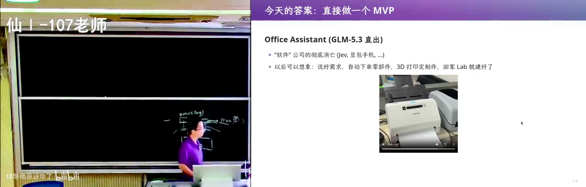
<figcaption>画面 25:27 · APP 沦为接口与软件公司消亡</figcaption>
</figure>

软件公司为什么「彻底消亡」，这里有了具体的账：一台卖几百块的标签打印机，硬件靠中国供应链并不贵，成本大头是 Windows 驱动加 Mac 驱动这些软件，而 AI 把这块打到接近零，连打印机参数和标签都能按你最舒服的方式定制，因为生产 intelligence 的成本会非常低。往上一层就是豆包手机的做法——APP 不重要了，都抽象成接口交给 computer use 去调，点外卖时应用就沦为一个点外卖的接口，只留一个查询数据的 API 给 agent；阿里也在把旗下服务往 agent 里整合，只是千问被评「生不逢时」，产品推得太早、算力和模型速度都不够，拿出来的更像未来半成品。这也意味着产业链上的人得重新找位置：一个细分市场里，硬件、外包、驱动开发养活了多少人。他给下一个实验埋了伏笔：让你们的 assistant 去驱动自己的物理设备，他办公室那块电子墨水屏是 Android app 烧写、极度难用，他直接把 APK 丢给模型逆向蓝牙协议，照样把屏点亮——软件工程的智慧没消失，只是换了用法。

### 30:20–34:20 · 1960 年代：硬件贵、码农贵

<figure>
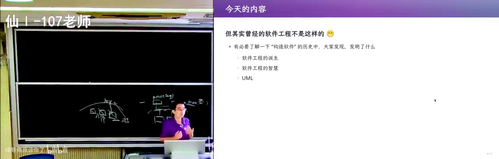
<figcaption>画面 30:22 · 1960 年代：硬件贵、码农贵</figcaption>
</figure>

正式进入历史：1960 年硬件比码农贵得多，一台计算机占一大间房，因为大家还不太会造计算机，只能猛堆料、不敢偷工减料，不像今天 iPhone 18 Pro 敢用 QLC 闪存，反正数据让你放 iCloud。码农更是高智力工种，写机器码、汇编不画流程图根本写不下去，就像今天让大模型直接吐二进制汇编也做不到。而且这批人数学训练太重，多少缺一点对客户的同理心和对商业的理解，可软件公司恰恰要负责把 implementation 和 intent 之间的 gap 补上——合同上写的是「一千万美元给你开发一个操作系统」，客户却根本不知道计算机能做什么，政府官员、要把人送上月球的 NASA、要飞控系统的人，都说不清自己想要什么。

### 34:20–39:00 · 1968 年的畅想与选课系统

<figure>
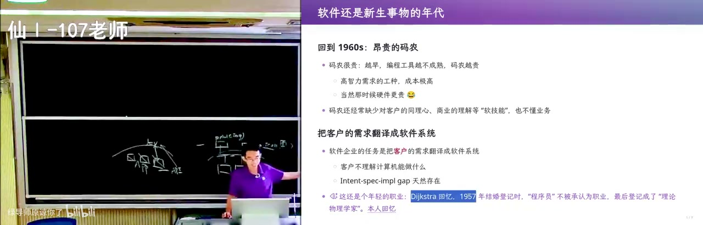
<figcaption>画面 34:22 · 1968 年的畅想与选课系统</figcaption>
</figure>

1957 年一位程序员结婚登记时，「程序员」还不算一个职业，最后被登记成理论物理学家，可见这行多年轻。可客户对软件的遐想已经过度：1968 年《Boys' Life》九月号就在畅想终端即时判分、针对薄弱环节辅导、让学生按自己的节奏学习，到今天也没完全实现，你们还在这里上每节 50 分钟的课。这个 gap 之所以天生比别的工程大，是因为桥梁、炼钢受自然规律约束，材料强度出厂时就定了，只能一代一代做增量改进，而软件是物理世界需求在信息世界里的投影，需求本身是拍脑袋想出来的。最典型的例子是选课系统：先到先得、抽签还是按专业保留名额，先修课是硬限制还是能被特批，最后差一门课毕不了业时学校会不会给你开口子。

### 39:00–42:50 · 从 goto 有害到可读性

<figure>
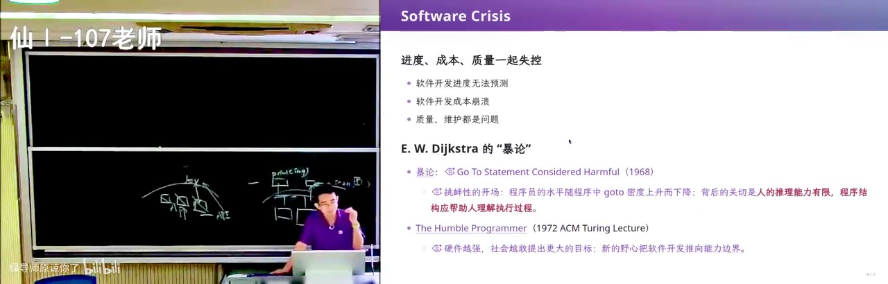
<figcaption>画面 39:02 · 从 goto 有害到可读性</figcaption>
</figure>

那个年代的问题是进度、成本、质量一起失控：开发进度无法预测、成本崩溃、交付延期。Dijkstra 的《Go To Statement Considered Harmful》常被简化成「goto 有害」，但他讨论的其实是可读性——程序员水平随 goto 密度上升而下降，而只有人能读懂代码，代码才有可能维护下去。反例就在 Linux 内核里：大量 goto release，函数里申请的每一份资源都在 release 处逐个检查释放，中途想退出也只能跳过去，这恰恰是「正确地使用 goto」，顺便治好了大家做 OJ 时随手申请、从不释放的坏习惯。

### 42:50–47:20 · 谦卑的程序员与阿波罗代码

<figure>
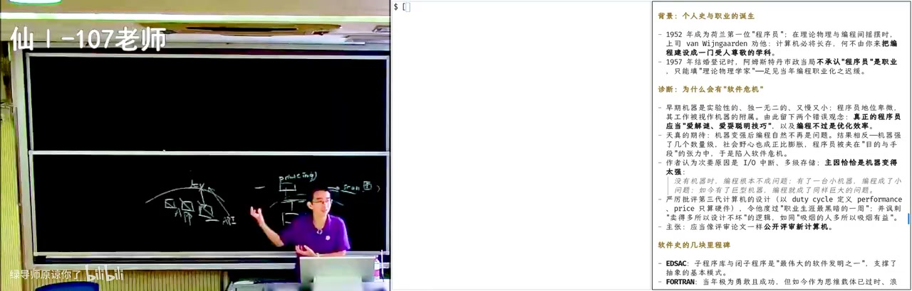
<figcaption>画面 42:52 · 谦卑的程序员与阿波罗代码</figcaption>
</figure>

1972 年 Dijkstra 的图灵奖演讲《The Humble Programmer》现在可以直接读原文：永远写 OJ 小程序就不会有软件危机，因为调对一次就再也不用维护；可机器越强，软件要承担的 intent 越多，不确定性越大，实现就越复杂。他提出的 nicely factored solutions，讲者说自己在驱动标签打印机和扫描仪时也在不断做同样的事，而他另一句话更狠——保守力量主要来自教育机构和舍不得重写旧程序的用户。1968 年的北约会议与汉密尔顿的团队差不多同时把 software engineering 这个词立了起来，那张 1969 年阿波罗代码的照片就是学科诞生的标志；他们的做法就是防御性编程，连「绝不会发生」的假设也当成可能，硬件不可靠就留兜底。

### 47:20–51:20 · 把不会发生的事当成可能

<figure>
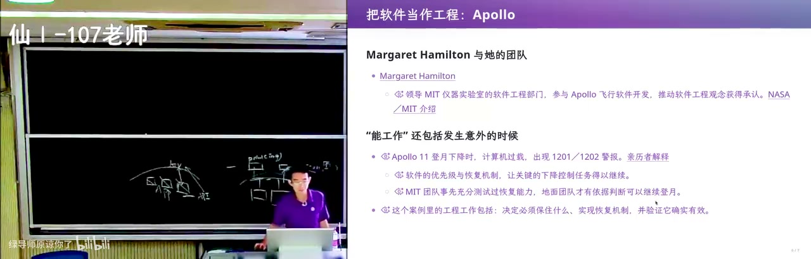
<figcaption>画面 47:22 · 把不会发生的事当成可能</figcaption>
</figure>

这份防御不是空谈：阿波罗 11 号登月下降时出过警报，靠软件里的优先级和 recovery，关键的下降控制任务才得以继续，那时还没有软件工程，他们是从 first principle 推的——「绝不会发生的事，也会发生」。于是软件工程有了定义：在成本、时间的约束下，把人的意图变成能工作、能维护、能随时间演进的东西；IEEE 的说法是一套系统的、可量化的、覆盖整个生命周期的工程方法，把个人英雄主义换成一张 checklist，全部打勾不能保证成功，但能大幅降低失败概率，这些经验是拿数亿美金和炸掉的火箭换来的。所以你们做 OJ 时那个隐藏假设就很危险：你假设题目是对的、条件不会变、题目不会变成另一道题，反复强化就会 overfit，而真实世界是开放的。也因此接到任务不能直接喊「大家去干吧」——他自己同时开两个窗口，一个管打印机、一个管扫描仪，任务划分本身就是软件工程。

### 51:20–55:30 · 瀑布模型的出处与被误读

<figure>
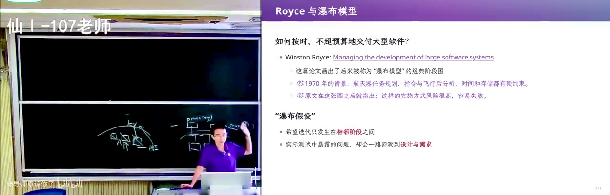
<figcaption>画面 51:22 · 瀑布模型的出处与被误读</figcaption>
</figure>

1970 年还没有 MVP、没有大模型，Royce 那篇《Managing the Development of Large Software Systems》要回答的是怎么按时、不超预算地交付大型软件。讲者顺手打开浏览器在百度搜「瀑布模型」，屏幕上那张从上到下的图就是所有人软件工程课上都见过的瀑布图，出处正是这篇文章；他读文章的方式也变了——把 PDF 丢给 agent 入库，生成带图的 markdown 整理版，再用命令行工具直接在终端里读论文、提图片。有意思的地方在这：所有人都学瀑布模型，可这篇文章恰恰是在批判瀑布模型，所以一个东西被反复消化几手之后，你拿到的可能已经不是原来那个东西了，而 1970 年的人什么都没有，只能从 first principle 想。

### 55:30–59:40 · 测试是第一个物理事件

<figure>
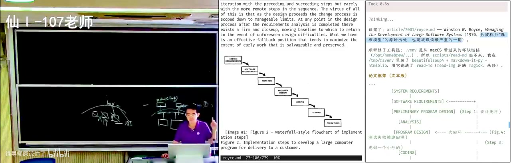
<figcaption>画面 55:32 · 测试是第一个物理事件</figcaption>
</figure>

那张经典图是需求、系统需求、软件需求、分析、设计、代码、测试、上线，Royce 说小到一个人自己用、两步就够了，你们做 OJ 的实践其实对得上；但他真正的 first principle 是：测试是整条链上第一个物理事件，在它之前全是不能运行的文档。文档你只是「写了」，没人能保证它和代码、和设计一致——就像你们写实验文档，最多是 best effort，改了代码文档照旧放在那儿。一旦 intent 到 specification 到 implementation 发生了漂移，等到测试才发现，代价就是回头改前面所有东西，这正是超期超支的源头，所以风险既然总在测试处爆炸，所有补救的本质就是同一句话：把发现问题的时间点提前。

### 59:40–1:04:30 · 先做两遍与知识的压缩

<figure>
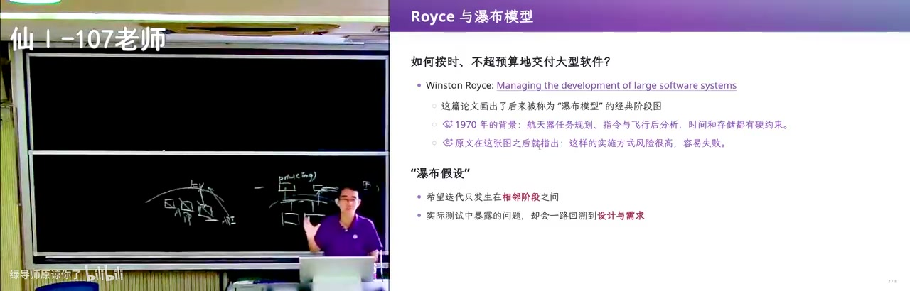
<figcaption>画面 59:42 · 先做两遍与知识的压缩</figcaption>
</figure>

于是有了 do it twice：先做一个不完备但能体现系统功能的设计，迭代成本低，失败了也能反哺到设计上，Royce 管它叫 preliminary pilot program，也就是今天的 MVP，而且放到 web coding 时代这个流程依然成立，因为任何人都从空项目开始，先想清楚要干什么再写代码，写代码的是人还是 AI 都一样。讲者由此说知识获取的方式变了：他上学时要查证一个知识网络几乎不可能，图书馆的索引建得也不好，只能靠教科书做有损压缩，好老师能共情学生、把一手信息的损失压到最小。今天他不必再做统一压缩，因为对不同的人损失的部分都不同，他只要把知识拆成一个个发现的点，把点和原文交给你，让你做属于自己的压缩；而刚投了百万、千万甚至上亿建的精品课程，也可能被一个模型直接碾过去。

### 1:04:30–1:09:50 · 从测试先行到敏捷迭代

<figure>
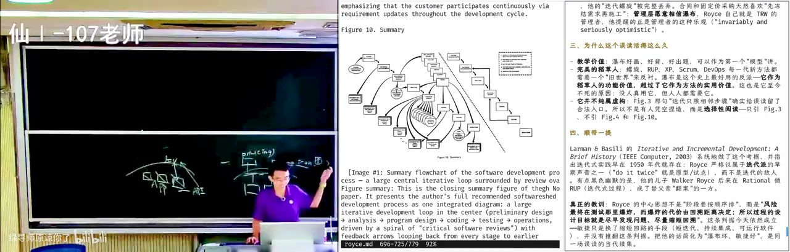
<figcaption>画面 1:04:32 · 从测试先行到敏捷迭代</figcaption>
</figure>

接着他把这套理解落到具体：缺陷被发现得越晚，返工代价越大，做 OJ 时脑子一热选个错算法，写完跑样例才发现整个算法都错了，这就是最典型的瀑布式失败；而 TDD 就是设计先行，先把测试用例定好——输入这个、该走这个流程、输出这个，再立刻对。再往上一层，第一个版本哪怕只打印一句 hello，只要能把模块串起来就是好原型，所谓敏捷不是 doing it twice，而是 doing it infinitely many times，让关键假设尽早遇到证据。他顺手举了爱迪生和特斯拉的直流电、交流电：全人类在某个点选错方向就会被带歪，一旦换个方向可能立刻走上正确道路，所以 AI 时代真正的变量不是它会不会学会品味，而是还能理解 AI 在做什么的人才活得下来。

### 1:09:50–1:14:50 · 把软件看成依赖图的遍历

<figure>
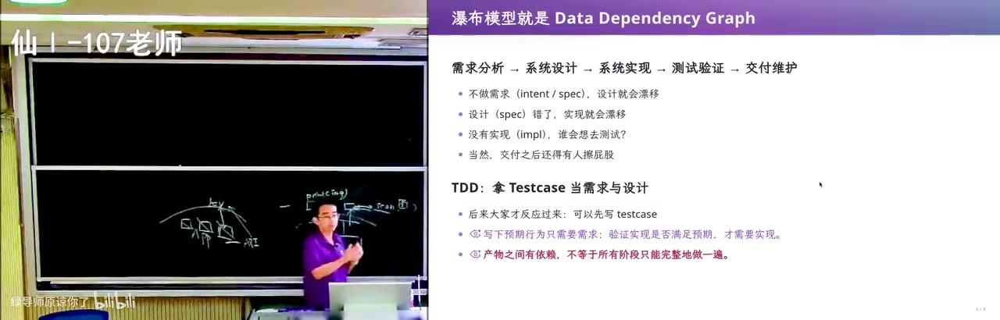
<figcaption>画面 1:09:52 · 把软件看成依赖图的遍历</figcaption>
</figure>

作为一个计算机科学出身的人，他给自己找了个解释方式：把 Royce 的模型看成 data dependency，把人当成程序——人脑也是神经网络，做 chain of thought 时也要对齐到语言上，于是每个阶段是 program、每个产物是 artifact，连起来就是一张有向无环的依赖图。这样一来瀑布为什么贵就很清楚：一旦测试发现错了，往上追发现是几个设计错了，所有依赖它的东西全部作废，而需求和设计之间的关联还会层层传递。解法自然就是把它切小：不做一次性铺开大量依赖的宽度优先，而是先做第一层再做第二层，用深度优先一点点往外扩——这就是 MVP，就是敏捷。对照瀑布的每个阶段，需求阶段定 intent、设计阶段定 spec、编码测试才是 implementation，中间用 MVP 和 TDD 尽早拿到反馈，显然是正确的。

### 1:14:50–1:19:20 · 清单式检查与代码坏味道

<figure>
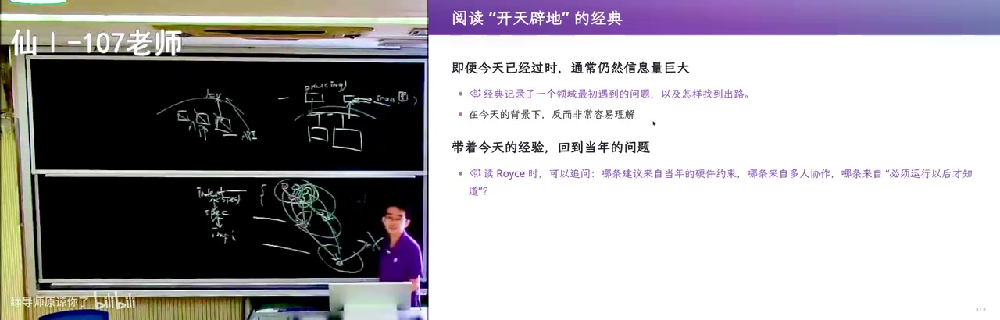
<figcaption>画面 1:14:52 · 清单式检查与代码坏味道</figcaption>
</figure>

几十年下来，软件工程为每个阶段都造了方法和工具，用来降低返工概率：软件工程课上那份长长的 checklist，你当时觉得 nonsense，但最后一条「是否和客户沟通过」真的打上勾，intent 不符的概率就大幅下降，这是一件没有任何代码、却带人文关怀的工具。有了代码以后，研究题目就变成自动测试、bad smell 这类，比如等号左右不写空格会被判成坏代码——可 GPT-6 学会省 token 之后，它会把很多语句塞进一行，难读得要命但结果是对的，也许我们永远不该去读那种代码。他也提醒想读研的人：这个方向细到一个很小的点上，但别忘记抬头看树林，深度给你更长的思维链，广度给你对整个世界的感觉。

### 1:19:20–1:24:20 · 不同阶段需要不同的语言

<figure>
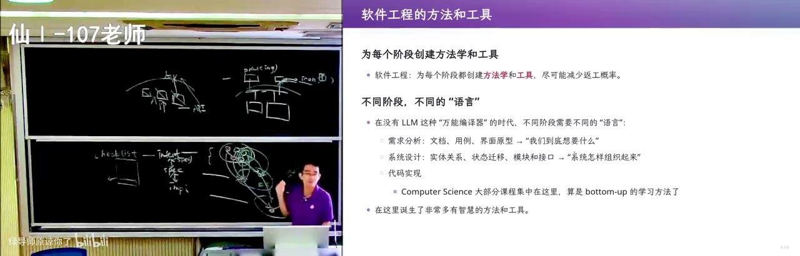
<figcaption>画面 1:19:22 · 不同阶段需要不同的语言</figcaption>
</figure>

为每个阶段造工具，就必然要在不同阶段用不同的语言，而语言之间的断层马上暴露出来：checklist 那时就是一个 docx 文档，打印出来存档，跟客户的沟通记录可能还是手写的，而设计阶段在 1970 年就是一份自然语言的设计文档。文档最大的缺点是写文档的是人，人会幻觉、会笔误，人和人讲同一件事根本对不齐——你跟室友说一件事，他能理解成另一件，这种对齐成本你早就付过无数次。所以为设计阶段造工具，要的就是一个介于自然语言和编程语言之间的设计语言，而 checklist 其实就是这种中间语言：它有格式规范、一条一条必须打勾或打叉，勾和叉的对齐比一整篇文档正式得多，形式化程度就这样从设计到编码一路升高，正好贴着 intent 到 specification 到 implementation 的 gap 在补。顺带一提，以前的学法是 bottom-up，先学编程再学工程；AI 来了以后可以先从产品经理做起，反正你不理解代码怎么运作，也依然能设计出好产品。

### 1:24:20–1:28:40 · 性质测试与需求追踪矩阵

<figure>
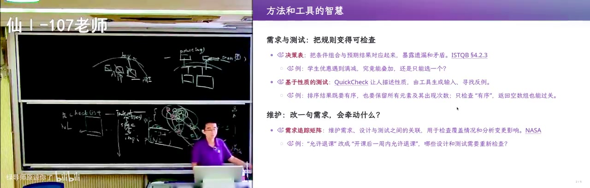
<figcaption>画面 1:24:22 · 性质测试与需求追踪矩阵</figcaption>
</figure>

更细的工具还有决策表——只有所有勾都打上才能进入下一阶段，看着像 nonsense，但它赋予形式语义、避免遗漏和矛盾，甚至要求把所有文档两两摆在一起交叉审查一遍，为的就是不让 gap 漂移，这些管理经验是从失败里长出来的。测试这边 QuickCheck 算开山鼻祖：让人描述性质，由工具生成输入去找反例，背后的逻辑是任何从上到下的翻译都会错，除了写下来的规格，还有「程序不能 crash、不能有空指针、资源不能泄漏」这些隐含的 specification，把它们写成 property 自动变成大量用例，全部通过你就对代码更有信心。再往上是需求追踪矩阵，traceability 要求每个代码点、每个需求点、需求与设计之间都用链接对得上——文件系统里那一堆 .md、.ts 和 README 本来就是 work around，独立的交叉检验才是它能给的东西。

### 1:28:40–1:33:20 · 契约式编程与两千五百个码农

<figure>
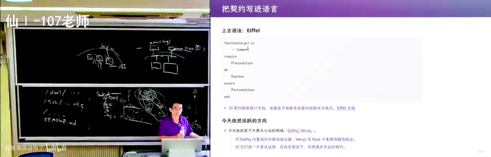
<figcaption>画面 1:28:42 · 契约式编程与两千五百个码农</figcaption>
</figure>

这里有个视角转换：学生总想把自己练成世界上最厉害的码农，但在资本眼里没有任何一个码农能单独完成项目，他要算的是花多少钱雇多少人，所以现在人人都得当产品经理——你手上马上就有 2500 个并发的 DeepSeek，相当于 2500 个资深码农，管理半径和 mindset 都得改。语言层面的努力是 design by contract：Eiffel 在 1986 年前后把前置条件、后置条件直接写进代码，先写这个函数干什么，再 require 前置条件，然后才是 do 和 ensure，取款那个例子会逼你想清楚余额不足该怎么处理——而写 MVP 时你肯定直接让它 crash，把这件事排除在 specification 之外。他由此预言：以前说 30 年后 assert 证不出来就不许编译，现在看可能从那个时间点算 10 到 15 年就能做到，到那天连 property based test 都不需要，因为 property 直接写进去就能被证明。

### 1:33:20–1:40:00 · UML 的野心与它的死亡

<figure>
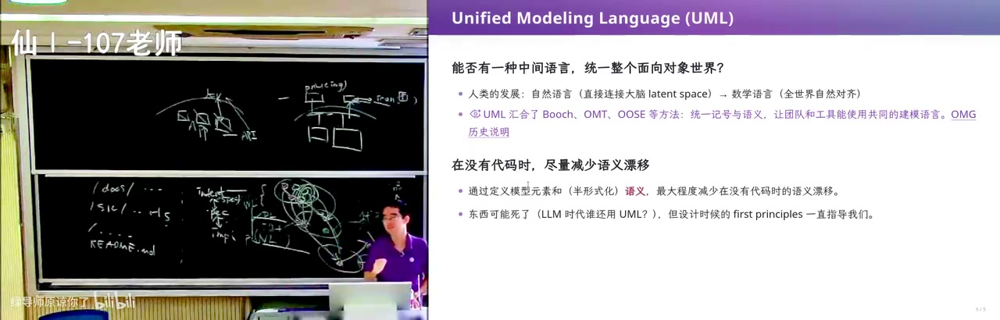
<figcaption>画面 1:33:22 · UML 的野心与它的死亡</figcaption>
</figure>

这条线的集大成者是 UML：既然不同层次要用不同语言，能不能有一种中间语言统一整个面向对象的世界？它要解决的是语义对齐，而这件事人类天生做不好——自然语言直连大脑的 latent space，我说「看到一个美女」，每个人脑子里构造的那个都不一样；数学语言之所以能全人类对齐，是因为从很小的公理（比如皮亚诺公理）一点点构造起来。UML 就把能对齐的部分剥离出来：类图的语义是确定的，class student 里有 name 就是 student.name，能直接变成源代码；时序图里谁先谁后、能不能并发也是绝对对齐的。但讲者判「UML 已经死了」，因为它的前提是自然语言和形式语言无法对齐，而这个前提被大模型打破了；他仍然让 AI 把 796 页的 spec 每 50 页带 overlap 切给多个 subagent，提取软件工程智慧，花掉 699 套餐五小时额度的 18%、约 5.3 元，最后那句话是：这份 spec 从头到尾只回答一个问题——哪些 intent 必须定死，哪些可以流动；而剩下的现实问题是学生群体用得起好模型和用不起，学习效率和成本差距会很大，教育平权怎么办，他不知道，然后下课。

<!-- live:end -->

## 章节详解

### 1. 课前新闻：百毫秒的实时决策

<figure>
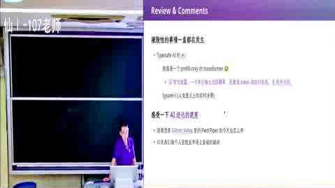
<figcaption>画面 00:33 · 新闻播报</figcaption>
</figure>

**画面解读：** 课前新闻：百毫秒级只吐一个决策 token 的模型玩《Doom》，打开实时决策赛道；随后是七十年加速史，判断新 scaling 维度是「数据分布工程」；再讲基模厂在搭递归自我改进闭环、每建一个实验室能力就上一台阶，学术界的投稿—评审链正被取代。

- 

**⭐ 核心：** 某模型（自称 system one）把《Doom》的游戏状态转成一个 JSON 喂进去，毫秒到百毫秒级吐一个决策 token，「不说人话但能干事」。
- 

**⭐ 核心：** 技术不算全新，但这次把赛道正式打开——实时微表情、有人感的数字人、哄婴儿睡觉，都建立在「延迟够低」上。
- 

**🔧 实操：** 讲者判断它是一次只出一个 token 的 transformer，经过特定微调/训练，介于大语言模型和老式决策树之间。
- 

**⚠️ 易错：** 别把它当范式革命，真正的变量是**延迟**，不是参数量。

> 💡 核心提炼：延迟降到 100ms 量级，AI 才能进入「人感」交互；这条赛道比的是速度，不是智商。

### 2. 七十年加速史与「数据分布工程」

- 

**⭐ 核心：** AI 生成的时间轴——1956–60 感知与规划机器走出实验室 → 70–90 年代寒冬 → 1997 搜索算法首次击败人类世界冠军 → 2012 AlexNet → 2016（讲者现场看直播）→ 2017 Transformer → 2020 GPT-3 → 2022 ChatGPT 爆发 → 2023 多模态、语音 → 2024 Sora。
- 

**⭐ 核心：** 讲者对 GPT-6 的判断——OpenAI 摸到的门道是**数据分布工程**：基模已经够强，再注入一个它没见过的领域数据做强化学习，所有任务会一起变好。
- 

**⭐ 核心：** 模型训练顺序是 语言 → 数学 → 多模态 → 空间感知；人相反，是世界模型 → 语言 → 数学 → research taste。顺序不同，但只要有足够数据和 scaling law，两边都成。
- 

**⚠️ 易错：** 直觉上「多学一个领域要多喂数据」，讲者的观察相反——**每加一个新领域，需要的数据反而更少**，因为不必从零重建。

> 💡 核心提炼：scaling 的第二维度不在参数量，而在「什么分布的数据、什么比例、什么时候注入」。

### 3. 基模厂与学术界的裂缝

- 

**⭐ 核心：** OpenAI 的 Noam Brown 式判断：模型短板是**品味**，即「对接下来该做什么的直觉」不够好；模型被训成 prompt 的舔狗，还有 reward hacking 倾向，会用最快最脏的方式交差。
- 

**⭐ 核心：** 可验证 / 不可验证的边界没那么清楚。数学看着可验证，但自然语言问题形式化本身就有 gap——视频里那个「证明 P=NP，其实证明了一等于一」的笑话就是这么来的。
- 

**⭐ 核心：** 基模厂在搭 RSI（递归自我改进）闭环，Anthropic 甚至要建 wet lab 做生物实验；每新建一个实验室，模型能力就上一个台阶。
- 

**⚠️ 易错：** 小规模实验对大厂「没意义」，不等于实验无用，而是**你碰不到那个数据分布**。

> 💡 核心提炼：「随机想 idea → 投稿 → peer review」这条链，正在被「有钱就能往飞轮里插一个新领域」取代。

### 4. 回到软件：三件东西之间的 gap

<figure>

<figcaption>画面 17:40 · 回到软件开发</figcaption>
</figure>

**画面解读：** 回到软件：意图、规格、实现之间的 gap 才是世纪难题，所以先做能扔的最小原型逼出没想清的意图；再讲标签打印机加扫描仪的自助服务——设备抽象成 scan/print 接口，让 AI 打一张问一句、第十五次调准加热深度；APP 则沦为接口。

- 

**⭐ 核心：** intent / specification / implementation 三者之间的 gap，是软件成为世纪难题的根因，也是这门课反复讲的那句话。
- 

**🔧 实操：** MVP——先做能扔的最小原型，用 AI 生成 slop，成本低、随时丢弃，目的是**逼出 intent 哪里没想对**，再迭代几个版本。
- 

**🔧 实操：** 讲者自建「标签打印机 + 扫描仪」的 self-service：把设备抽象成 scan / print 接口（类比 OS 设备驱动 read/write/ioctl），上层软件只依赖接口，彻底甩掉厂商那个难用的软件。
- 

**⭐ 核心：** 热转印打印机有个没人懂的「加热深度」参数，AI 就打一张、问「淡了还是浓了」，打到第 15 次调对；接个摄像头连人都能省掉。
- 

**⚠️ 易错：** 不要一上来写通用驱动；他是先让它能跑，再抽出接口。

> 💡 核心提炼：稳定接口 + 可验收的结果 + 一轮轮试错，就是 AI 时代最便宜的软件工程。

### 5. 软件公司会消亡吗

- 

**⭐ 核心：** 标签打印机的成本大头是软件（Windows 驱动 + Mac 驱动），AI 把这块打到接近零，「卖硬件送软件」的细分市场逻辑被改写。
- 

**⭐ 核心：** 豆包手机把 APP 抽象成接口，交给 computer use 去调；阿里把旗下服务整合进 agent。APP 沦为「点外卖的接口」，只留一个查数据的 API 给 agent。
- 

**⚠️ 易错：** 千问被评「生不逢时」——产品推得太早、算力和模型速度不够，不是方向错。

> 💡 核心提炼：软件形态从「给人用的界面」变成「给 agent 用的 API」，这一层被替代后，产业链上的人得重新找位置。

### 6. 软件工程为什么诞生（1960s）

<figure>
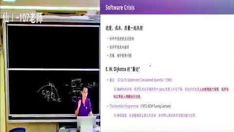
<figcaption>画面 51:41 · 从软件危机到软件工程</figcaption>
</figure>

**画面解读：** 讲软件工程为何诞生：硬件贵、码农贵，客户根本不知道计算机能干什么，需求全靠拍脑袋；再精读三篇一手文献——Dijkstra 的 goto 讲的是可读性、图灵奖演讲说机器越强意图越多，Royce 那篇是瀑布出处却恰在批判瀑布，共同原则是把发现问题提前。

- 

**⭐ 核心：** 1960 年硬件极贵（一间房一台机器）、码农也极贵（高智力工种），写机器码/汇编要先画流程图。
- 

**⭐ 核心：** 客户根本不知道计算机能干什么——政府官员、要送人上月球的 NASA 工程师、要飞控系统的人，都说不清想要什么。1968 年《Boys' Life》9 月号就在畅想「终端即时判分、针对薄弱环节辅导、按自己节奏学」，今天也没完全实现。
- 

**⭐ 核心：** 软件需求是拍脑袋想出来的、高度定制化。选课系统就是活例子：先到先得还是抽签、还是按专业保留？先修课是硬限制还是能被特批？毕业前最后一秒能不能开口子？
- 

**⭐ 核心：** 桥梁、炼钢受自然规律约束，只能增量改进；软件没有这个约束，它是物理世界需求在信息世界的投影，gap 天生更大。
- 

**⚠️ 易错：** 不是程序员不努力，是需求方自己也没想清楚那些 corner case。

> 💡 核心提炼：软件工程的起点不是技术问题，而是「人的意图无法无损翻译成机器行为」。

### 7. 三篇一手文献

- 

**⭐ 核心：** Dijkstra 1968《Go To Statement Considered Harmful》——被简化成「goto 有害」，其实讨论的是可读性；Linux 内核里 `goto release` 逐个释放资源，正是「正确使用 goto」的反例。
- 

**⭐ 核心：** Dijkstra 1972 图灵奖演讲《The Humble Programmer》——永远写 OJ 小程序不会有软件危机；机器越强，承担的 intent 越多，不确定性越大。他提 nicely factored solutions，还说「保守力量主要来自教育机构与舍不得重写旧程序的用户」。
- 

**⭐ 核心：** Royce 1970《Managing the Development of Large Software Systems》——**瀑布模型的出处，但原文是批判瀑布的**，被称作「被误读最严重的文章」。
- 

**⭐ 核心：** Royce 的两个 first principle：① 测试是整条链上第一个「物理事件」，在它之前全是不能运行的文档，所以人一定会糊弄；② 因此一切补救的本质都是**把发现问题的时间点提前**。
- 

**⭐ 核心：** do it twice / preliminary pilot program 就是今天的 MVP；敏捷是 doing it infinitely many times，第一个版本哪怕只打印一句 hello 也算数；TDD 是同一原理的现代版。
- 

**⚠️ 易错：** 教科书把瀑布讲成「应该这么做」，一手文献讲的是「千万别这么做」。

> 💡 核心提炼：所有方法学都在服务一句话——让关键假设尽早遇到证据。

### 8. 学科沉淀与语言的光谱

- 

**⭐ 核心：** 讲者用 CS 视角重述 Royce：把每个阶段看成程序、产物看成数据，就得到一张 data dependency graph。瀑布等于一次性铺开大量依赖，错一处全盘返工；MVP/敏捷等于小步 BFS/DFS 往外扩。
- 

**⭐ 核心：** checklist、决策表、文档两两交叉审查、需求追踪矩阵（traceability）——这些「没有一行代码的人文工具」实实在在降低返工概率，让需求和设计、代码两两对得上。
- 

**⭐ 核心：** 语言形式化程度是一条光谱：自然语言文档 → checklist → 设计 DSL → 编程语言 → 形式化证明，每一格都在补 gap。
- 

**⭐ 核心：** 契约式编程（Eiffel，1986 前后）把 require / ensure（前置、后置条件）写进语言；QuickCheck 让人描述 property，工具生成输入去找反例。
- 

**⭐ 核心：** UML 的野心是对齐自然语言世界，类图、时序图有确定语义；但它的前提是「自然语言无法和形式语言对齐」，这个前提被大模型打破了，所以讲者判「UML 已经死了」。
- 

**🔧 实操：** 讲者让 AI 通读 796 页 UML spec，按 50 页切分带 overlap、多 subagent 提取，最后总结成「哪些 intent 必须定死、哪些可以流动」。
- 

**⚠️ 易错：** UML 死了不等于它的 first principle 死了；「哪些语义必须钉死」这个问题一直在。

> 💡 核心提炼：每一层中间语言都在减少语义漂移；AI 只是把最上面那层自然语言的漂移也压掉了。

### 9. 知识获取方式变了

<figure>
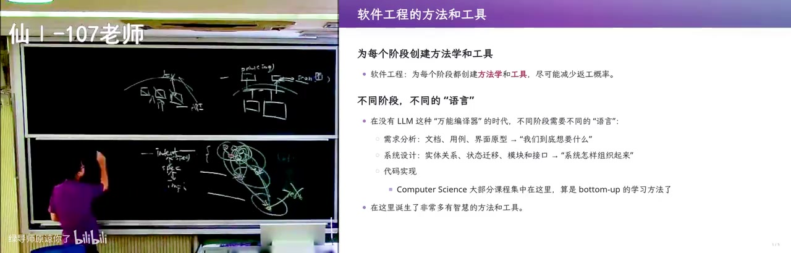
<figcaption>画面 1:16:01 · 软件工程给世界带来了什么</figcaption>
</figure>

**画面解读：** 把学科沉淀摊开：checklist、需求追踪矩阵这些无代码工具都在降返工；形式化程度是从自然语言到形式化证明的一条光谱，契约式编程把前置后置条件写进语言；UML 的前提被大模型打破所以判它已死，但「哪些语义必须钉死」这个问题还在。

- 

**⭐ 核心：** 过去查一手资料几乎不可能，只能靠教科书做「有损压缩」；今天可以直接读原文，还能让 AI 追出「教科书一级级曲解」的传递链。
- 

**⭐ 核心：** 老师不必再做统一压缩——每个人的损失点不同，可以只给「发现点 + 原文」，让人自己做属于自己的压缩。
- 

**⚠️ 易错：** 一手文献也可能把人带歪，一个方向想错就能带歪全人类，所以要交叉验证。

> 💡 核心提炼：AI 让「读原文」从奢侈品变成默认操作，代价是判断责任回到你自己身上。

## 关键数字与例子

| 数字 / 例子 | 出处与含义 |
|---|---|
| 100–200ms | 实时决策模型的目标延迟，够做微表情与「人感」交互 |
| 1956–1960 | 感知与规划机器走出实验室的起点 |
| 70–90 年代 | 人工智能寒冬 |
| 1997 | 搜索算法第一次击败人类世界冠军 |
| 2012 / 2016 / 2017 | AlexNet / AlphaGo（讲者现场看直播）/ Transformer |
| 2020 / 2022 / 2024 | GPT-3 / ChatGPT 爆发 / Sora 发布 |
| 1957 | 一位程序员结婚登记时「程序员」还不算职业，被登记成理论物理学家 |
| 1968 | 北约软件工程会议；Dijkstra 的 goto 文章；《Boys' Life》9 月号畅想 |
| 1970 / 1972 | Royce 那篇论文 / Dijkstra 图灵奖演讲 |
| 15 次 | 调热转印「加热深度」参数时 AI 反复打标签的次数 |
| 796 页、18%、5.3 元 | UML spec 页数；读它花掉 699 套餐五小时额度的 18% |
| 2500 并发 | 「你手上马上就有 2500 个码农」，管理半径变了 |
| 30 年 → 10–15 年 | 讲者旧预言「assert 证不出就不许编译」，如今改口 |

## 速查卡

| 概念 | 一句话 | 标记 |
|---|---|---|
| intent / spec / impl | 三者之间的 gap 是软件的根本难题 | ⭐ |
| MVP | 先做能扔的最小原型，用来逼出没想清的 intent | 🔧 |
| do it twice | Royce 的 pilot program，1970 年版的 MVP | ⭐ |
| 测试是第一个物理事件 | 之前全是不可运行的文档，人必然糊弄 | ⭐ |
| 把发现问题提前 | 所有方法学的共同本质 | ⭐ |
| goto considered harmful | 讲的是可读性，不是禁用 goto | ⚠️ |
| 瀑布模型 | 出自一篇批判瀑布的论文，被误读最严重 | ⚠️ |
| traceability | 需求↔设计↔代码两两可追溯，用交叉检验换信心 | 🔧 |
| design by contract | require/ensure 写进语言，前置后置条件 | 🔧 |
| UML | 用半形式语言对齐语义，讲者判「已死」但 principle 还在 | ⚠️ |

## 我的判断

这讲的锋利之处在于把「软件工程史」讲成了「一个 gap 的反复修补史」，而不是罗列方法论名词——它敢直说瀑布模型是后世教科书造出来的反派，敢把 Royce 原文里的 pilot program 直接认成 MVP，也敢承认 UML 这套 796 页的宏大工程已经失去前提。但它最值得警惕的恰恰是自己的叙事惯性：一边用「数据分布工程」和「斩杀线上升」制造紧迫感，一边又用「AI 抹平了自然语言对齐」轻松判掉几十年积累，这两句其实互相拆台——如果对齐真的被解决了，那 traceability、checklist、契约式编程的价值就不该只是「原理还在」，而应该被重新定价。另外，讲者用自己的一台标签打印机和一次 APK 逆向就推出「软件公司彻底消亡」，样本太小、结论太快；真实世界里的软件成本大头是长尾需求、合规和运维，不是驱动。真正立得住的是那句不煽情的判断：读一手文献比读教科书省事，因为经典记录的是这个领域最初也最根本的问题——这条对做工程的人比任何预测都值钱。
