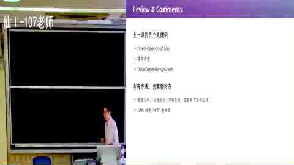
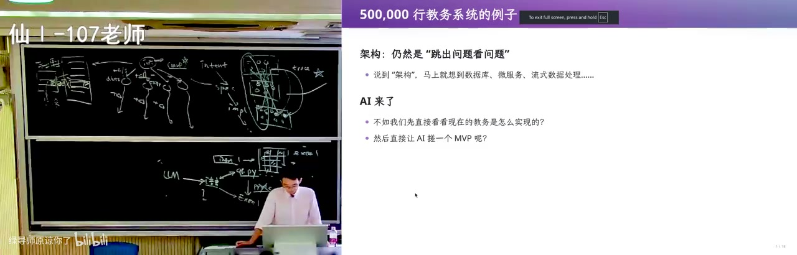

# 需求和架构 (1) [06-Raw/26生成式软件工程/NJU]

> 用南大教务系统当活体样本，讲清「需求为什么会滚成屎山、架构为什么要从第一行代码就开始」；后半段用二维码生成器和院系改名，推到 CRUD 的死穴与 event sourcing。

- **UP**：绿导师原谅你了（南京大学 蒋炎岩）
- **链接**：https://www.bilibili.com/video/BV1Rch76WEfQ
- **播放量**：17210
- **时长**：96:51

## 官方章节时间轴

| 时间 | 章节 |
|---|---|
| 00:00–15:03 | 引言 (后半音频翻车) |
| 15:03–44:28 | 需求工程 |
| 44:28–1:12:32 | 无处不在的架构 |
| 1:12:32–1:36:50 | 回到教务系统 |

## 讲了什么
<figure>

<figcaption>00:00 · 引言 (后半音频翻车)</figcaption>
</figure>

**画面解读：** 开场回顾瀑布模型：意图→规格→实现→维护，层间是数据依赖，错一层会往回污染，所以要可追踪性；再补「软件不软」——一个 bit 翻掉就能让程序无限读数。AI 让实现变便宜，但意图→规格、产品设计与架构仍是杠杆。

开场回顾 Royce 的瀑布模型：intent → spec → implementation → 维护，每一层之间是 data dependency，错了会往回污染一大片，所以需要 traceability、UML 这些工具。他补了一个「软件不软」的论证：软件是纯逻辑制品，容不下细微差错。比如程序读入 N=1，如果宇宙射线把 unsigned int 的最高位翻成 1，N 就变成巨大数，程序会无限读数直到 memory error；数据中心里也会因热噪声出现 silent error，同一条指令在不同机器上结果不同。所以「软」只是错觉。

软件工程难教，是因为学生只能从最底层（C 语言、写代码）往上走，没有一手痛苦就做不好需求。AI 时代实现变便宜了：他只要把边界划清楚、validation 设计好，可以不太看 AI 写的代码；但 intent → spec、产品设计、架构这三段仍是杠杆——同样一个 MVP 需求，加几个字的 prompt（CLI 还是 client/server）就会得到完全不同的架构，一旦 `db.ts` 写进上下文，后面每个需求都带着这个技术债走。MVP 要选最重要的功能，别提前调按钮样式，因为上层设计一变，按钮样式就白做。

<figure>

<figcaption>15:03 · 需求工程</figcaption>
</figure>

**画面解读：** 拿南大教学平台当样本：让 agent 写成带形式化 ID 的需求说明书，再交给只看文档的 sub agent 复现，页面能跑却出现缺课次数超课时的 bug。需求变更则更狠：离散数学拆成两门，毕业、重修、抵扣全被穿透，最后靠院长特批手改数据库。

需求工程部分，他拿南大本科教学服务平台做样本：让 agent 用浏览器探索「和教师相关」的功能，生成一份需求说明书。这份文档有调研方法、证据边界、业务目标、成功标准、用例规约、功能需求、术语表、验收场景、需求清单，每个需求有形式化 ID，能建 traceability；然后再起一个 sub agent，只给它这份需求说明书（不看真实系统），实现一个假的教务系统。结果页面、教学任务、教材编辑、学生名单、缺课记录都能跑，甚至「保存记录」也成功；但也暴露 bug：缺课次数可以填到超过总课时，说明前端校验没做全。作者用这个说明：需求写清楚后，编码、traceability、测试 AI 都能接；但需求本身要靠无尽沟通，要有同理心——你的用户可能是 53 岁、快退休、上大学时没怎么用过电脑的教务老师，不是你自己这种 geek。

然后讲需求变更如何摧毁架构。学校把离散数学拆成上下两门，毕业/保研规则就变了：原来「必须修离散数学」，现在要「离散数学 或 离散数学一」，下拉框要加「或」，还要处理重修、转院系课程抵扣、先修课替代……每加一条规则，屎山长一截。更麻烦的是系统外的事实：学生马上毕业、春季学期不再开课，最后只能教学院长特批，工程师手改数据库把「毕业条件」改成满足。他 2018 年还亲身撞过一个 bug：把某学生缺课次数从 0 改成 1，所有能选到该学生的页面直接 500，最后工程师进数据库修条目。结论是「没有银弹」，早期决策会跟着软件一辈子。

<figure>

<figcaption>44:28 · 无处不在的架构</figcaption>
</figure>

**画面解读：** 从 10 行代码讲架构：getopt 把参数收进解析状态再分派，就是把变化隔在稳定接口后；同一道汉诺塔的四种写法用来衡量「压缩就是智能」。再讲 Excel 里生成二维码：公式直写必成一坨，正解是先造中间语言，再分别翻译成程序与公式验证。

架构部分从 10 行代码讲起：`main` 里读入、处理、输出；命令行程序用 `getopt` 把 argv 解析成一个 parsing state，再 switch，这就是把复杂性隔开的最小架构。接着是汉诺塔的四种写法：GPT-6 走数学路线（用二进制末尾零个数、盘子移动方向，高度优化但难读）；DeepSeek v4 flash 写出「递归就是栈」的优雅版本（把剩余任务压栈，每次执行栈顶）；豆包方案对但代码有瑕疵；作者自己的版本是把 C 语言的小步语义翻译成状态机，能机械地把任意递归转成非递归，对汉诺塔是 overkill，但作为理解程序语义的练习很好；CSDN 上搜到的版本比 AI slop 还糟。他说「压缩就是智能」，同一问题在不同抽象层的表达，能看出架构水平。

2000 行的例子是「在 Excel 里生成二维码」。需求看似明确：一个输入单元格、一个输出 01 矩阵；但 Excel 公式表达能力有限，直接写会得到一坨不可维护的巨型公式；Excel 还有版本差异（VLOOKUP vs XLOOKUP），兼容旧版还是只用新版会让需求变模糊；单元格位置一改，硬编码全崩。他的架构是：定义一个中间语言（表达式树），每个节点既能翻译成 Python（用来验证逻辑），也能翻译成 Excel 公式（用来交付）；LLM 只负责生成中间语言的二维码计算逻辑；之后还能在中间语言上做改写优化（循环不变量外提、profiling-guided optimization），Excel 版本变了只需换算子实现。这和 `getopt` 是同一个套路：先找一个稳定的中间表示，把变化挡在外面。

最后是 50 万行的教务系统。AI 生成的版本是一个 54KB TSX + 38KB services 的单体，AI 自己评价「经典三层单体、前后端分离、乐观锁、幂等、事务、审计、统一错误处理，可维护」；作者承认它有工程直觉，但本质仍是 CRUD。CRUD 的世界观是「软件 = 物理世界在信息世界的投影」，当前状态用数据库表表示，退学就是 update，页面是状态的投影。问题在于：当前状态丢掉了历史。比如「是否允许毕业」这个字段是由学分、毕业设计等一堆历史计算出来的，你只知道 0/1，不知道 why；政策变了、培养方案没导入，系统里就出现无法解释的不一致，最后靠手改。院系改名「计算机系 → 计算机学院」也是：改对象名，历史毕业记录就变成「2011 年毕业于计算机学院」与事实不符；不改，所有 department_id 又指向旧系，必须做数据库迁移，而迁移要面对历史上所有情况，还可能把库搞坏。

<figure>

<figcaption>1:12:32 · 回到教务系统</figcaption>
</figure>

**画面解读：** 回到 50 万行的教务系统：AI 写出的单体有乐观锁、事务、审计，本质仍是 CRUD——当前状态丢掉了历史，毕业字段只是别人算完又忘了的结论，院系改名还会让旧毕业记录说谎。解法是 event sourcing：只追加事实、重放出状态。

于是他给出 event sourcing：不维护当前状态，只追加不可篡改的事实/操作日志；当前状态 = replay 所有事实的投影。可以存状态、存操作、存 delta，三者等价（快照、git、WAL 日志）；查询时可以裁出与某事实相关的历史再 replay，所以能查过去、也能查现在；改错了可以退回快照重放。代价是性能（需要快照/缓存）、以及如果系统已经是屎山，改成 event sourcing 很困难。CQRS、DDD 这些概念可以看，但不是必须；回到 first principle「记录事实、派生状态」，即使没听过这些名词也能设计对。他还讲了一个真实故事：隔壁软件工程组接研究生院教务系统，二三十万的单子，CRUD 架构，赶上研究生扩招、类型变多，最后维护不下去，被公司系统取代。

## 关键点

- 软件不「软」：一个 bit 翻转就能让程序崩溃；「软」是相对物理世界弹性而言的错觉。
- MVP 的隐藏杠杆是架构：同样的需求，CLI 还是 client/server、早不早引入数据库，会决定后面所有上下文和技术债。
- 需求变更不是加一个字段，而是「离散数学拆成两门」这种会穿透毕业、保研、选课、抵扣的连锁重构。
- 10 行代码也有架构：`getopt` 把 argv 收进 parsing state，就是把变化隔离在一个稳定接口后面。
- 二维码进 Excel 的解法是「中间语言 + 两个后端（Python 验证 / Excel 交付）」，本质是编译器架构。
- CRUD 的死穴是丢掉历史和派生依赖；event sourcing 用「追加事实 + replay」换回可追溯、可回退、可推演。

## 为什么值得看

给做业务系统、被需求变更和历史数据不一致折磨的人看。它从教务系统、汉诺塔、Excel 二维码一路推到 event sourcing，每例都能对上真实开发的痛；前半段需求文档的生成与复现 demo 也值得参考。坑是跨度大，没做过业务系统会觉得前半段散。

## 我的一句话

这讲最值钱的是那句「当前状态丢掉了历史」——你库里那个 `can_graduate` 字段，不是事实，是别人替你算完又忘了怎么算的结论。

<!-- BILI_ITEM {"bvid":"BV1Rch76WEfQ","score":9,"reason":"用教务系统、汉诺塔和 Excel 二维码讲透需求债与 CRUD→event sourcing 的架构推导","verdict":"pick"} -->
