# 需求和架构 (2) [07-Raw/26生成式软件工程/NJU]

> 这一讲把「需求怎么收敛、架构怎么隔离复杂性」讲成了历史课：从 Dijkstra 的结构化程序、Guy Steele 的 Growing a Language，到 UNIX、关系数据库、MVC/MVVM，最后落到 event sourcing 为什么能治「当前状态数据库」的不一致。

- **UP**：绿导师原谅你了（南京大学 蒋炎岩）
- **链接**：https://www.bilibili.com/video/BV1JGap6LE74
- **播放量**：12502
- **时长**：99:42

## 官方章节时间轴

| 时间 | 章节 |
|---|---|
| 00:00–14:17 | 回顾 |
| 14:17–49:21 | 阅读经典 |
| 49:21–1:19:04 | 典型的系统架构 |
| 1:19:04–1:39:41 | 应对复杂性 |

<!-- live:start -->
## 课堂实录（按时间顺序）

### 00:00–05:53 · 开场回顾：需求与架构不可分

<figure>

<figcaption>画面 00:40 · 开场回顾：需求与架构不可分</figcaption>
</figure>

开场承接上一讲：从瀑布模型到 MVP，都是在用数据依赖跨过 intent、specification、implementation 之间的 gap；而“代码之外有客户规律，客户之外有社会规律”，站哪一层看需求，结果就不一样。他回顾上节课用浏览器逆向教务系统、拿到一份需求规格说明书的做法，但同时提醒：从做设计决定那一刻起就背上技术债，从十行代码到千万行代码都一样，所以第一反应该是“也许可以回头再想一想”。接着落到 Brooks 那句“软件工程的本质是驾驭复杂性”：选课的容量、先修、时间冲突、排课、教室、师生借教室，都是 problem domain 里消不掉的 essential complexity，只能用架构隔开。技术选型也是 trade-off——文件系统好 hack、UNIX 工具能组合，但没有原子事务和并发控制；数据库给你 transaction，代价是调试要穿过一个中间层。

### 05:53–10:54 · 登录这一个需求怎么滚成泥潭

<figure>
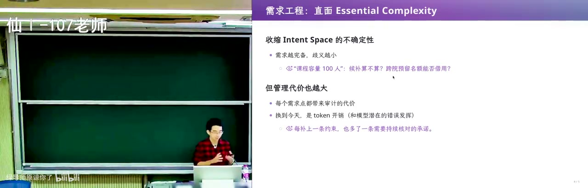
<figcaption>画面 05:55 · 登录这一个需求怎么滚成泥潭</figcaption>
</figure>

需求层面他先讲“让 GPT 直接做个 login”会怎样滚：注册就要确认密码，没有忘记密码功能用户一定被锁死在门外，找回又要选短信还是邮件、用哪家服务；转头用微信/支付宝登录，个人开发者可能连公司实体都没有。所以他主张深度优先做 MVP 验证最重要的功能点，同时广度优先比较登录方式、首页布局这些分叉，在两者之间找平衡只能靠动手做。需求最后总要写出来，但代码本身也是需求——把文档删掉让模型读代码也能还原，只是会非常长。

### 10:54–14:18 · 架构的作用是收缩实现空间

<figure>
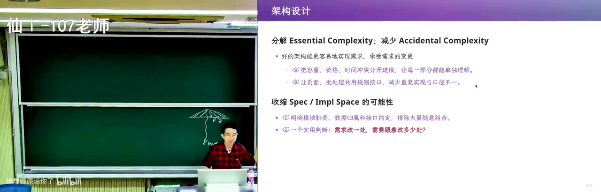
<figcaption>画面 10:56 · 架构的作用是收缩实现空间</figcaption>
</figure>

架构有两个作用。一是分解 essential complexity：数据交给数据库，就不用再关心怎么存，云厂商还给备份承诺，最多短暂降低 availability，于是只盯业务。二是收缩 spec 到 implementation 的可能性——需求收缩 intent 的不确定性，架构收缩实现的不确定性，代价还是技术债。他顺带举学校的信息系统：统一身份认证打通花了很多年，财务系统因为要做平账、接审计，至今没和选课等系统真正连起来。

### 14:18–19:00 · 重读经典与 AI 陪读方法

<figure>
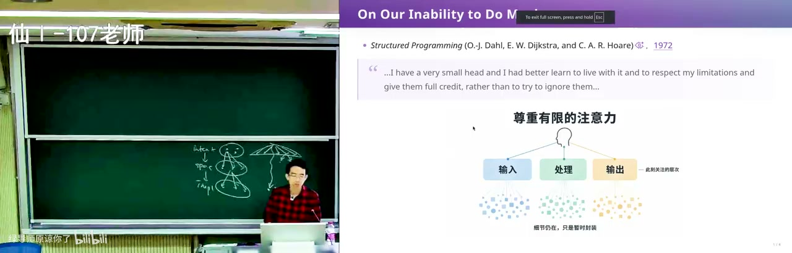
<figcaption>画面 14:20 · 重读经典与 AI 陪读方法</figcaption>
</figure>

从 14:17 起他换了个讲法，重新读老 paper：1972 年 Dijkstra 的《Notes on Structured Programming》还在用流程图讲顺序、选择、循环，跟“goto is harmful”较劲，看着不像现代软件工程的书，但值得重读。他说现在读书比以前容易，前提是用对 AI；前两天让云端的 bot 去收集 1980 到 2010 年值得读的 systems 文献，找了 1000 篇、每个领域两三百篇，核对下来列表相当靠谱。他读 paper 的方法是从已知知识往外扩：要解决什么不知道的问题、用了什么不知道的手段、得到什么结论，最后连成一张网。

### 19:00–22:58 · 人脑很小所以要抽象分层

<figure>
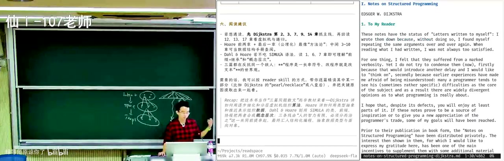
<figcaption>画面 19:02 · 人脑很小所以要抽象分层</figcaption>
</figure>

全书开篇那句 “our ability to do much... I have a very small head, and I had better learn to live with it” 是这一段的落点：人能力有限，只能靠抽象加层次分解，把人不能一次理解的东西变成可以逐层理解的东西。他喜欢那个“串项链”的比喻——每颗珍珠是一个模块，串起来才是软件；还说人脑真正能干的就三件事：枚举、归纳、抽象。顺便提醒，教科书脚注引到的老书过去只好跳过，今天可以直接去读第一手原文。

### 22:58–27:02 · 1972 年就有类与协程

<figure>
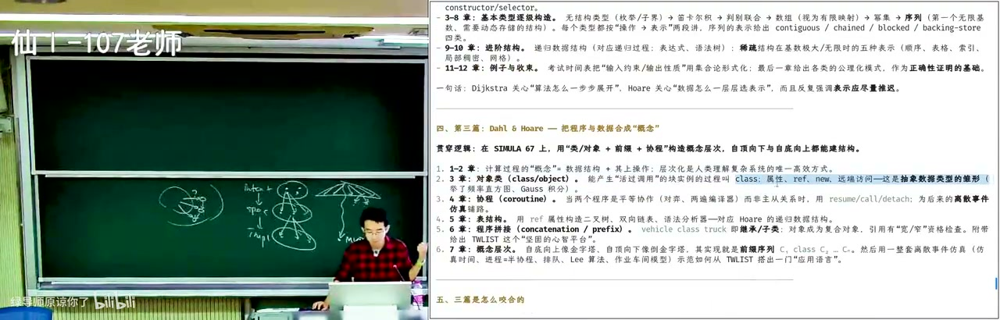
<figcaption>画面 23:00 · 1972 年就有类与协程</figcaption>
</figure>

他特别指出书里 1972 年就有 class and object 和 coroutine：当年没有现成模型，协程是为了把工作切成几条线、每条线有自己的 memory，靠 communication 协议在共享空间里协作，今天 Go 的协程反而更像轻量线程。让 AI 读面向本科生的那部分时，提炼出的核心是把数据和操作打包成一个概念、再用前缀机制一层层搭起来，选课和教室管理就该这样隔开。书里还有一句观察：学生程序写不好，是因为一次要同时装在脑子里的东西太多。

### 27:02–30:58 · 动态规划为什么难调

<figure>
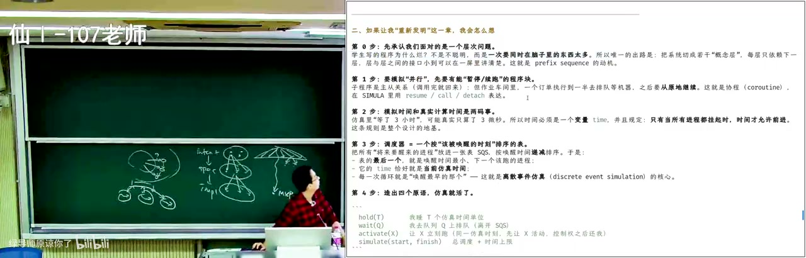
<figcaption>画面 27:04 · 动态规划为什么难调</figcaption>
</figure>

他顺势讲为什么动态规划难调：模拟题还能拆成几个 class 分别测，几百行的 DP 中间是纯数学表示，错了连怎么错都看不出来，因为写 dp[i][j][k] 的时候把状态空间、无后效性、有向无环图这层抽象扔掉了。他给的办法是把状态和迁移放回来，写个 getNext 打印所有可能的迁移甚至可视化，调通再改写成等价的更高效形式；模拟并行也一样，先造出 hold、wait、activate、simulate 这样的抽象。中间他插了段工具闲聊：GPT 的实时语音能在后台调更强的模型，一边对话一边问，还能让它给个 React Fiber 式的现代比喻。

### 30:58–35:40 · 语音陪读到可生长语言

<figure>
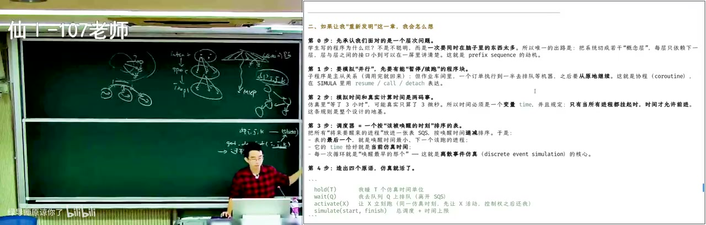
<figcaption>画面 31:00 · 语音陪读到可生长语言</figcaption>
</figure>

他还说预训练模型只能凭直觉，开了 web search 就能去一千篇的池子里挑最合适的，于是挑出来的是 UNIX、关系数据库、TCP/IP 这些“好抽象”的例子，恰好也是他今天要讲的。他想知道 1980、1990 年代的人怎么看同一件事，于是找到了下一场 talk。34:22 起第二个经典登场：作者是 Scheme 的设计者、Java 语言规范和虚拟机的合著者，1998 年在 OOPSLA 给了那场著名的 keynote《Growing a Language》。

### 35:40–40:00 · 全篇单音节词的演讲

<figure>
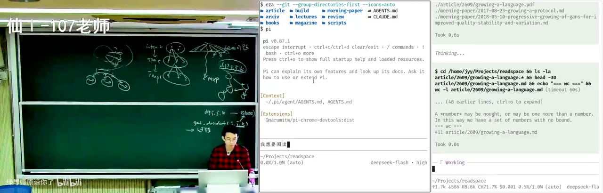
<figcaption>画面 35:42 · 全篇单音节词的演讲</figcaption>
</figure>

打开 PDF 第一眼是 “Most of the time I do not read my talks”，十几页全是字，很容易被直接关掉，但那其实是一场表演性的演讲：全篇只用单音节英文词，遇到 vocabulary、programming、computer 这种双音节以上的词必须当场定义。这么写下去必然撞墙——想讲清楚任何复杂东西都变得很费劲，而这正好对应编程语言的处境：语言相对英语和用户需求永远很小，因为它必须有形式语义才能执行。他拿一种极简语言举例，几乎就是把图灵机编码成一串指令，最小但人不可读；C 是可用的经典，可它没有运算符重载。

### 40:00–44:19 · C 语言缺少的抽象能力

<figure>
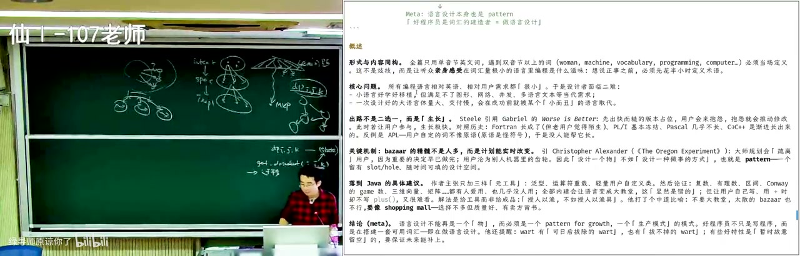
<figcaption>画面 40:02 · C 语言缺少的抽象能力</figcaption>
</figure>

没有运算符重载，C 里表达“往队列里放东西”就很痛苦，qsort 的比较函数签名是 int cmp(const void*, const void*)，还要额外传元素个数和元素大小，等于逼你自己造抽象。小语言好移植、能满足形式语义，但顶不住膨胀的需求；一次设计一个大语言又体量大、交付慢，会在成功前被小而丑的语言取代——C 赢就赢在与机器一一对应、能移植到任何地方。所以他给 Java 只提三样：泛型、运算符重载、轻量用户自定义类；还说“语言里有什么”本身就是架构，出路不是二选一而是生长，C 到 C++ 是长出来的，但模板在 C++11/14/17 之前被 boost 用滥了。

### 44:19–49:01 · 扩展必须是一等公民

<figure>
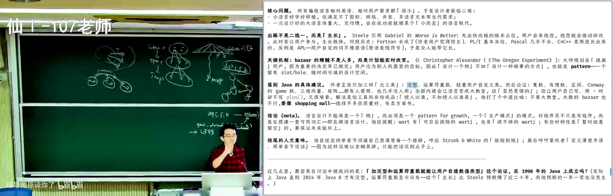
<figcaption>画面 44:21 · 扩展必须是一等公民</figcaption>
</figure>

结论是一句架构哲学：扩展必须是一等公民，扩展之间还能组合，这才叫可生长；不是拿一张需求清单全部实现就完事。他借机批评 OJ：从进大学就疯狂刷题，把人训练成解题机器，题对了代码就扔，用后即扔的代码让人不再想扩展和架构。他也说读这些经典慢是因为已知知识太少，而今天太多宝藏被埋在快速发展里，品味被海量 AI slop、CSDN 上那些东西污染；于是畅想一个“大学毁灭计划”，把 1970、80、90 年代的经典拆开重新串成教材。

### 49:01–52:58 · UNIX 的三条设计原则

<figure>
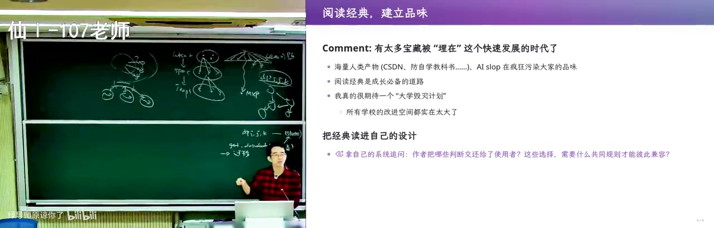
<figcaption>画面 49:03 · UNIX 的三条设计原则</figcaption>
</figure>

49:30 起进入可生长架构的经典案例，第一个是 UNIX 的三条原则：每个工具 do one thing well、程序之间能协作、用文本流当接口。文本接口一下子统一了人和程序、程序和程序——用数据库时总觉得隔层纱，每次查询都要一条 SQL，这个 indirection 让人难受，可程序照做毫无压力。管道的想法 1964 年就有，1983 年才进 UNIX；再加上统一的命令行参数、统一输出格式和 exit status，就成了一套能组合的世界。反例是“打开文件”菜单：要么自己实现，要么用操作系统的，都不满意也没办法。

### 52:58–57:00 · 文本流让工具无限组合

<figure>
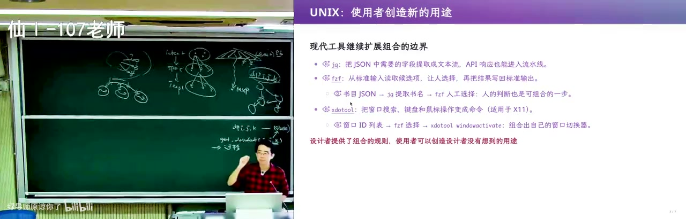
<figcaption>画面 53:00 · 文本流让工具无限组合</figcaption>
</figure>

现场他给 vim/nano 配了个自定义菜单打开文件，直接打开第一课的 index，说明打开文件这件事可以由工具组合出来，不必被 IDE 或 OS 锁死；他说这套文本接口和编程语言、UNIX 管道是一脉相承的。用 UNIX 的每个人都是程序员，因为每条命令都是一个小程序，负责把 do one thing well 的工具组合起来，这种可组合性到今天都很难在 GUI 程序里得到。第二个案例是 1970 年 Codd 的关系模型：原话是要保护用户，不受数据表示随数据量增长和访问模式变化而改变的影响；文件系统是 row interface，好处是工具能复用，坏处是太自由、没有统一管理。

### 57:00–1:01:00 · 两大可生长架构：SQL 与网络

<figure>
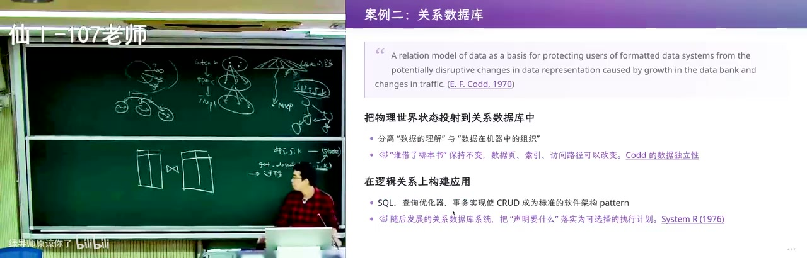
<figcaption>画面 57:02 · 两大可生长架构：SQL 与网络</figcaption>
</figure>

关系数据库把世界建模成二维表，用表间操作处理任何数据管理，底下怎么存、可靠不可靠全交给实现；SQL 是接口也是语言，上面还有查询优化器、事务和 view，当前状态经一次 transaction 到下一个状态。它带来了近乎无限的 scale，图书馆、学籍、财务、在线商城订单全都信息化，schema 由应用自己扩展。第三个案例是 Internet：只做 connectivity，TCP 保证可靠传输，上面跑什么不做预设；RFC 1958（1996）说唯一应该永存的原则是变化本身，而 datagram、拥塞控制、连接什么时候断，这些细节必须在架构里解决。

### 1:01:00–1:04:58 · 从 HTTP 裸奔到 HTTPS

<figure>
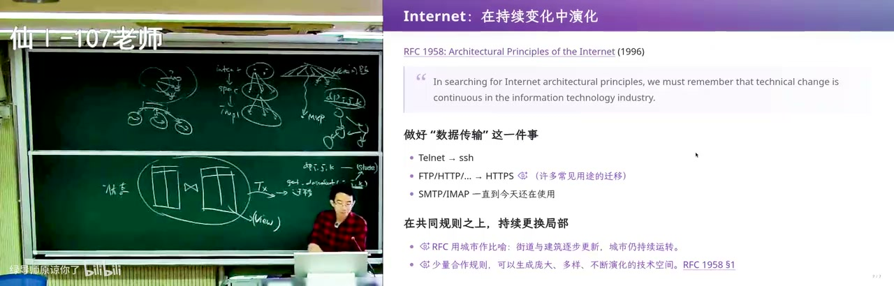
<figcaption>画面 1:01:02 · 从 HTTP 裸奔到 HTTPS</figcaption>
</figure>

他讲自己读书时全网在 HTTP 上裸奔，用 telnet 连小百合 BBS 灌水，传文件用 FTP 就因为协议自带断点续传，电影下一半可以下次接着下；今天换成 SSH、HTTPS，功能都收进 HTTPS 这个接口，上面再长 RESTful，像先修好城市交通网再不停盖楼。所以为什么要在大学学这些：具体技术用时得能写出来，但更要看这些经典为什么能活下来、怎么应对变化。系统这一层（IBM360、UNIX、面向对象语言、Internet、Android、云原生）把地基打好之后，才轮到业务系统的舞台。

### 1:04:58–1:09:59 · 每个页面就是一个事务

<figure>
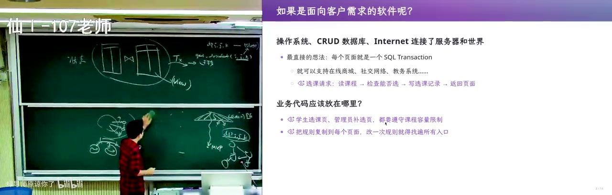
<figcaption>画面 1:05:00 · 每个页面就是一个事务</figcaption>
</figure>

回到 1998 或 2000 年设计业务系统，最直接的想法是每个页面、每个功能都做成一个数据库 transaction：需求点投射成 CRUD，当前状态用表表示，页面是状态的视图、是查询切出来的一个切片，比如写个 select 看谁选了我的课。这套在需求点粒度上很好用，于是有了图书管理系统那一波爆发。1998 年 Java 如日中天，允许直接在 HTML 里写代码；今天拼 prompt 用 A 加 B 加 C 很难维护，用模板语言就清楚，Jinja 里 instructions 是个变量，还能传 Python 表达式算今天的日期，PHP/ASP、JSP 早就探索过页面嵌服务端脚本。

### 1:09:59–1:14:00 · MVC：模型是单点真相

<figure>
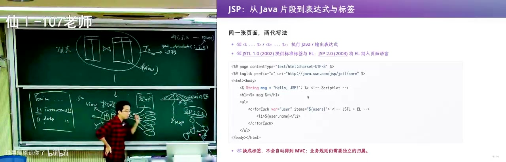
<figcaption>画面 1:10:01 · MVC：模型是单点真相</figcaption>
</figure>

一个页面只要一个 transaction，把需要的数据捞进 list、map 再投射成 HTML，DOM 和 CSS 还分了家，界面几乎能随便排，这就是以数据库为中心的应用。1979 年那篇两页纸的 MVC 把它形式化：model 是当前世界的 knowledge、是单点真相，view 是 model 的 pure function，controller 是用户与系统之间的链路，把输入翻译成 transaction。映射到教务系统，model 是课程和选课记录，view 是页面，controller 是按钮和输入框。

### 1:14:00–1:19:01 · MVVM 把视图状态也当模型

<figure>
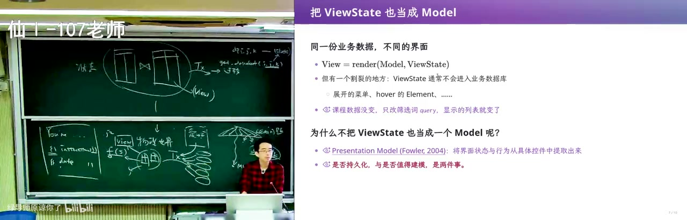
<figcaption>画面 1:14:02 · MVVM 把视图状态也当模型</figcaption>
</figure>

问题出在单页刷新之外：今天界面上有大量元素的状态不在数据库里——随时展开的菜单、搜索框、hover 高亮、query string，教务系统还把搜索做成了一个 transaction，其实列表已经拿到，只要本地过滤器。于是把 view state 也当成 model，就有了 MVVM。React 想把 DOM 树写成 state 的 pure function，但页面上几万个元素，输入一个字符全部重算扛不住，于是用 virtual DOM 把这份复杂性藏起来；Vue 则建依赖图帮你保持同步，两者都是要你把变与不变、逻辑与数据源头分开。

### 1:19:01–1:24:01 · 长流程撑不住状态字段

<figure>
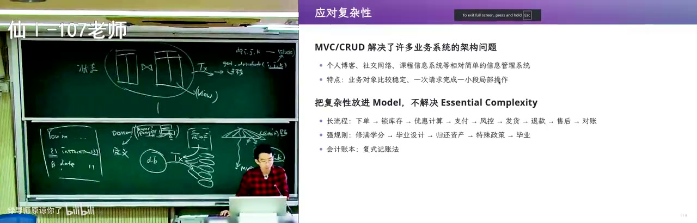
<figcaption>画面 1:19:03 · 长流程撑不住状态字段</figcaption>
</figure>

但 MVC/MVVM 没碰真正的 essential complexity：长流程。淘宝下单之后要锁库存、算优惠、等用户确认支付、风控、发货、退款、售后、对账；最直接的做法是 order 表加一列 status，1 是下单、2 是库存，再往后是支付，状态机很快复杂到要单独设计风控触发后的返回逻辑。教务系统里就会冒出“既该毕业又不该毕业”的学生：某处被 override、程序有 bug，数据静默 corrupt，最后没人管。因为当前状态只是快照，它是从过去推演来的，怎么来的丢了。

### 1:24:01–1:29:00 · 复式记账与 LLM 当编译器

<figure>
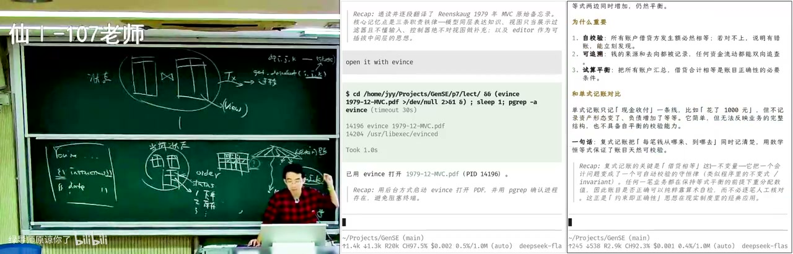
<figcaption>画面 1:24:03 · 复式记账与 LLM 当编译器</figcaption>
</figure>

会计早就用复式记账防这个：每笔交易同时计入两个以上账户、金额相等方向相反，能试算平衡、能查错。他不懂会计却要资产负债表（现金、存货、固定资产、应付账款、短期借款、所有者权益），于是干脆不记当前状态、只记状态迁移：一份不可篡改的流水账，每条由 LLM 编译成对报表的若干操作，当前报表是所有操作 reduce 出来的。比如付一笔营业成本，货币资金、应付账款、现金流量表各动一下；GPT 写的代码太长，他就给 payroll 加一个参数做 curry 化。

### 1:29:00–1:34:21 · 成绩更正暴露状态库缺陷

<figure>
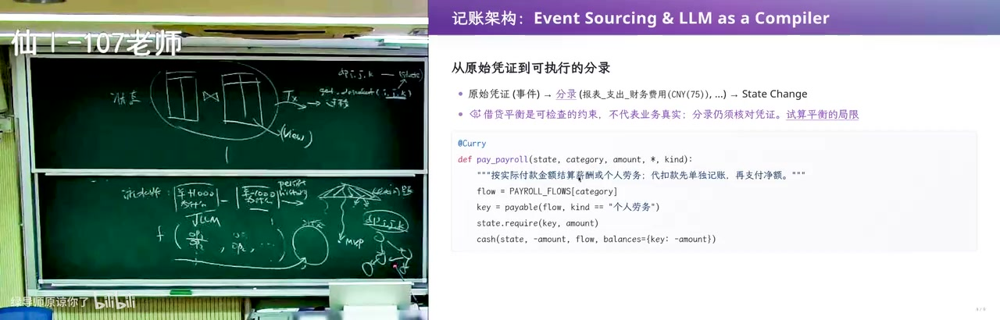
<figcaption>画面 1:29:02 · 成绩更正暴露状态库缺陷</figcaption>
</figure>

现成的条目，比如银行收支，所有 side effect 都落在报表上，按时间顺序重放一遍就得到当前报表。回到数据库就看出问题：当前状态库管的是“现在”，状态可变，逻辑一错就会从对的状态走到错的状态；规则改了还要给状态打 patch，而数据库迁移非常危险。他举成绩更正：查卷子把白送的 20 分扣掉、这门课挂了，学分减一，先修链上“计算机系统基础”挂了却还选着操作系统，内部天生不一致，可你只改了一列状态，对其它部分的影响很难评估、很容易漏。

### 1:34:21–1:39:41 · 现在是过去的结果

<figure>
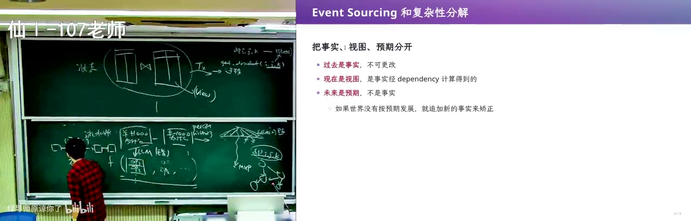
<figcaption>画面 1:34:23 · 现在是过去的结果</figcaption>
</figure>

event sourcing 让依赖显式：LLM 编译错了，改那一条重放，不付代价；“通过 ICS”这个事实一改，所有派生结论都能重算，data flow 看得见而不是藏在状态里。又因为 replay based，他能站在“支付中”这个节点推演风控成功、失败分别到哪，还能靠应收账款回不来的比例估破产概率；它消不掉先修和毕业这些依赖，但把事实、视图、预期分开，世界不按预期就追加新事实，而不是让工程师手改库。最后一句总结是“现在是过去的结果”，并说关系代数犯了 billion dollar mistake 式的错——没把图灵可计算的计算关系当 first-class，于是“能不能毕业”只能存成 0/1；MVVM、React data flow、event sourcing 都是在把 derived state 和 dependency 显式化。

<!-- live:end -->

## 讲了什么
<figure>
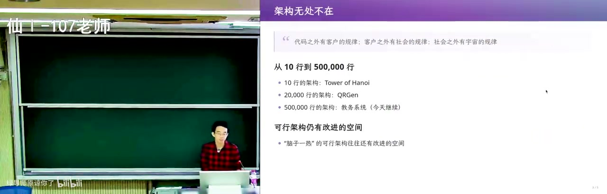
<figcaption>画面 02:58 · 回顾</figcaption>
</figure>

**画面解读：** 承接上讲：做设计决定就背技术债，Brooks 说本质是驾驭复杂性，选课的容量、先修、教室冲突是消不掉的本质复杂性；文件系统好 hack 却没事务，数据库给事务却要穿过中间层调试。再以「登录」演示需求怎么滚成泥潭。

开场承接上一讲：需求与架构分不开，因为只要做设计决定，就背上技术债。Brooks 说软件工程的本质是驾驭复杂性；选课系统的容量、先修、时间冲突、教室、师生借教室，这些是问题域里的 essential complexity，消不掉，只能用架构隔离。任何技术选型都是 trade-off：文件系统好 hack、UNIX 工具能直接组合，但没有原子事务和并发控制；数据库给你 transaction、备份、scale，代价是调试要穿过中间层，不能像文件一样随手用工具看。

他用「登录」说明需求会怎样滚成泥潭：直接让 GPT 做 login，它会猜一个用户名密码方案；有了注册就要确认密码，然后用户一定会忘密码，于是要忘记密码；发邮件要选邮件服务，发短信要通道；想用微信/支付宝登录，个人开发者可能连公司实体都没有。所以需求阶段要 DFS 做 MVP 验证最重要的点，也要 BFS 比较登录方式、首页布局这些分叉；最后总要把需求写出来，但代码本身也可以是需求——把文档删掉让 AI 读代码，也能还原出需求点，只是会非常长。

<figure>
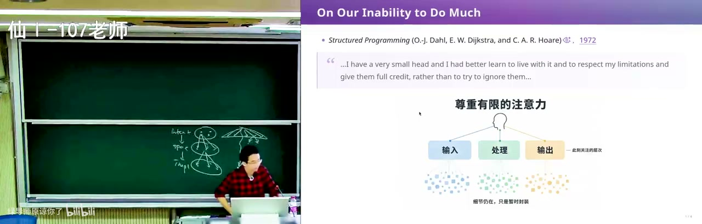
<figcaption>画面 14:25 · 阅读经典</figcaption>
</figure>

**画面解读：** 用 AI 重读老 paper：Dijkstra 说人脑很小，只能靠抽象与层次分解，把不能一次理解的东西变成可逐层理解的；再用动态规划说明「抽象丢失」。Guy Steele 全篇只用单音节词，主张语言要小、要有形式语义、扩展必须是一等公民且可组合。

架构的作用有两个：分解 essential complexity（数据库把存储、可靠性、原子性收进一个 contract，你只管业务）；收缩 spec→implementation 的可能性。需求收缩 intent→spec 的不确定性，架构收缩 spec→implementation 的不确定性，代价还是技术债。

然后他开始「用 AI 重读老 paper」。Dijkstra 的《Notes on Structured Programming》（1972）里说：我们能力有限，i have a very small head，最好承认并尊重这个限制；办法是抽象 + 层次分解，把不能一次理解的东西变成可以逐层理解的东西。书里用「串项链」比喻：把一颗颗珍珠（模块）串起来。1972 年就在讲 class and object、coroutine；今天的 coroutine 多被当成轻量线程（Go 那种），而当年是在没有现成模型时应对软件复杂性。他还用动态规划讲「抽象丢失」：写 `dp[i][j][k]` 时把状态空间/转移图这层抽象扔掉了，所以错了很难调；把状态和迁移显式建模、可视化，就能调，再改写成高效形式。

第二个经典是 Guy Steele 1998 年 OOPSLA 的 keynote《Growing a Language》：全篇只用单音节英文词，遇到双音节以上的词必须当场定义。他用这个形式说明：语言一开始必须小、必须有形式语义、必须能执行；但需求会膨胀，一次性设计一个大语言又交付太慢，会在成功前被小而丑的语言取代。C 就是典型：没有运算符重载，表达「往队列里放东西」很痛苦，`qsort` 的 `int cmp(const void*, const void*)` 加 `nmemb/size` 也很丑；但 C 和机器一一对应、可移植，所以赢。结论不是二选一，而是「生长」：扩展必须是一等公民，扩展之间可以组合；Java 他只主张加泛型、运算符重载、轻量用户自定义类三样。他顺带批评 OJ 把人训练成「解题机器」：题对了代码就扔，不需要扩展，也就不会想架构。

<figure>
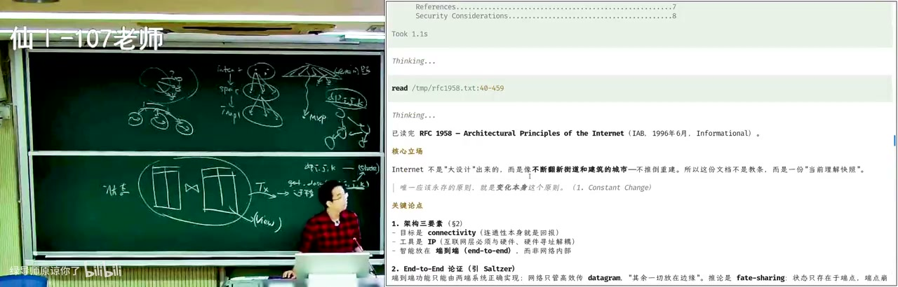
<figcaption>画面 59:46 · 典型的系统架构</figcaption>
</figure>

**画面解读：** 三个可生长架构：UNIX 每个工具只做一件事、用文本流协作，管道把人与程序统一起来；关系数据库用二维表加 SQL，把优化器与事务藏在接口后；Internet 只做连通性，RFC 1958 说唯一该永存的原则是变化本身。

接着是三个「可生长架构」的经典案例。UNIX：每个工具 do one thing well，程序之间用文本流协作，文本接口同时统一了人、程序、程序与程序；管道 1964 年就有想法、1983 年进入 UNIX；还有统一命令行参数、统一输出格式、exit status。现场他用 `fzf` 式菜单打开文件，说明「打开文件对话框」也可以由工具组合出来，不必被 IDE/OS 锁死。关系数据库（Codd 1970）：把世界建模成二维表，SQL 是接口，查询优化器、事务、视图都在后面；schema 可扩展，于是图书馆、学籍、财务、订单都能信息化。Internet：只做 connectivity，TCP 保证可靠传输，上面跑什么不管；RFC 1958（1996）说「唯一应该永存的原则就是变化本身」，于是 HTTP→HTTPS、REST 一层层长出来。

最后是业务系统架构。数据库 + 操作系统 + Internet 打好的舞台上，最直接的做法是「每个页面/功能 = 一个数据库 transaction」：需求点投射成 CRUD，当前状态用表表示，页面是状态的视图。MVC（1979）把它形式化：model 是当前世界的 knowledge，view 是 model 的 pure function，controller 接收用户输入、翻译成 transaction。但 MVC 不够：页面上有大量不在数据库里的状态——展开的菜单、搜索框、hover、query string；于是 MVVM 把 view state 也当成 model，React 用 pure function + virtual DOM，Vue 用依赖图，两者都在藏「状态变了怎么更新 DOM」的复杂性。

真正没解决的是长流程。淘宝下单要锁库存、算优惠、支付确认、风控、发货、退款、售后、对账；如果你只在 order 表加一列 status，流程一长就会出现「既该毕业又不该毕业」这种不一致状态，甚至是静默 corrupt 的数据。他用成绩更正举例：一门先修课从及格改成不及格，学分、后续选课、能否毕业全都连锁变化，手改当前状态数据库必然漏。于是他讲复式记账：每笔交易同时记入两个以上账户、金额相等方向相反，才能自平衡、查错；但传统记账仍然只记当前状态。

<figure>
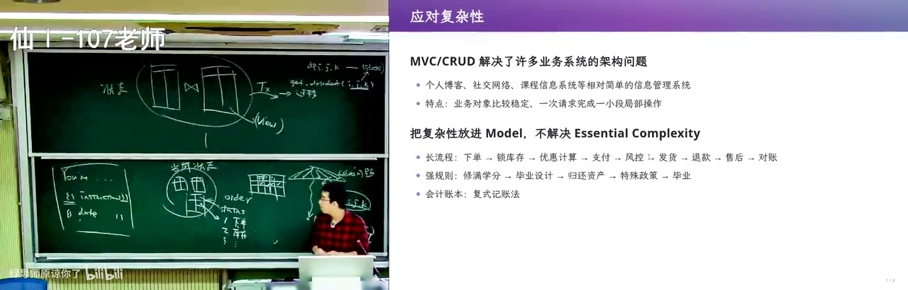
<figcaption>画面 1:21:32 · 应对复杂性</figcaption>
</figure>

**画面解读：** 业务系统里每个功能等于一个数据库事务，MVC 与 MVVM 把模型、页面状态都形式化。但长流程撑不住：订单表只加一列状态就会出现「既该毕业又不该毕业」；于是引入复式记账与事件溯源，只追加事实、重放出报表，让派生状态可溯源。

他自己的记账系统用 event sourcing + LLM 当编译器：只追加不可篡改的流水账条目，每条由 LLM 编译成对资产负债表、现金流量表等的若干操作，当前报表 = 对所有操作做 reduce。这样翻译错了可以直接改那一条重放，不用改历史；还能推演「风控成功/失败会到哪个状态」、评估破产概率。更深一层：当前状态数据库把 derived state（能不能毕业、学分够不够）存成 0/1 字段，依赖关系藏在代码里；event sourcing 把事实、视图、预期分开，所有计算可溯源、可重放，追加新事实而不是手改数据库。他最后说关系数据库犯了个「billion dollar mistake」式的错：没有把图灵可计算的计算关系当成 first-class citizen 管起来，所以 derived state 永远有不一致的风险；MVVM、React data flow、event sourcing 都是在试图把 derived state 和 dependency 显式化。

## 关键点

- 需求阶段要同时 DFS（MVP 验证）和 BFS（登录方式、首页布局等分叉），否则会被一个「理所当然」的方案拖进泥潭。
- 架构 = 收缩 spec→implementation 的可能性；需求和架构都在用「现在做决定」换「未来付技术债」。
- Dijkstra 的核心不是结构化编程语法，而是「人脑很小，所以抽象 + 分层」；动态规划难调，是因为写代码时把状态空间这层抽象丢了。
- Guy Steele 的结论：语言/系统要能生长，扩展必须是一等公民且可组合，而不是一次性满足需求清单。
- UNIX 的文本流、关系数据库的 SQL、Internet 的 connectivity，都是「只统一一个接口，其余交给生态」的架构。
- 当前状态数据库 + status 字段撑不住长流程；event sourcing 用「追加事实 + 重放」把依赖和派生状态显式化。

## 为什么值得看

给被「订单状态」「学籍状态」这类长流程折磨的人看。它没停在 MVC，而是把「当前状态为什么会不一致」推到 event sourcing 和复式记账，还给了 LLM 当编译器的做法。前半段老 paper 串讲能练品味；坑是跨度大，没做过业务系统会觉得散。

## 我的一句话

这讲最狠的一句是「现在是过去的结果」——你要是还在往 order 表里加 status 字段，那不是在建模，是在给未来的自己埋一颗静默 corrupt 的雷。

<!-- BILI_ITEM {"bvid":"BV1JGap6LE74","score":9,"reason":"从需求收敛、经典架构到 event sourcing 治长流程不一致，历史脉络与实操案例都扎实","verdict":"pick"} -->
