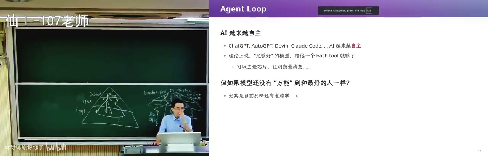
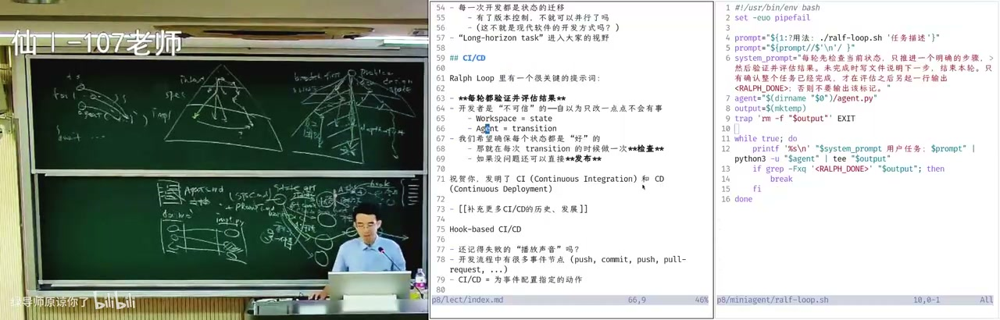

# Agent-native 开发 [08-Raw/26生成式软件工程/NJU]

> 把 agent 开发拆成三件事：Ralph loop 怎么把长任务变成状态机、CI/CD 门禁为什么在 agent 时代更值钱、以及 DeepSeek Harness 如何用一套「文档配对 + 门禁」把 AI slop 挡在主干之外。

- **UP**：绿导师原谅你了（南京大学 蒋炎岩）
- **链接**：https://www.bilibili.com/video/BV11LWw6VEHW
- **播放量**：15426
- **时长**：97:10

## 官方章节时间轴

| 时间 | 章节 |
|---|---|
| 00:00–11:09 | Review & Comments |
| 11:09–40:57 | Agent Loop |
| 40:57–59:32 | CI/CD |
| 59:32–1:37:10 | Agent-native 开发 |

## 讲了什么
<figure>

<figcaption>画面 04:19 · Review & Comments</figcaption>
</figure>

**画面解读：** 开场是实验安排与自用工具：每天给小朋友生成播客、早上收资讯推送。他借带博士生比喻模型——有很强 DFS 倾向，而设计空间里很多分叉在浅层；Humanize 烧了很多 token 后发现，最有效的协作是让 GPT 与 Claude 互相 review。

开场是课程实验安排：第二个实验做 agent loop，把第一个实验里的个人 agent 往前推一步。他顺手讲了自己怎么用 GrokBot：每天给小朋友生成播客（背后是 Claude Code 的 Opus 5.5）、每天早上收 morning paper 推送、看 GitHub trending。他借「带博士生」比喻模型：模型解决问题有很强的 DFS 倾向，找到一个 idea 就一路做下去，但 design space 里很多分叉在浅层，宽度和深度要平衡。Humanize 团队烧了很多 token 后发现，最有效的 multi-agent 协作是让 GPT 和 Claude 互相 review、互相挑刺——不同模型带不同偏见，比同一个模型一路走到黑更容易岔开。

他把软件工程画成 intent → spec → implementation 的搜索：每一步都是一对多，靠访谈、checklist、架构师讨论、UML、IDE、git worktree 这些工具收敛。AI 的价值是让你在任何一个阶段都能立刻生成一个版本，比较「变好还是变坏」，再迭代；需求能拆成两个 subsystem 就并行开两个 agent。他自己实际开发时开四个终端、四个 agent，再多大脑就跟不上输出速度。

<figure>

<figcaption>画面 11:14 · Agent Loop</figcaption>
</figure>

**画面解读：** 梳理 agent loop：从早期幻觉一路到今天的「版本答案」Ralph loop——同一个 prompt 反复丢给 agent，每轮只推进一步、验证后把下一步写进文件，直到输出 RALPH_DONE 才停；现场还拆了 150 行 agent 的主循环。

然后是 agent loop 的历史：2023 年 ChatGPT/GPT-4 幻觉严重，Devin 早期号称能自主解决任务；ReAct 式 agent 靠工具自主行动。今天 harness 的「版本答案」是 Ralph loop，名字来自《辛普森一家》的 Ralph——有点笨、有点可爱、但从不放弃。它简单到三行：把同一个 prompt 反复丢给 agent，让它检查、修改，直到无法改进。核心是「prompt 不变，但世界在变」。

他现场展示自己 150 行的 agent：bash tool 是一个合法 Python object，可序列化成 JSON（type/name/description/parameters），`run_bash` 直接执行；主循环是 while：读终端输入 → build messages → 调 API → 没有 tool call 就输出，有就执行 bash、把 tool_call_id 和 output 塞回消息。这个 agent 真能用，也会暴露产品级问题：timeout 是硬编码的，换到教育网访问 GitHub 就会被误杀——他自己「肉身翻墙」后才发现 clone 能跑满带宽，承认自己 overfit 了环境。他还让这个 agent 生成 HTML 卡片、开浏览器、截图问他「你满意吗」，说明白板模型的行为需要 harness 约束。

Ralph loop 的关键 prompt 是：每轮先检查当前状态，只推进一个明确步骤，验证并评估结果，未完成就把下一步写进文件，全部完成才输出 RALPH_DONE；外层脚本看到 DONE 就停。他把开发看成状态机：workspace 是状态，一轮是一次状态迁移，可 git commit，可停下来检查；同一状态可以选不同 action（GPT 干活、Claude review），也可以并行改 A/B 模块再 merge，于是得到搜索树。这样长任务不再一把梭，能防上下文漂移。他现场对比同一个「做一张我的名片」prompt：一把直出做了很花哨的玻璃动效和 macOS 终端，但邮箱错、也不是 NJU；loop 版本朴素，邮箱和 GitHub 都对——当然有随机性，但算力和 prompt 的投入确实改变结果。

<figure>

<figcaption>画面 44:11 · CI/CD</figcaption>
</figure>

**画面解读：** CI 的第一性原理是「不要相信开发者」，机器永远是对的，于是提交、合并、发布层层设卡。而 agent 更不可信——它会把思维链塞进 doc.md、为一个网页疯狂截图、在细节上过度出力，所以要让它只回简短 summary。

接着是 CI/CD。软件工程的老公理是「机器永远是对的，你的代码永远是错的」，开发者不可信：实习生改一行、跑过单元测试就提交，生产系统就挂。所以要在每个状态迁移后自动检查：pre-commit 编译/lint、pre-push、PR、merge、release 层层设卡。lint 是最基础的守门员；GitHub Actions 每月约 2000 分钟免费算力，他甚至在里面养 Claude Code。CI 的第一性原理就是「不要相信开发者」，而 agent 是更不可信的开发者：它会写 20K 的文档、把思维链和踩坑过程全塞进 doc.md，导致 doc 与 implementation 的隐式关联在上下文压缩后失配；会为一个网页疯狂截图，把图片一直留在上下文里；会在细枝末节过度出力，对 design space 里最重要的选择视而不见。所以要让 sub agent 只回简短 summary，不要回传截图。

他举 OpenAI 的 Codex 为例：文章说他们从空 git repo 开始、人不写代码，人负责定义环境约束、反馈和验证机制；公开的 CI 只有 lint、测试、发布三层。蒋炎岩的判断是：只靠这些门控项目一定崩，Codex 背后必然还有一整套巨大的 agent-native 门禁没公开。Anthropic 也遇到 16 个 agent 协作编译 Linux 时撞同一个 bug、互相覆盖改动，所以需要 orchestration agent 调度。他们自己的项目用 architecture.md 自动生成架构图，log book 记 task 状态，agent dashboard 把进行中的任务按百分比标在架构图上，总架构师看一张图就知道进展。

最后是 DeepSeek Harness 的 agent-native 实践。因为中文读得比英文快约一倍，DSH 同时维护中英文文档，这就是灾难；它用「三件套 + 门禁」：每篇文档同目录下有中、英、i18n.yml 三个兄弟文件，i18n.yml 两侧存 hash，谁是权威由 hash 新旧决定，翻译是 patch-based，只改差异；`pnpm run verify:translation-parity` 检查一致性。文档还有预算：root ≤1960、architecture ≤2400（防止 AI slop 无限堆积）；agents.md 分层、按需加载 skills；agent notes 分 implemented/proposed/rejected/archive；code review 有评分；code block 里的 interface 必须逐字出现在某个源文件里，代码块还带执行语义；terminology 统一术语；style samples 校准「人感」。这些门禁单看都很小，加起来才把项目维护住。DSH 的提交史从 2026-06-10 23:00 开始，6 月 25 日先有 terminology 约定，7 月才有配对契约和门禁——是逐步长出来的，不是第一天设计好的。

<figure>

<figcaption>画面 1:00:06 · Agent-native 开发</figcaption>
</figure>

**画面解读：** 讲 DSH 的做法：中英文档靠「三件套 + 门禁」——同目录放中、英、配置文件三个兄弟，hash 新旧决定谁是权威，翻译只改差异并由 parity 脚本校验；文档有字数预算防 slop，代码块里的 interface 必须逐字出现在源文件。

结尾是他的社会观察：不做很多次、不失败很多次，就很难把东西做好；没有 token 的学生尝试机会更少，「没有 token 应该退学」虽是玩笑，但斩杀线真实存在——公司宁愿给 senior 无限 token，也不愿花四五年培养新人；他甚至放话说大学会崩溃，资本化运营的样板课机构可能是新形态。

## 关键点

- Ralph loop 的全部精髓是「同一个 prompt + 每轮只推进一小步 + 强制检查 + 明确的 DONE 信号」，五行脚本就能实现。
- 开发即状态机：workspace 是状态，一轮是一次迁移，git commit 是检查点；并行 subagent 就是搜索树的分叉与合并。
- agent 比人更不可信：它会膨胀文档、把截图塞满上下文、在细节上过度反应，所以门禁要可执行、要能自动 fail。
- DSH 的文档一致性靠 hash 判定权威 + patch 翻译 + parity 校验，不是靠人肉同步。
- 「文档不超过 1000 字」这种人类不会写的 CI 规则，在 agent 时代是有效的防 slop 手段。
- 他明确说公开的 Codex CI 只是冰山一角，真正的 agent-native 门禁不会开源。

## 为什么值得看

给用 coding agent、但项目开始「越跑越脏」的人看。Ralph loop 和「状态机 + 门禁」今天就能改工作流；DSH 的文档配对、预算、code block 校验，长期项目可以直接抄。坑是信息密度大、demo 有随机性，别把名片对比当严格实验。

## 我的一句话

这场的硬货是「别信 agent，给它装门」——但更有意思的是他顺带承认了：连他自己都会 overfit 网络环境，所谓「智能」很多时候只是没被换过环境。

<!-- BILI_ITEM {"bvid":"BV11LWw6VEHW","score":9,"reason":"Ralph loop、状态机式开发与 agent 时代 CI 门禁的实操细节，含 DSH 文档一致性完整机制","verdict":"pick"} -->
