# 《DeepSeek Harness [09]》详细学习笔记

> BV144nc6KEA4 · 89:24 · 南京大学蒋炎岩（B站「绿导师原谅你了」）
> 依据 2224 段完整字幕 + 时间轴整理；格式参考 DSH 技能 `video-to-notes`（章节拆解 / 知识地图 / 重点标记 / 速查卡）。

## 一句话结论

这节课用「150 行 agent demo 为什么不能当产品」作引子，讲透两件事：**需求会杀死架构**；**DSH 用 microkernel + append-only session + event bus 把能力让给插件生态**。但插件只能消除 accidental complexity，消除不了 essential complexity。

---

## 知识地图

```mermaid
mindmap
  root((DeepSeek Harness [09]))
    问题
      agent 组织化
        CTO 与 sub-agent
        版本控制锁
      demo 不能当产品
        网络中断
        会话恢复
        客户端/服务端一致
    需求
      PRD 膨胀
      MVP 验证假设
      需求变更杀死架构
    架构
      受限 vs 自由
      LAMP
      event sourcing
      MapReduce
    DSH
      microkernel
      Cordis
      session 唯一事实
      event bus
      pre-step 可改事件
    生态
      creator mode
      WPS/Excel bridge
      动态 UI
      语义冲突
```

---

## 官方章节时间轴

| 时间 | 章节 |
|---|---|
| 00:00–23:27 | 需求 |
| 23:27–38:21 | 架构 |
| 38:21–1:05:56 | 设计 |
| 1:05:56–1:29:24 | 生态 |

## 分段大纲

| # | 章节 | 时间（约） | 核心内容 |
|---|------|-----------|---------|
| 0 | 开场：agent 时代，git 不够用了 | 00:00–10:50 | 组织架构、并行 task、版本控制锁 |
| 1 | 150 行 demo：能玩，不能当产品 | 10:50–20:00 | 3D 校园、断网、重试、支付状态 |
| 2 | 从 demo 到产品：PRD、MVP、需求变更 | 20:00–30:00 | WorkBody、slop、GrokBot |
| 3 | 架构的本质：受限 vs 自由 | 30:00–40:15 | LAMP、event sourcing、MapReduce |
| 4 | DSH 的世界模型 | 40:15–50:00 | Cordis、session、event bus、pre-step |
| 5 | 演示：TUI、PDF、VS Code 式侧边栏 | 50:00–58:30 | 扔掉 UI slots、共享状态、better sidebar |
| 6 | Creator mode：运行时拆装插件 | 58:30–68:20 | 动态插件生命周期、现场许愿 |
| 7 | WPS/Excel bridge：超级应用 AI 原生 | 68:20–76:00 | 锁对象、hand off、写回 |
| 8 | 动态 UI：HTML+JS 卡片 | 76:00–84:00 | 成语接龙、五子棋、1.5KB 协议 |
| 9 | 代价与结论：release nothing | 84:00–89:23 | 语义冲突、essential complexity、生态 |

---

<!-- live:start -->
## 课堂实录（按时间顺序）

### 00:00–03:11 · 开场：版本控制不够用了

<figure>
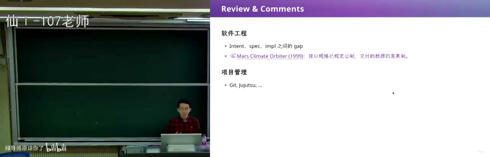
<figcaption>画面 00:22 · 开场：版本控制不够用了</figcaption>
</figure>

他从软件工程的老概念讲起：这些概念太基础，反而在 agent native 时代不断被重写，上周 Anthropic 就直说 git 已经不够用了。原因是你原本像一个单线程 agent 自己学 C++、写项目，有了 agent 之后立刻拥有了和现代公司一样的架构——你是 CTO，下面还有产品、前端、后端，每个 agent 再带一串 sub-agent，版本控制要协调的是大量并行 task。于是他设想给 repo 加锁：只读锁、写锁，refactor 锁和 minor fix 的写锁还要区分，小的互相独立的 fix 应该能并行，可以借鉴操作系统的锁和数据库里乐观、悲观的 conflict detection。概念讲得差不多了，他说该回到一个具体项目上。

### 03:11–06:37 · 先许愿跑起来再说

<figure>
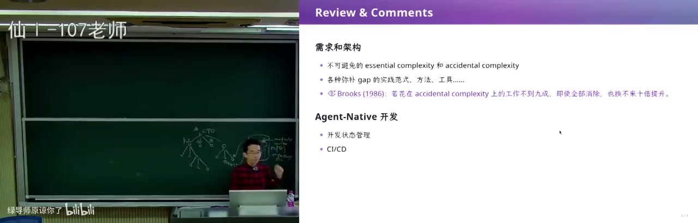
<figcaption>画面 03:13 · 先许愿跑起来再说</figcaption>
</figure>

他选 DSH 当这个 agent native 时代的样本，因为前天在北京刚参加他们的线下聚会，台下很多同学是没有古法编程经历、直接对着 web 许愿编程的一代。他顺手泼了盆冷水：网上流传的 skills、grow with stocks、super powers 拿过来用，很容易一头扎进你不想它管的细枝末节，反复 spawn sub-agent 做没必要的测试和 validation，在公司里也许成立，学生最好自己摸索出切身感受。所以他昨天到今天在这台机器上部署 DSH 全是许愿式操作，只要确认项目能编译就交给 agent，然后回到上一节课那个 150 行的 mini agent 当起点。

### 06:37–10:20 · 高铁上的三维校园

<figure>
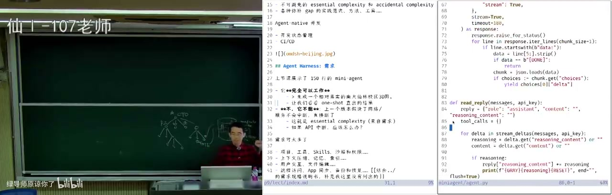
<figcaption>画面 06:39 · 高铁上的三维校园</figcaption>
</figure>

那个 150 行的 harness 遵循几乎所有 agent harness 的循环：大模型是一问一答的 responses API，回答的要么是人要么是工具。周日他在高铁上突发奇想给 agent 一句话——要一个比例基本真实的南大仙林校区三维图，结果计算机楼十层的高度明显不对，大门被当成一栋楼、门口还铺满了树，但图书馆的建模不错，从 top-down 看几何形状是保持住了。原因是它从 OpenStreetMap 爬了很细的地图数据再自己建模，地图上没有东西的地方就标成绿地。想修得更好就再给提示词——先把每块区域单独划出来、判断功能、再精确建模，代价大概是十倍 token，这样就能得到做「南大版 GTA」的 starting point。

### 10:20–14:35 · 断网那刻暴露的差距

<figure>

<figcaption>画面 10:22 · 断网那刻暴露的差距</figcaption>
</figure>

但这个 demo 当不了产品，因为上一个版本假设了网络服务不会中断。在高铁上跑了很久、已经有中间结果时网一断，进程直接终止，150 行代码没有会话保存、没有恢复、也不能断点续跑，他只能从零重来或者让它重做一遍。真要做产品就要处理 API 中断后的重试间隔——等距还是 exponential backoff 的 1s、2s、4s、8s，物理故障可能要两三分钟才回来；还要处理客户端与服务端不一致：支付请求发出去后服务端已经把订单交给银行或航空公司，手机却断网了，App 不能崩，只能转圈并告诉用户「订单处于我不知道的状态」。

### 14:35–19:20 · 一份很长的需求文档

<figure>
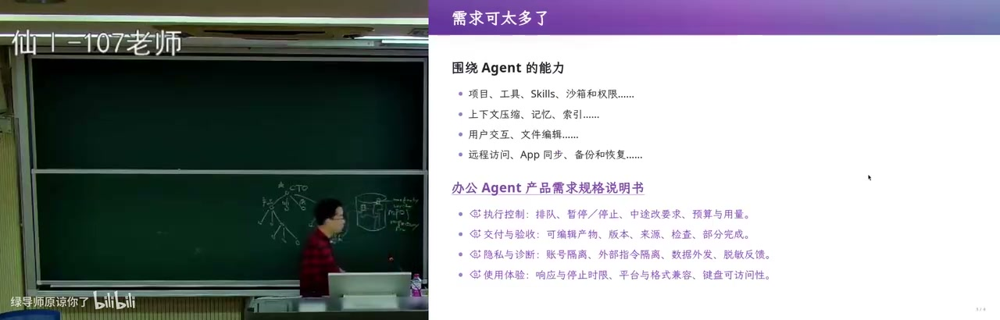
<figcaption>画面 14:37 · 一份很长的需求文档</figcaption>
</figure>

把 demo 做成产品，就要多项目 dashboard、项目相关的 skills、工具调用的沙箱与权限、账号与数据管理，于是一份很长的 PRD。他让 AI 假装自己要做卖得最好的 WorkBody：先列用例，把本周项目记录整理成周报、列出延期事项、生成 Word 文件，再列功能——历史检索与任务复用、模板与偏好、执行预算与用量、账号与数据管理、外部内容隔离、用户反馈与问题诊断，外加大量非功能需求。直接让 agent 实现这份需求大概率陷入 slop，因为 agent 有强烈倾向「先把任务完成」，不会想未来；MVP 的价值不是缩小版产品，而是让假设被 validate。

### 19:20–22:10 · 需求改变会杀死架构

<figure>
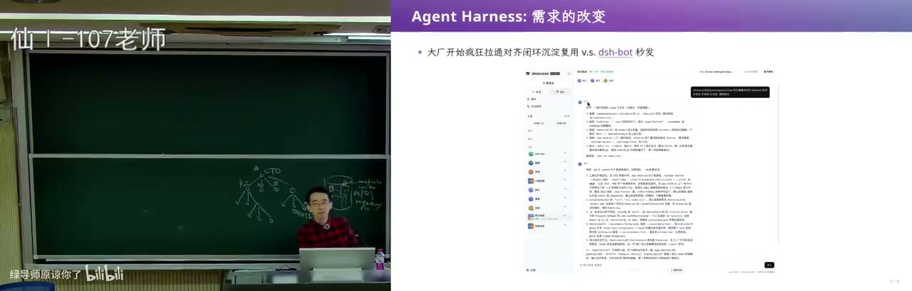
<figcaption>画面 19:22 · 需求改变会杀死架构</figcaption>
</figure>

真正的挑战是需求会变：你已经带着 AI 按 WorkBody 那套「左边栏是项目、右边是几种 view」写完 50 万行并上线，老板突然说下一版照 GrokBot 做——agent 当人、各自有记忆、可以拉群协同、可以定时干活，交互模式的根基就全崩了，所以说杀死一个程序员只要改需求三次。大厂的对策是疯狂拉通对齐、闭环沉淀，架构偏保守以保证交付质量；而在 DSH 生态里，GrokBot 火了几周就不止一个人光速 release 出像素级复刻的 dsh bot，连群图标都有，还能再外挂 multi-agent dashboard，把左边栏做成树状的部门结构。

### 22:10–24:56 · 六月十日的第一个提交

<figure>
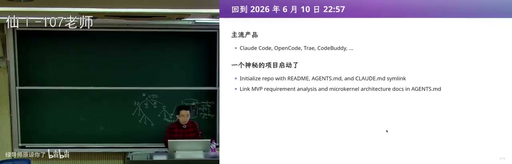
<figcaption>画面 22:12 · 六月十日的第一个提交</figcaption>
</figure>

要理解 DSH 为什么敢走另一条路，得把时间倒回 2026 年 6 月 10 日晚上 11 点，那时 Claude Code、Open Code、Cold Body 都在，还没有 WorkBody（据说两者共享同一套 agent 层编排）。那个神秘项目的第一个提交几乎什么都没有，连 CLAUDE.md 都还是个恶心的需求点——要同时支持多种 agent，就得用它们都认的方式组织项目文件。但里面已经写了 link MVP requirement analysis 和 microkernel architecture：第一天他就想造一个操作系统，一艘航母。

### 24:56–28:58 · 架构是受限与自由

<figure>
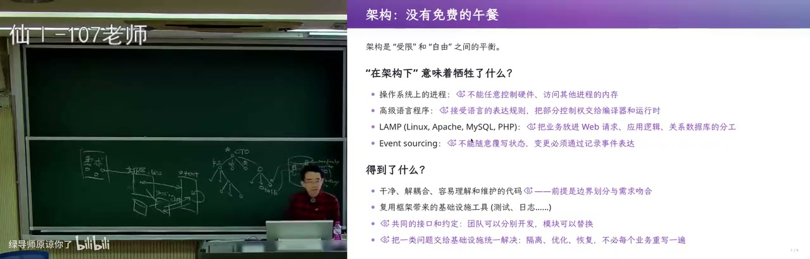
<figcaption>画面 24:58 · 架构是受限与自由</figcaption>
</figure>

如果照着需求文档让 agent 设计架构，注意力就全在需求上：它会为「工作区」建一个 class，设计工作区与 session、agent、canvas 的交互，再拿数据库存 session，这是很自然、大厂也常这么做的方式。但架构没有免费的午餐——边界一旦定下，你开发一个模块就不必知道系统其余部分怎么工作，于是第一天就能拉起大量 sub-agent 并行堆产品；代价是限制自由，未来需求一变就不断有抽象泄漏。反过来若追求每个模块都是一个 process、彼此 message passing，架构看着最干净最自由，却等于没有架构：什么时候发什么消息都不确定，这就是 actor model 的反面教材。

### 28:58–33:17 · 单机上最好的架构

<figure>
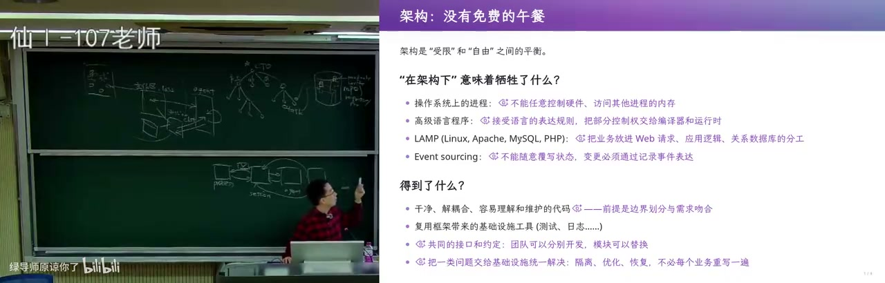
<figcaption>画面 29:00 · 单机上最好的架构</figcaption>
</figure>

他往下数案例：LAMP 这一整套架构引领互联网世界十几年，WordPress 就是典型，单机还能扛需求时它就是最合适的；可一旦要服务一亿、十亿人，从单机到数据库每个点都是瓶颈，只能先分库分表、再把服务器拆开，抽象一路泄漏。event sourcing 概念最干净——所有东西都是 append-only 的事实，其余都是事实的派生，可以回退到任何历史版本；但当前状态全靠历史推导，性能更难做，而且「教务员想让一个学生在一个月黑风高的晚上悄悄毕业」这种 hack 当前状态的需求很难办，事件历史里留着谁 committed 的记录，一审计就穿。

### 33:17–38:21 · 用两个函数换容错

<figure>
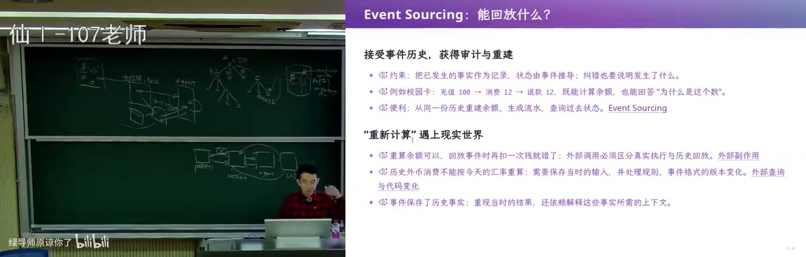
<figcaption>画面 33:19 · 用两个函数换容错</figcaption>
</figure>

2004 年 Jeff Dean 和 Sanjay 那篇 MapReduce 文章，某种程度上改写了 LAMP 那波中心化服务器的浪潮。它做的是架构上的取舍：限制你的编程模型，分布式计算只能写成 map 和 reduce 两个函数（reduce 要有结合律才能并行拆开），中间的按 key 排序 shuffle、分布式执行和机器故障容错全藏在框架后面，你只要声明最多 2000 台机器、每个 task 100MB 内存就能跑。这样 Google 就敢做整个互联网索引这种跑很久的任务——机器一多就必然有掉线，而「我的机器不会消失」这个假设在真系统里不成立；代价是只适合离线批处理，实时订单撑不住，后来才有 Spark 和 Flink。

### 38:21–42:39 · 一切皆插件的内核

<figure>

<figcaption>画面 38:23 · 一切皆插件的内核</figcaption>
</figure>

所以回到 first principle：操作系统不需要知道每个进程干什么，但能把进程组合起来、互相使用，DSH 的答案就是 microkernel 加 everything is a plugin。他也提醒别掉进「每个插件都当进程、随便发消息」的陷阱——那等于把模块间的函数调用换成远程过程调用，任何软件都能变成这样，所以这种架构没有用。负责装卸的是 Cordis：服务解析、依赖激活、插件的 load 和 unload，理想情况下插件 declare 自己依赖的东西，会被自动加载，unload 时自动卸载，就像进程退出时操作系统回收它持有的全部资源。

### 42:39–46:00 · 会话日志是唯一事实

<figure>
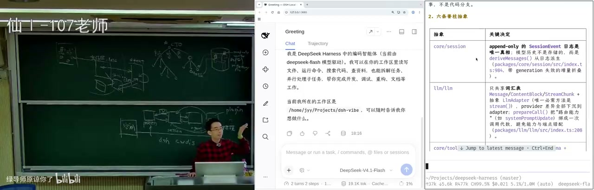
<figcaption>画面 42:41 · 会话日志是唯一事实</figcaption>
</figure>

但插件装卸不是难点，难点是协同——随便发消息就全乱了，所以 DSH 建了一个所有插件共享的世界模型。核心是 append-only 的 session event 日志，它是唯一的 ground truth，模型历史不单独存储而是从事件派生，这就是 event sourcing；插件挂在 event bus 上，有类型检查、service 的 provider 与 consumer、一系列权限管理，事件是扩展点、按领域分类，类型匹配不上 TypeScript 直接不让你编译。更关键的是插件能监听甚至修改尚未 persist 的事件：LM inference 在 history 里留一个 open entry，token 不断流入、不落盘，但状态仍可被看到，所以能实时显示思维链、统计 token 和 cache hit。

### 46:00–49:50 · 白板一块与轨迹投影

<figure>
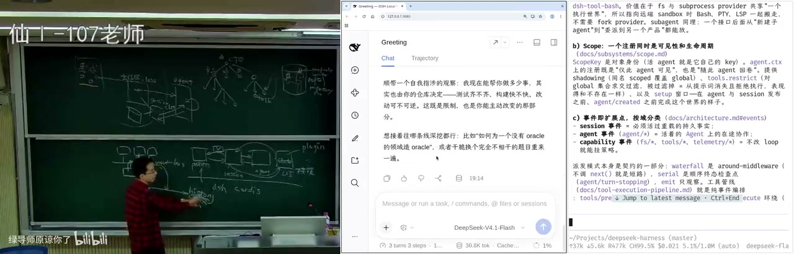
<figcaption>画面 46:02 · 白板一块与轨迹投影</figcaption>
</figure>

有了总线，第一方只需要给少量抽象：session 是 list of event，agent 接收输入并推动执行，装配界面靠 UI slots。他回忆内测版本真的就是白板一块，什么都没有，可开发者群第一天就有人做了 token 与上下文统计——只要观察 event bus 上 LM 吐 token 的情况、更新自己内部状态，完全不侵入系统任何其他部分。你看到的聊天窗口本身也只是 message history 的一种投影，DSH 同时提供给人看的 UI 和给开发者看的 trajectory，工具调用、payload、结果和额外信息都在，所以他说发布那天看完是「震惊瘫坐」、像原子弹爆炸：干净的架构能带来什么，很多人还没意识到。

### 49:50–53:47 · 干净接口与预步骤钩子

<figure>
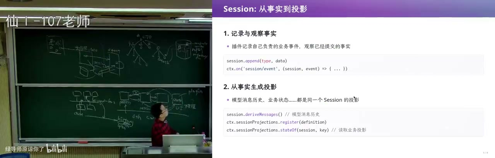
<figcaption>画面 49:52 · 干净接口与预步骤钩子</figcaption>
</figure>

这套 API 看上去很平常：session 上 append，注册某一类 event 的 handler，从事实派生投影——session.deriveMessages、从 persist history 导出 trajectory，向 agent 提交输入还能 follow up、inject、steer。这些正是用 Codex 时遇到的产品问题：模型正在推理输出时你继续提问，是等这一轮工具全部完成再注入，还是下一轮 response 就立刻注入，还是按 ESC 停下来重来。而最关键的一环是能 hook 还没 persist 的事件，比如 agent 的 pre-step 之前动手，甚至往 loop 里 inject prompt，于是「每一轮都把我所在时区、机器指纹这类信息注入上下文」不必写死在 build context 里，挂一个 hook 改掉事件内容就行。

### 53:47–58:22 · 拆掉界面做命令行

<figure>

<figcaption>画面 53:49 · 拆掉界面做命令行</figcaption>
</figure>

地基打好之后，做什么都容易：想要 text UI，就把所有用于装配界面的 UI slots 全扔掉，只要 session 和 agent，在 event bus 上听全 session 相关事件——包括还在吐 token 的 open chat completion——再投射到自己的终端，web UI 一行都不用动，甚至能在第二个终端看到一模一样的共享状态；内测时官方 repo 里的 TUI 后来被移除，现在是第三方在维护。PDF reader 则去 hook 生命周期，加载时把自己 inject 进去。再往前一步，有人把 VS Code 的假设搬过来：一个工作区目录、可动态配置的边栏、底下放 terminal，再加 git 和 side chat，就得到 cursor agent mode 的体验，而这跟系统里别的东西完全不冲突，因为它只是看主 session、维护自己的状态。

### 58:22–1:03:01 · 创造者模式现场许愿

<figure>
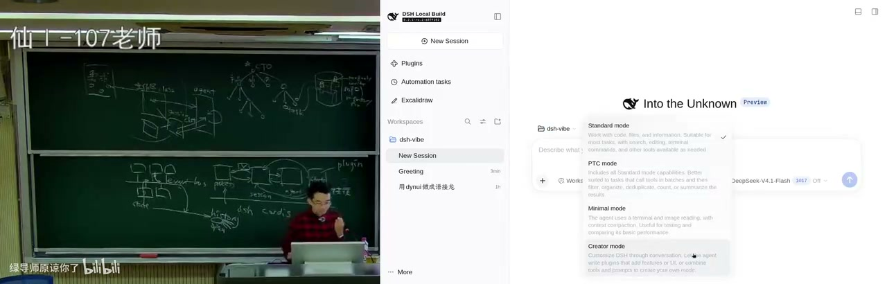
<figcaption>画面 58:24 · 创造者模式现场许愿</figcaption>
</figure>

这就是 creator mode 的用法：普通 session 只有工作区目录读写加 bash 的权限，后面可能还套个沙箱，而 creator mode 把 Cordis 的权限也交出去，agent 一边跑一边就能拆插件、往 event bus 上挂东西，这要求全动态的插件生命周期，像在操作系统里随时启动和杀掉进程。它和 Wake up、Buddy 那类「预先设好需求、所有人都在我的需求里工作」的产品不同，这里许愿的对象是插件本身。现场他许愿在 token 消耗旁边放一个超大号显示，弹窗要一个很危险的安装权限他直接 allow，为了快还关掉了「雷霆大思考」，顺带看到实时推理速度从早上的 200 左右涨到了 250。

### 1:03:01–1:07:10 · 插件语义会互相打架

<figure>
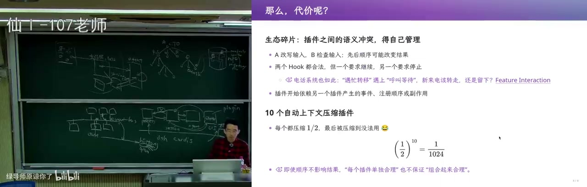
<figcaption>画面 1:03:03 · 插件语义会互相打架</figcaption>
</figure>

但所有好处都有代价：event bus 只在事件这一层做了统一对齐，插件自己的状态管理仍留在本地——better sidebar 的窗口是什么终端、怎么表示，都是它自己的事。于是语义会冲突：装十个「自动把上下文压缩一半」的插件，输出就被压到约千分之一，小到信息全丢；一个 hook 检查输入、一个 hook 改写输入，到底谁先谁后架构没有规定；两个 hook 一个要求停、一个要求继续，跑到停的那个就停住了。他强调这是 essential complexity，插件只减少 accidental complexity，真要共享状态可能得再放一块 blackboard，而那一刻抽象就泄漏了。

### 1:07:10–1:12:30 · 给超级应用装薄桥

<figure>
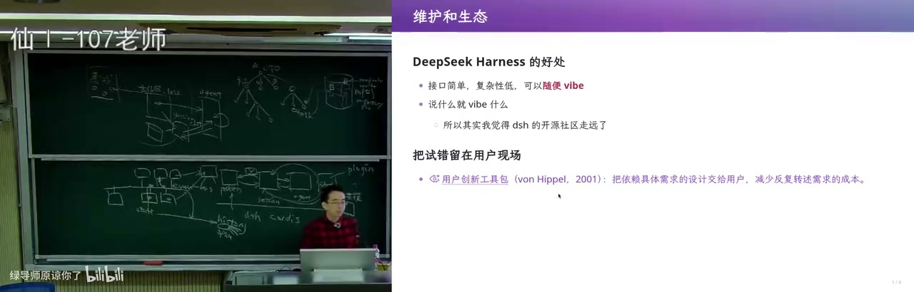
<figcaption>画面 1:07:12 · 给超级应用装薄桥</figcaption>
</figure>

他真正看重的是生态：DSH 发布时几乎 release 了一个 nothing，只有基础抽象和少量第一方功能，剩下的交给开源——上周北京的线下活动完全是开发者自组织，官方一个人都没到场。event bus 的能力不在接几个花哨小插件，而在把整个生态接进来：接一个 super app 只需要两个操作，先把对象锁住（比如 PPT 第二页别编辑了），再把对象 hand off 进模型上下文，最后把修改拿回来替换回去。他花五分钟 web 了一个 Excel/WPS 式的画布，AI 在框里画 turtle，锁住的对象照常可编辑，不满意就把龟壳删掉重来——因为东西挂在总线上，整个生态都归他，而 Kimi 那类产品却要自己做一套 PPT 编辑器。

### 1:12:30–1:18:46 · 会写代码的界面卡片

<figure>
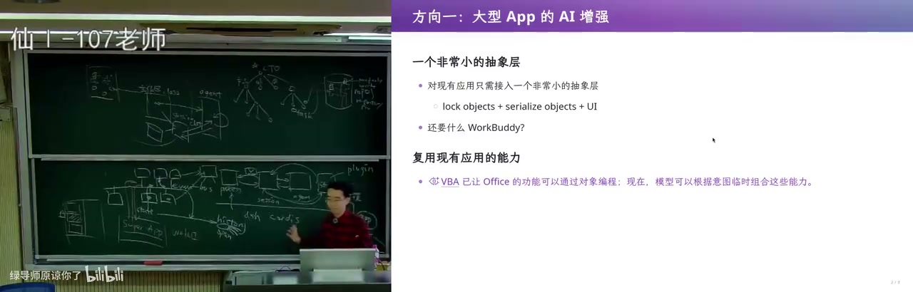
<figcaption>画面 1:12:32 · 会写代码的界面卡片</figcaption>
</figure>

第二个方向是把模型输出变成可交互界面：允许模型吐一张带 JavaScript 的 HTML 卡片，放到界面任何 slot 上，插件只约定一个 dsh-dynamic-ui 的 div，靠 system prompt 注入一段协议告诉模型该怎么写。卡片里的 JS 能把按钮点击、输入框状态通过 event bus 注回模型上下文，模型再据此更新界面，这就是 generative UI 的雏形；理论上卡片里放 WPS、放一个复杂组件都行。现场演示成语接龙以「惊弓之鸟」开局接到「鸟语花香」，再做五子棋——棋盘状态留在 UI 里、每一步落子由模型思考决定，可惜关掉思考后棋子下在了线上，他自己也承认这肯定不是成熟产品，但就像 ChatGPT 当年从 50 数到 100 都数不利索，看到一种可能性就够了。

### 1:18:46–1:23:50 · 插件到底侵入多少

<figure>
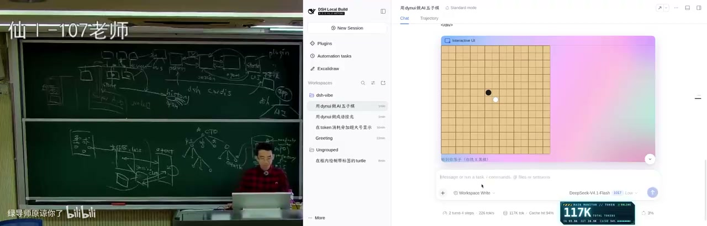
<figcaption>画面 1:18:48 · 插件到底侵入多少</figcaption>
</figure>

演示完他反过来让 agent 打开插件实现，看看到底侵入了多少，结论是很薄的一层应用改造：画布等于 session，编辑请求等于 tool call，提交等于回合结束的 commit，工具调用不直接改画布、只暂存到 store，选区 id 锁在画布上。动态 UI 插件同样只靠 context.systemPrompt 那个事件注入协议，从模型输出到 UI 状态靠「标记加投影」，不新增消息类型；DSH 还用 scope 机制兜底，插件实际行为和它声称的能力匹配不上就自动 fail，相当于隔离。它做的也只是旁听全局的 assistant stream、用对象同一性过滤掉别人的 agent，然后后台起一个 inference session 取结果。

### 1:23:50–1:29:23 · 填一张表与操作系统

<figure>
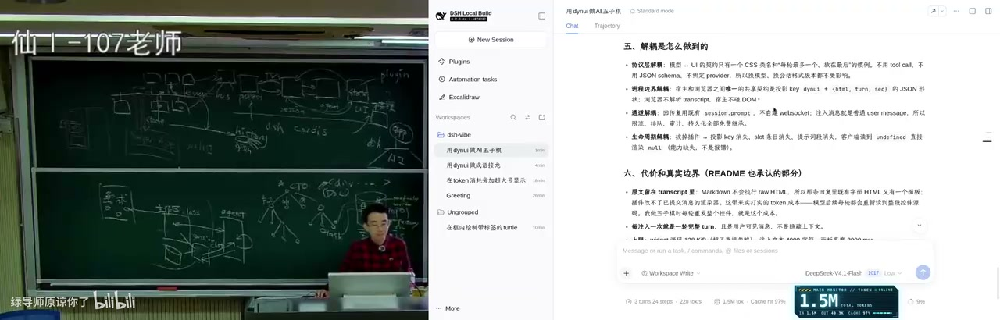
<figcaption>画面 1:23:52 · 填一张表与操作系统</figcaption>
</figure>

收尾是一个很日常的例子：因为要保密他昨天被迫删了帖，又得填一张从 2021 年到现在所有发表论文的表格，别人可能用 Codex 的 computer use 慢慢截图填，他则在自己的生态里接一个个人 database 插件，把个人信息、论文列表、学生信息交给模型，WPS 需要论文列表时把任务往总线上一丢，生态里的工具和 bot 一起把数据凑齐、一把把表格填好，中间不需要 computer use、不需要多余 token、不需要疯狂截图。所以他认为好架构带来的是一整个生态，release nothing 反而把上限交给所有人；他还在做一个保密的 agent OS 项目，同样 everything is a plugin，但位置在 DSH 更下面，可以和它并行提供更多能力。最后他说下节课再讲 DSH 里 agent native 开发的细节，今天下课。

<!-- live:end -->

## 0. 开场：agent 时代，git 不够用了（00:00–10:50）

<figure>

<figcaption>画面 10:53 · 需求</figcaption>
</figure>

**画面解读：** 开场先说 git 已经不够用：有 agent 后一个学生就拥有公司级组织架构，你是 CTO，要协调大量并行任务，于是设想只读锁、写锁、重构锁。再用 150 行 agent 做三维校园：能跑，但断网即终止、没有会话恢复，demo 的假设是网络稳定。

Anthropic 说 git 已经不够用。蒋炎岩的解释是：有了 agent 之后，一个学生立刻拥有公司级组织架构——你是 CTO，下面有产品、前端、后端 agent，每个还能再带 sub-agent。

- ⭐ 这时版本控制要处理的不再是单线程提交，而是大量并行 task。
- 他设想给 repo 加「锁」：只读锁、写锁、refactor 锁；小的、互相独立的 fix 可以并行。
- 🔧 可以借鉴操作系统的锁，以及数据库的乐观/悲观并发控制和 conflict detection。
- ⚠️ 这不是「git 要死了」，而是「git 的假设是单人/单线程，agent 把假设打破了」。


> 💡 **核心提炼：** agent 把「一个人写代码」变成「一个人管理一个组织」，版本控制必须从「提交」升级为「并行任务的协调」。

## 1. 150 行 demo：能玩，不能当产品（10:50–20:00）

他在高铁上用一句话让 150 行的 mini agent 做一个「比例基本真实的南大仙林校区三维图」。Agent 从 OpenStreetMap 爬数据、自己建模：

- 图书馆的俯视几何基本正确；
- 十层的计算机楼高度明显不对；
- 大门被当成了一栋楼，门口铺满树；
- ⭐ 加提示词、烧十倍 token 可以修得更好。

这个 demo 证明 agent 能完成不平凡的任务，但它**假设网络永远稳定**。高铁断网后进程直接终止，150 行代码没有会话保存、没有恢复、没有断点续跑。

真实产品还要面对：

- 🔧 API 中断后的重试间隔：1s → 2s → 4s → 8s 的指数退避；物理故障可能要两三分钟才恢复。
- ⚠️ 客户端/服务端状态不一致：支付请求发出后，服务端已把订单提交给银行/航空公司，手机却断网了，App 只能转圈并显示「订单处于我不知道的状态」。


> 💡 **核心提炼：** demo 的假设是「网络稳定、进程不崩、状态可丢」；产品的假设是「这些都会发生」。两者之间是 essential complexity。

## 2. 从 demo 到产品：PRD、MVP、需求变更（20:00–30:00）

一个真正的 agent 产品需要：多项目 dashboard、项目相关 skills、工具调用的沙箱与权限、账号与数据管理……于是有了一份很长的 PRD。

他让 AI 假装做一个对标 WorkBody 的产品。AI 会先列用例：

- 把本周项目记录整理成周报；
- 列出延期事项；
- 生成 Word 文件。

再列功能：历史检索与任务复用、模板与偏好、执行预算与用量、账号与数据管理、外部内容隔离、用户反馈与问题诊断，以及大量非功能需求。

- ⚠️ 直接让 agent 实现这份 PRD，大概率会陷入 slop——agent 有强烈的「先把任务完成」倾向，不会想未来。
- ⭐ MVP 的价值是让假设被 validate；假设一破，需求就膨胀。
- ⭐ 需求会杀死架构：你已经按 WorkBody 写完 50 万行并上线，老板突然说下一版照 GrokBot 做——交互从「左侧项目栏 + 右侧面板」变成「拉群、agent 当人、有记忆、可定时」。之前所有需求假设的根基崩塌。
- 大厂靠拉通对齐、闭环沉淀、保守架构保证交付质量；而 DSH 生态里，GrokBot 火了几周就有人像素级复刻出 dsh bot，还能加 multi-agent dashboard。


> 💡 **核心提炼：** 需求变更不是例外，是常态；架构必须为「假设会变」留余地，否则 50 万行会变成负债。

## 3. 架构的本质：受限 vs 自由（30:00–40:15）

<figure>
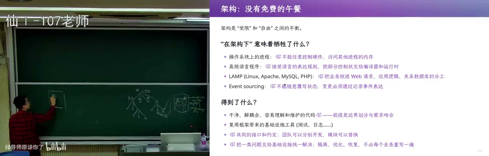
<figcaption>画面 23:45 · 架构</figcaption>
</figure>

**画面解读：** 先讲需求会杀死架构：五十万行写完上线，老板一句改需求，交互假设全崩。再讲架构的本质是受限与自由的取舍——约束划出边界让 sub agent 并行，太自由等于没有架构；LAMP 单机最优、十亿人处处瓶颈，MapReduce 用两函数限制换容错。

时间倒回 **2026 年 6 月 10 日 23:00**，DSH 的第一个提交：一个 microkernel architecture、link MVP requirement analysis，什么都没有，连 CLAUDE.md 都是后来才不需要的。

他对比了两种设计路径：

- **对着需求设计**：agent 会为「工作区」建 class，设计 workspace–session–agent 的交互，用数据库存 session。很自然，但架构会被需求绑死。
- **从 first principle 设计**：操作系统不需要知道每个进程干什么，但能把进程组合起来。所以 DSH 选择 `everything is a plugin`。

架构的本质是**受限与自由之间的取舍**：

- ⭐ 约束划出模块边界，让 sub-agent 可以并行开发；代价是需求变化时抽象泄漏、难维护。
- ⚠️ 如果每个模块都是进程、随便 message passing，架构很干净很自由，但「没有任何用」——没有约束，什么时候发什么消息都不确定，等于没有架构（actor model 的反面教材）。

几个案例：

- **LAMP**：单机能扛时最好；服务 10 亿人时每个点都是瓶颈，只能分库分表、再拆服务。
- **Event sourcing**：概念干净、可回退、可审计；但性能更难，而且「教务员想悄悄让一个学生强行毕业」这种 hack 当前状态的需求很难办，因为事件历史会留下谁 committed 的记录。
- **MapReduce（2004，Jeff Dean & Sanjay）**：把编程模型限制成 map 和 reduce，用户只写这两个函数，框架负责排序 shuffle、分布式执行和机器故障容错（最多 2000 台机器、每 task 100MB 内存）。代价是只适合离线批处理，实时数据撑不住，后来才有 Spark、Flink。


> 💡 **核心提炼：** 架构不是「画得越干净越好」，而是「用限制换协作」；限制和需求匹配时是便利，假设一变就是阻力。

## 4. DSH 的世界模型：Cordis、session、event bus（40:15–50:00）

DSH 的 first principle 是操作系统式的：

- Cordis 负责服务解析、依赖激活、插件 load/unload；
- 插件声明依赖，unload 时依赖自动卸载；
- 资源回收像操作系统回收进程资源。

真正的难点是**协同**，于是 DSH 建了一个所有插件共享的「世界模型」：

- ⭐ **session 是 append-only 的事件日志，是唯一 ground truth**；
- ⭐ 模型历史不单独存储，由事件派生（event sourcing）；
- ⭐ event bus 上挂插件，事件按领域分类，类型不匹配 TypeScript 直接编译不过；
- 🔧 插件可以监听甚至**修改尚未 persist 的事件**（如 agent 的 pre-step）——这是关键能力；
- 🔧 LM inference 有一个 open entry，token 不断流入、不 persist，但可被观察，所以能做实时 thinking、token/cost 统计；
- 第一方提供 session、agent、UI slots 等抽象，trajectory 就是 session history 的另一种投影；
- 插件大部分状态留在本地，只把希望别人看见的东西发上 event bus。


> 💡 **核心提炼：** DSH 不是「一堆插件」，而是「一个所有插件共享事实的世界模型」；session 是事实，event bus 是协作接口，插件是投影。

## 5. 演示：TUI、PDF、VS Code 式侧边栏（50:00–58:30）

- **Text UI**：把 UI slots 全扔掉，只监听 session 事件，就能做 text UI，甚至和 web UI 共享状态。
- **PDF reader**：用事件 hook 注入生命周期。
- **VS Code 式侧边栏**：终端、git、side chat 都能作为插件加上去。
- better sidebar 这类插件证明了：只要看主 session、维护自己的状态，就能做出完整工作台，而不侵入系统。


> 💡 **核心提炼：** UI 只是 session 的一种投影；把 UI slots 换掉，DSH 就能变成 TUI、IDE、bot，甚至你没想到的形态。

## 6. Creator mode：运行时拆装插件（58:30–68:20）

<figure>
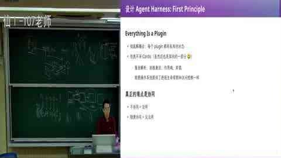
<figcaption>画面 42:54 · 设计</figcaption>
</figure>

**画面解读：** 讲 DSH 的世界模型：Cordis 管服务解析与插件装卸，session 是只追加的事件日志、唯一事实来源，模型历史由事件派生，event bus 按领域分类，插件还能修改尚未落盘的 pre-step 事件。随后演示扔掉 UI slots 的 TUI 与侧边栏。

- Creator mode 给插件 Cordis 权限，agent 运行时可以拆插件、加插件，因为 DSH 有全动态插件生命周期。
- 现场演示：让 agent 现场写插件，给 token usage 旁加一个超大号显示；agent 一边跑一边往 event bus 上挂东西。
- 这和 Wake up/Buddy 这类「预设需求」产品不同：creator mode 把「创造插件」本身交给使用者。


> 💡 **核心提炼：** 动态插件生命周期把「软件发布」变成「运行时许愿」；架构的上限由第一方抽象决定。

## 7. WPS/Excel bridge：给超级应用装 AI 原生能力（68:20–76:00）

- WPS/Excel bridge 只支持三个操作：**锁住对象**、**把对象 hand off 给模型**、**把修改拿回来**。
- 就把一个没有 AI 能力的超级应用接进生态；任何能嵌在网页里的应用都可以。
- 他举了个人 database 插件 + WPS 填表的例子：论文列表、学生信息、个人资料由生态里的工具协作完成，不需要 computer use、不需要疯狂截图。


> 💡 **核心提炼：** 不需要重写超级应用，只需要一个很薄的 bridge，把「对象」交给模型，再把结果写回；生态的能力就接上了。

## 8. 动态 UI：HTML+JS 卡片（76:00–84:00）

- 模型输出带 JS 的 HTML 卡片，卡片里的按钮通过 JS 往 event bus 注入事件，回到模型上下文。
- 现场演示成语接龙、五子棋：五子棋状态在 UI 里，落子由模型思考决定。
- 插件用 `context.systemPrompt` 注入 1.5KB 协议，让模型知道要生成特定标记的 div。
- ⚠️ demo 有 bug（五子棋下在线上），不是成熟产品；但它展示了「生成式 UI」的可能性。


> 💡 **核心提炼：** 动态 UI 把「模型输出」变成「可交互界面」，再把界面事件注回上下文——这是 generative UI 的雏形。

## 9. 代价与结论：release nothing（84:00–89:23）

<figure>
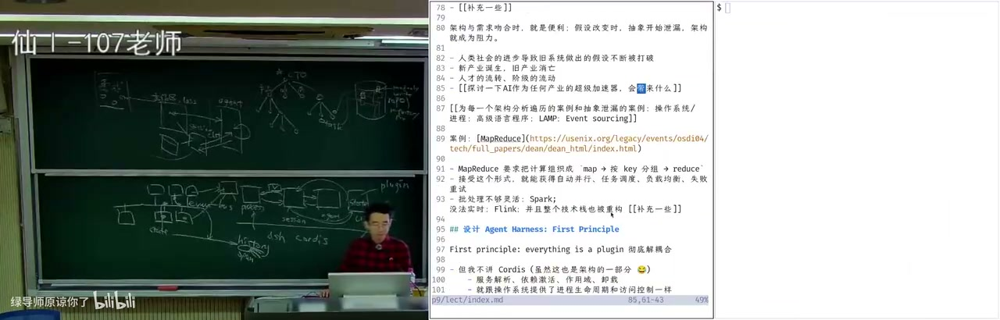
<figcaption>画面 1:12:49 · 生态</figcaption>
</figure>

**画面解读：** 讲生态侧：creator mode 让 agent 运行时拆装插件，现场加了个超大号用量显示；WPS/Excel bridge 只支持锁对象、交给模型、把修改拿回来三步就接进生态；动态 UI 让模型输出带 JS 的 HTML 卡片。代价是插件语义会冲突。

- event bus 只统一了事件和类型，插件自己的状态仍在本地。
- ⚠️ 插件之间语义会冲突：装十个「上下文压缩一半」的插件，输出会被压到千分之一；一个 hook 要停、一个要继续，谁先谁后没有规定。
- 这些 essential complexity 解决不了，插件只减少 accidental complexity。
- ⭐ DSH 发布时几乎「release 了一个 nothing」，把剩下的交给开源生态；任何 super app 都可以用很小的 bridge 接入，享受整个生态。
- 他提到自己在做 agent OS，思路与 DSH 类似，但位于更底层，可以和 DSH 并行。


> 💡 **核心提炼：** 插件不是万能的，架构也不是；好的架构能把「协作」变成生态，但语义冲突、hook 顺序、压缩叠加这些 essential complexity 仍然要人来解决。

---

## 关键数字与例子

| 内容 | 数字/细节 |
|---|---|
| mini agent | 150 行 |
| 视频时长 | 89:24（5363 秒） |
| DSH 第一个提交 | 2026-06-10 23:00 |
| MapReduce 论文 | 2004 年，最多 2000 台机器，每 task 100MB 内存 |
| 修 3D 校园图 | 约 10 倍 token |
| 动态 UI 协议 | 1.5KB systemPrompt |
| 十个压缩插件叠加 | 输出被压到约 1/1000 |
| WorkBody 假设崩塌 | 已写 50 万行，老板改需求照 GrokBot 做 |

## 🃏 速查卡

| 概念 | 一句话 | 标记 |
|---|---|---|
| agent 组织化 | 你是 CTO，sub-agent 是团队，版本控制要协调并行 task | ⭐ |
| demo vs 产品 | demo 假设网络稳定；产品要处理断网、恢复、状态一致 | ⚠️ |
| MVP | 不是缩小版产品，是验证假设的工具 | ⭐ |
| 需求变更 | 需求一变，旧架构的假设就崩塌 | ⚠️ |
| 架构 | 用限制换协作；太自由等于没有架构 | ⭐ |
| MapReduce | 用 map/reduce 限制换容错与并行 | 🔧 |
| session | append-only 事件日志，唯一 ground truth | ⭐ |
| event bus | 插件共享的协作接口，类型不匹配编译不过 | 🔧 |
| pre-step | 插件可修改尚未 persist 的事件，注入上下文 | 🔧 |
| 插件边界 | 只减少 accidental complexity，不解决语义冲突 | ⚠️ |
| release nothing | 把生态交给开源，super app 用薄 bridge 接入 | ⭐ |

## 适合谁看 / 怎么用

- **给 DSH 写插件的人**：重点看第 4、6、7、8 章，理解 session、event bus、pre-step、UI slots 和 creator mode。
- **设计 agent 产品的人**：重点看第 1、2、3 章，把「demo 假设」和「产品假设」列成 checklist。
- **架构师**：重点看第 3、9 章，理解「受限 vs 自由」和 essential complexity 的边界。
- **学生/复习**：先看知识地图和速查卡，再按章节回看视频。

## 我的判断

这场最值钱的不是「DSH 架构真好」，而是它把「架构 = 用限制换协作」说透了。你要是只记住 `everything is a plugin`，回去大概率会写出一个谁都能发消息、谁都不知道该干什么的漂亮垃圾。

⚠️ 另外，这是课堂 raw 录像，demo 有 bug，节奏快；把它当「架构思路课」，别当 API 文档。

---

- 视频：https://www.bilibili.com/video/BV144nc6KEA4/
- 评论：https://www.bilibili.com/video/BV144nc6KEA4/#reply319063825473
